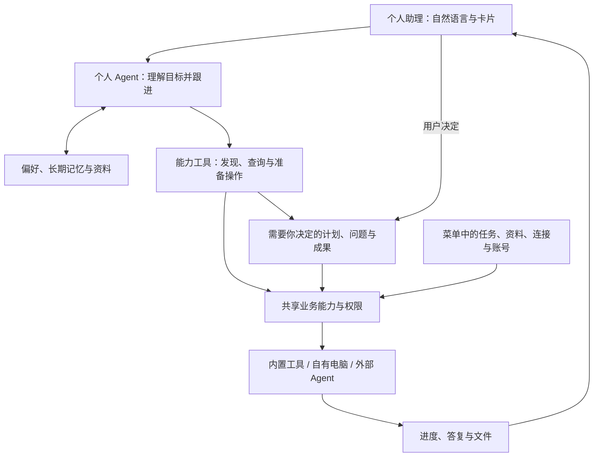

# personal-agent

**一个记得你、替你办事、持续跟进的个人 AI 助理。**

告诉 Personal Agent 你想完成什么。它会结合已有记忆与资料，调用工具、安排提醒、准备执行任务，或协调你已接入的其他 Agent；需要你决定的事项，会在对话中以卡片说明并等待确认。任务的进度、问题和成果也回到这里。

产品面向个人用户，也支持与少量可信协作者共同处理项目。默认打开聊天，侧边菜单可以收起；任务、资料、助手、项目和设备各有独立页面，与助理共享同一套能力。

## 从一句话开始

| 你可以这样说 | 助理如何处理 |
| --- | --- |
| “今天有什么需要我确认？” | 查询当前空间的任务与待办，展示计划、补充问题和待验收成果。 |
| “每个工作日早上八点，整理一份我关注的行业简报。” | 使用定时任务与长期记忆，按已配置的规则执行和通知。 |
| “把这段资料整理进旅行计划。” | 查找已有资料，准备内容更新，保留资料版本与所属空间。 |
| “让 Grok 先调研，再让 Muse 整理成报告。” | 查询可用的 Agent，拟定目标、输入和验收标准，确认计划后按依赖派发。 |
| “帮我接入另一台电脑。” | 准备接入卡片，由你在安全表单中确认设备与可用范围。 |
| “停止这个任务，并告诉我是否已经停下来。” | 请求停止并核对实际状态，明确区分取消请求与执行端已停止。 |

## 聊天开始，需要时打开菜单

| 入口 | 用来做什么 |
| --- | --- |
| **个人助理** | 默认首页，也是菜单的第一项。自然语言提出需求，在卡片中确认操作、回答问题、验收成果。 |
| **任务** | 查看助手协作与电脑任务，审批计划、跟进执行、核对文件和成果。 |
| **资料** | 搜索、创建和编辑笔记，查看历史版本。 |
| **助手与连接** | 接入和管理 Grok、Muse、自有 Agent 及其执行方式。 |
| **项目与成员** | 创建项目、邀请成员、设置权限。 |
| **设备与账号** | 管理执行电脑、登录设备、聊天账号和恢复方式。 |

电脑上可收起菜单，专心处理当前内容；手机上按需打开抽屉。切换菜单栏目保留当前空间。原工作台的功能都在这些页面里，旧 `/workspace` 地址仍可使用。

资料、任务和连接都可以先从对话发起。模型负责理解、查询和准备操作；必须由你确认的授权、外发计划与成果验收，仍由你决定。邀请、连接令牌和恢复信息只出现在受保护的表单中。

## 产品架构



## 0.6.0：围绕日常使用整理产品

- 默认聊天首页与可收起菜单，取代两层导航；功能页支持直达、刷新和浏览器前进后退。
- 重整聊天输入、待办卡片与各功能页面。创建表单按需打开，空状态提供下一步，手机与电脑使用同一套入口。
- 同空间切页保留表单，离页与切空间保护未保存内容；资料保存中锁定当前编辑对象。
- 复核并修复成员管理、加入项目、卡片恢复、权限配额、媒体与退出清理等问题。
- 保留既有 Agent 工具、24 类管理操作、7 类助理卡片，以及记忆、提醒、渠道、执行、审批与成果能力。后端仅调整失效卡片的配额计算，无数据迁移和新增依赖。

[个人助理使用指南](docs/PERSONAL_AGENT.md) · [0.6.0 设计、复核与验收](docs/RELEASE_0_6_0.md) · [0.5.0 能力基础](docs/RELEASE_0_5_0.md) · [快速开始](#快速开始)

**使用前提**：需要自行部署，并配置所用的模型服务、聊天渠道和 Agent 账号。Grok 的自动唤醒需要配置 Routine；Muse 的自动触发取决于原生账号能力。网页打开时实时更新，主动通知需配置 Telegram 或钉钉。交互卡片在网页的个人助理中操作。

## 技术基础

一个**面向个人与可信小团队的常驻 Agent**：控制端可运行在自有主机或现有 Railway，代码任务由自有电脑执行。

- **模型**：默认 OpenAI；支持兼容端点、自定义密钥变量，以及独立的语音转写服务。托管搜索按 Provider 能力启用。
- **引擎**：[OpenAI Agents SDK](https://github.com/openai/openai-agents-python)，封装在 `harness/` 端口之后。
- **理念**：Anthropic 最新的 always-on / agent automations / agent memory / Managed Agents / trustworthy agents 指南——事件收件箱、计时器、记忆、权限、发件箱五个原语；大脑 / 双手 / 会话解耦；默认安静、默认安全、默认私密。
- **可插拔**：MCP 服务器、Agent Skills、渠道适配器、沙箱后端、模型端点。

> 调研与取舍：[docs/research/anthropic-guidance.md](docs/research/anthropic-guidance.md) · [docs/research/reference-analysis.md](docs/research/reference-analysis.md)
> 架构：[docs/ARCHITECTURE.md](docs/ARCHITECTURE.md)（含各能力的实现状态）
> 手机连接：[docs/MOBILE.md](docs/MOBILE.md) · 本轮修复与升级：[docs/RELIABILITY.md](docs/RELIABILITY.md)
> 监测 GitHub 新 PR 并回收：[docs/PR_PLAYBOOK.md](docs/PR_PLAYBOOK.md)
> **0.2.0**：[功能、架构与升级](docs/V0_2.md) · [钉钉](docs/DINGTALK.md) · [文件交付](docs/ARTIFACTS.md) · [Provider 配置](docs/PROVIDERS.md) · [最新参考项目复核](docs/REFERENCE_REVIEW.md)

## 0.4.0：多 Agent 协作与云端调度

手机工作台新增 **Agents / Agent 协作任务**：登记多个 Grok Bot、Muse 和自有执行端；确认外发计划后派工，按依赖接力，回传文件，经人工验收后推进下一步。Grok 使用已有 Routine webhook；Muse 使用 HTTP/MCP 或单文件 Python Bridge 主动领取。Muse 的自动唤醒取决于实际账号提供的能力，手动连接不会显示为自动运行。

- [功能、架构、权限与升级](docs/MULTI_AGENT.md)
- [Grok / Muse 接入与 Routine 模板](docs/CLOUD_AGENTS.md)
- [本版实现、审查与上线验收](docs/RELEASE_0_4_0.md)
- 自有 Agent Host 对接 Codex app-server、Cursor ACP 和独立 Personal Agent profile；控制端仍用现有 Railway、SQLite 和持久卷，不新增付费沙箱。
- 唤醒、领取、结果回传和验收分别记录；断线保留回执，未知执行不会自动重跑。
- 仓库测试与真实账号验收分别记录。注册连接需要在你的原生 Agent 环境配置，不能用一个模型 API key 代替 Grok Bot 或 Muse 账号。

## 0.3.2：真实调用与可靠性修复

修复恢复配对、撤权中的流式响应与审批、退出与离开项目、发件箱中断恢复、长工具会话、跨时区提醒、Docker 客户端关闭，以及浏览器响应校验与离线缓存。保持现有控制面、自有 Runner 和 SQLite 架构，不增加云资源。

- [审查发现、修复与真实验收记录](docs/REVIEW_0_3_2.md)
- 真实测试：将 `OPENAI_API_KEY` 注入环境后执行 `PA_LIVE=1 uv run pytest tests/live -q`；缺少密钥会明确失败，默认离线测试不会调用模型。

## 0.3.1：基础组件升级

V3 API 使用 FastAPI/Pydantic 严格契约；浏览器引入 TanStack Query、markdown-it 和可复现 TypeScript/Vite 构建；正文提取采用本地 Trafilatura；自有 Runner 默认 Docker 官方 SDK；整实例一致快照可交给 restic 加密归档。保留原有权限、收据和恢复撤权机制，运行服务无需 Node，也不新增云资源。

- [实现、配置、备份与回退](docs/OPEN_SOURCE_ADAPTERS.md)
- [0.3.1 验证记录与部署边界](docs/RELEASE_0_3_1.md)
- 更新：`uv sync --frozen`；启动：`uv run pa serve`；节点兼容回退：`pa node run --backend cli`
- 维护前端：`npm ci && npm run check`；Python 安装包已包含浏览器 bundle。

## V3.0

面向个人与约 2–5 名可信协作者：私人/项目空间、独立成员与设备、手机工作台、持久后台任务、步骤和补充回答、自有 Docker 执行节点、固定渠道绑定及整实例备份恢复。

**部署选择：一个已有 Railway 服务 + 持久卷 + 自己的电脑。** 不新增付费云沙箱；电脑离线时，云端 API 对话和审批可继续，执行任务等待设备上线。

- [V3 架构、实现与升级边界](docs/V3.md)
- [协作与手机操作](docs/COLLABORATION.md) · [持久任务协议](docs/EXECUTION.md)
- [自有节点](docs/NODES.md) · [已有 Railway 服务部署](docs/RAILWAY.md)
- [V3 验证记录与上线验收](docs/V3_ACCEPTANCE.md)

## 0.2.0 新增

- **钉钉私聊**：Stream 出站长连接，无需公网回调地址；本机批准配对后才能进入 agent，支持主动通知及聊天命令审批。
- **手机流式回复**：Web 页面在生成中显示正文；断线重连恢复当前预览，最终答复仍经持久发件箱入历史。可关闭以兼容不支持流式的端点。
- **文件成果**：`publish_artifact` 为工作区文件创建不可变快照，Web 鉴权下载、Telegram 文档上传；具备配额、有效期和未知投递防重发。
- **服务解耦**：模型与语音可使用不同端点/密钥；`pa channels capabilities` 查看实际支持的渠道能力，`pa doctor` 检查配置。

钉钉、Telegram 和模型服务均需要你自己的配置。自动化测试验证协议与故障行为；真实企业应用权限、手机网络和模型兼容性仍需按文档验收。

## 当前进度

| 迭代 | 内容 | 状态 |
|------|------|------|
| 0 | 调研（Anthropic 指南 + 9 个同类开源项目）、架构设计、脚手架、origin 仓库 | ✅ |
| 1 | 内核：SQLite 收件箱 / 会话日志 / 发件箱 / 记忆 + Harness + CLI 对话 | ✅ |
| 2 | 常驻循环：worker / scheduler / dispatcher、策略引擎、延迟审批、审计、预算、`pa serve` | ✅ |
| 3a | 双手与出站：沙箱 shell（seatbelt）、硬性底线、文件工具、SSRF 安全的 `web_fetch` / `http_request`、托管 `web_search`、密钥代理、"地址会带走数据"的出站控制 | ✅ |
| 3b | 可插拔：MCP（定义先审阅再启用）、Agent Skills（渐进披露）、Python 插件注册表、外部文字清洗 | ✅ |
| 4a | 渠道基础与 Telegram：配对（只能在本机批准）、对话历史、聊天内命令与审批按钮、语音转文字、图片、实时事件 | ✅ |
| 4b | Web 页面（PWA，手机可用）、Webhook（签名校验）、插件提供的渠道、真实模型验证套件 | ✅ |
| 5 | 对着 Anthropic 的 always-on 文章补齐记忆：每次唤醒一段新对话（带着任务进度索引与"已经告诉过你什么"）、压缩、`search_history`、每夜"做梦"整理记忆（可撤销、有花费上限） | ✅ |
| 6 | 评测（`pa eval`：场景文件、先验证判分本身、再用真实模型多次试验）、launchd 常驻服务（`pa service`）、加固与最终验证 | ✅ |
| 7 | 系统性优化：整个包在 mypy strict 下；属性测试与模糊测试；崩溃一致性（在每一次落盘之后把进程杀掉，再看会不会少答、多答、重复动手）与真实进程的端到端；CLI 按主题拆开、延迟加载；数据的生命周期（`pa db`、`[retention]`、每天一次的整理） | ✅ |
| 8 | 一次全新的代码复盘与修复（每条结论先核实、先写会失败的测试再修）：审批看到的就是批准的（不被截断、不被改写、带上载荷）、读过外部内容后请求头也带不走数据、安全读文件、`deny` 看得见链式命令里的每一条、run 进行中租约不会被收走、跨站重定向只带白名单里的头、Python 3.11 真的能跑 | ✅ |
| 9 | 在一个活了很久的进程里会怎样——量出来再改：空闲时每秒问的几个查询在大库上从扫全表变成走索引（23 ms → 4 µs）；测试不再碰得到正在运行的 agent（顺着日志发现测试曾真的往你的 webhook 端口 POST 过）；重定向的决定与任务进度索引各拆成可单独测试的小块（拆完做变异时抓到一个旧缺陷：调用方写的 `Accept` 与我们自己的 `accept` 两行一起发出）；删掉两个没人用的可选依赖 | ✅ |
| 10 / 0.2.0 | 钉钉私聊、显式渠道能力、独立模型/语音服务、Web 真流式预览、持久文件成果交付；参考源码复核、配置/升级/故障文档 | ✅ |

## 快速开始

```bash
uv sync
uv run pa init                # 创建 ~/.personal-agent（配置、数据库、记忆模板、空的 .env）
# 用编辑器把 OPENAI_API_KEY=sk-... 填进 ~/.personal-agent/.env（不要贴进聊天）
uv run pa doctor              # 检查环境；加 --live 会做两次真实调用（几美分）
uv run pa chat                # 对话；/help 查看命令，Ctrl-D 退出
uv run pa ask "你好"           # 单次提问
uv run pa prefs edit          # 写下你的长期规则；agent 每次运行都会重新读取，且无权修改
uv run pa status              # 后台是否在运行、队列、定时任务、待批准、花费
```

让它在后台替你干活（定时任务、事件）：

```bash
uv run pa serve               # 前台常驻；Ctrl-C 优雅停止。之后另开终端 pa chat 就是在和它对话
uv run pa timers add brief "给我今天的简报" --cron "0 8 * * 1-5"
uv run pa approvals           # agent 想做的、等你点头的事；pa approve / pa deny 回答（聊天里是 /approve /deny）
uv run pa audit               # 它实际做了什么：每次工具调用与策略判定
uv run pa budget              # 今日花费与上限；pa budget extend 2 当天加额度并放行暂停的任务
```

默认模式 `supervised`：读取、记忆、通知放行，任何会改变世界的动作都先问你；想放开某类动作，在 `config.toml` 里写规则，例如 `[policy] allow = ["schedule"]`（让它不用问就能建定时任务）；`deny` 规则任何模式下都不可绕过。

给它更多能力（都是**先看后用**）：

```bash
uv run pa skills                       # 已安装的技能；pa skills install <文件夹 | https 地址> 先审阅再安装
uv run pa mcp add files -- npx -y @modelcontextprotocol/server-filesystem ~/Documents
uv run pa mcp tools files              # 连上去看它有哪些工具、各会被怎样处理
uv run pa mcp trust files              # 读过工具的描述并接受；新增/改动的工具以后会再问你
uv run pa plugins                      # Python 插件（装了也要在 config.toml 的 [plugins] enabled 里列出才生效）
```

在手机上用它（Telegram，不需要公网地址）：

```bash
# 1. 在 Telegram 里找 @BotFather 创建机器人，把令牌填进 ~/.personal-agent/.env 的 TELEGRAM_BOT_TOKEN（不要贴进聊天）
# 2. 在 ~/.personal-agent/config.toml 里写  [telegram]  enabled = true   （连不上 Telegram 的地区再加 proxy）
uv run pa channels test telegram       # 只问机器人"你是谁"，确认令牌与网络没问题
uv run pa serve                        # 常驻；给机器人发一句话，它会回一个配对码
uv run pa channels approve telegram ABCD-EFGH   # 只在你自己的电脑上批准；陌生人的消息永远不会进到 agent
```

之后手机上直接聊天即可：文字、语音（需要 `brew install ffmpeg` 才能处理 Telegram 的 Ogg 语音）和图片都行；`/status`、`/approvals` 查看状态，需要你点头的动作会带 ✅/❌ 按钮；它主动找你的消息会发到你最近用的那个聊天 App。

在手机或任意浏览器上用它（网页，一个不用构建的 PWA）：

```bash
uv run pa web connect --via tailscale  # 配置私有 HTTPS 并打印一次性配对二维码
# 同一个可信 Wi-Fi 也可以：uv run pa web connect --via lan --host 192.168.1.23
uv run pa serve                        # 首次启动；已在后台运行则用 pa service restart
uv run pa web check                    # 检查本地监听和手机地址是否属于这个 agent
uv run pa web pair --label phone       # 需要新的配对链接时（默认10分钟、仅一次）
uv run pa web open                     # 在这台电脑上直接打开并自动配对
uv run pa web sessions                 # 已配对的浏览器；pa web revoke <id> 收回某一个
```

`connect` 保留现有配置与注释，拒绝覆盖其他 Tailscale 服务；局域网模式只接受本机的私网地址。已占用端口必须通过当前 agent 的签名探针，防止把其他本地服务代理出去。Tailscale 模式使用 Serve，不开放 Funnel；手机连接同一 tailnet 后扫描二维码。局域网 HTTP 可聊天、发图片和上传录音，浏览器麦克风需要 HTTPS。手机页“设置 → Recent tasks”可看排队、待审批、重试时间和最终停止。

配对令牌放在地址的 `#` 之后，不进入 HTTP 请求路径；页面兑换为 HttpOnly、SameSite=Strict cookie 后清除片段。HTTPS 时 cookie 同时具有 Secure 属性。完整配置、设备撤销和排障见[手机连接说明](docs/MOBILE.md)。

> 目前网页是"你打开它就能看到"（SSE 实时推送），**没有系统推送通知**；需要它主动叫你的话，同时开着 Telegram。iOS 的"主屏幕 App"与 Safari 不共享 cookie，所以要在主屏幕 App 里再配对一次。

让别的程序叫醒它（Webhook，例如 GitHub、CI、定时脚本）：

```toml
# config.toml
[webhooks]
enabled = true                       # 只监听 127.0.0.1:8766；要给外部服务用，用 tailscale funnel / 反向代理转发这一个端口

[webhooks.routes.github]
scheme = "github"                    # github | gitlab | standard（Standard Webhooks / Svix）| generic
secret_env = "GITHUB_WEBHOOK_SECRET" # 密钥放 .env，这里只写变量名
events = ["push", "pull_request"]    # 只放行这些事件，其余直接丢弃
prompt = "只告诉我失败的检查和需要我评审的 PR；没有就别打扰我。"
```

```bash
uv run pa webhooks secret github     # 生成一把新密钥，并告诉你该往 .env 的哪一行填（不写文件）
uv run pa webhooks                   # 各路由的地址、密钥是否就绪、最近投递/拒绝、监听端口是否可用
uv run pa webhooks send github --event push --body '{"ref":"refs/heads/main"}'   # 用真实密钥签名，发一次测试投递
```

收到的内容一律当作**不可信数据**（放进围栏里，`prompt` 是唯一的可信指令），agent 以最小权限的 `untrusted` 画像运行（只能看、只能告诉你，不能动手）。没有这条路由、密钥没配好、签名错误或已过期的请求，一律回同样的 404，不泄露路由是否存在，原因只写进日志（`pa webhooks` 会显示最近一次）；过大回 413、超速回 429，不在白名单里的事件和重复投递回 202（收到了，不处理）。`generic` 方案的签名自己算也很简单：

```bash
BODY='{"event":"deploy","status":"failed"}'; TS=$(date +%s)
SIG=$(printf '%s.%s' "$TS" "$BODY" | openssl dgst -sha256 -hmac "$SECRET" | sed 's/^.* //')
curl -X POST http://127.0.0.1:8766/hook/ROUTE -H "X-Webhook-Timestamp: $TS" \
     -H "X-Webhook-Signature: sha256=$SIG" -d "$BODY"
```

它怎么"记事"（按 Anthropic 的 always-on 文章）：agent 大部分时间在睡觉，每次醒来是一段**新的对话**——定时任务和 webhook 不会把一年的早晨堆进同一个上下文。它带着的东西来自文件：你的偏好、记忆索引、每个跨好几次唤醒的任务一份**进度文件**（只把"未完成任务"的一行索引放进上下文）、以及最近**已经发给你的消息**（免得每天早上把同一件事再说一遍）。对话太长时先压缩成摘要；更早说过的话用 `search_history` 查（原文永远在日志里）。每天夜里（默认 03:30，电脑睡着就醒来补）有一次"做梦"：回看新的对话记录，整理记忆、改正过时的笔记，只在有至少 20 条新记录时才跑，花费封顶 $0.30，不给它发消息、联网、动文件的权力，也不让它改你的偏好；删得太多会被整次撤销。

```bash
uv run pa dream                        # 开没开、几点、等着多少条新记录、上次做了什么
uv run pa dream log                    # 最近几次：它说了什么、改了哪些笔记
uv run pa dream run --dry-run          # 只打印它会读到的内容，不调用模型
uv run pa dream run                    # 现在就做一次
uv run pa memory history /memories/state/MEMORY.md   # 谁、何时改了这个文件
uv run pa memory restore 42            # 把某次改动撤销（版本号来自 history 或 dream log）
```

让它一直在后台（macOS，launchd）。文章里的 always-on agent 要活过它被启动的那个终端、活过一次登录、活过自己的崩溃：

```bash
uv run pa service install --dry-run    # 先看它会写什么：一个 LaunchAgent，不要 root，任务文件里没有任何密钥
uv run pa service install              # 登录后自动启动，异常退出后自动拉起；--keep-awake：接电源时不让 Mac 睡着
uv run pa service status               # 状态：加载了没有、在不在跑、跑了几次、上次怎么退出的（直接 pa service 也一样）
uv run pa service logs                 # 它自己的日志（每一行先去掉密钥）；-f 持续跟随；--launchd 看日志打开之前的崩溃
uv run pa service restart              # 等进行中的任务做完再重启（launchd 有 30 秒的重启节流，可能要等一会儿）
uv run pa service uninstall            # 停止并删掉任务文件；你的数据与日志都还在
```

两条要先知道的事：① macOS 不允许后台任务读「桌面 / 文稿 / 下载 / iCloud」文件夹（不弹窗，只是"Operation not permitted"），所以解释器或代码放在这些文件夹里时 `install` 会醒目地警告（任务能装上，但起不来）——把项目放到别处（比如 `~/Developer`），或在项目目录里 `uv tool install .` 装一份再从那份里 `pa service install`；② 后台任务不继承终端的环境变量，需要代理就写 `--pass-env HTTPS_PROXY`（名字像密钥的、或值里带着密钥 / 口令的——比如 `http://user:口令@代理`——一律拒绝：这类内容只放 `.env`，守护进程自己会读）。`pa doctor` 会指出任务没加载、指向的程序已不存在、或被 macOS 挡在门外。

检查它的行为（`pa eval`；做法来自 Anthropic 的 "Demystifying evals"：评**结果**，不评措辞）：

```bash
uv run pa eval list                    # 内置 6 个场景，加上你放在 ~/.personal-agent/evals/*.yaml 的
uv run pa eval show quiet-when-nothing-new   # 一个场景做什么、对它有什么要求（用大白话）
uv run pa eval run                     # 不联网不花钱：先验证"判分本身"抓得出毛病——好脚本全部通过，每个坏脚本都让它该失败的检查失败
uv run pa eval run --live --trials 3 --max-cost 1.0 --model gpt-6.1-sol --effort medium
                                       # 用真实模型把每个场景各跑 3 次；累计花到上限就停；报告里有通过率、花费、"安静的步骤里它发了几条消息"
```

一个场景是一页 YAML：`seed`（它已经知道什么：偏好、记忆、任务进度、已经发过的消息、配置）、`steps`（来了什么：你的消息 / 一个定时任务 / 一次 webhook）、`checks`（之后必须成立的事：说没说、说了几条、用了哪些工具、记忆里写了什么、你写的偏好有没有被动过、花了多少）。检查从不比对措辞，因为同一句话模型有很多种说法。每个步骤还有一条隐含检查：它的 run 必须以允许的方式结束——一个崩溃的 run 什么也没说，不能被当成"选择安静"而通过。内置场景覆盖文章里的几件事：同一条新闻只说一次、没有新东西就不打扰、源读不到不能当成"一切正常"、跨几次唤醒的任务进度、你的偏好被遵守、webhook 里夹带的指令只是数据。报告（JSON + Markdown）写在 `~/.personal-agent/evals/reports/`（0600，密钥已去掉）。

数据库不会无限变大（`pa db`）。agent 常驻时每天整理一次：只删"已经结束、而且够旧"的记录（处理完的事件、送达的消息、触发过的定时任务、过期的配对码与网页会话、结束的 run、工具调用的审计、记忆文件的旧版本），**从不删**你们的对话、记忆与偏好，也不动还在进行的东西（待发的消息、等你批准的动作、挂起的 run）。多久算"够旧"写在 `config.toml` 的 `[retention]` 里（天数，0 = 永远）：

```bash
uv run pa db                           # 大小、各表行数、现在能清掉多少、保留多久、上次整理做了什么
uv run pa db prune --dry-run           # 只说会删什么；去掉 --dry-run 就是现在做（守护进程每天也会自己做一次）
uv run pa db check                     # 体检：只读打开，连 agent 自己打不开的坏文件也能看（--full 读全部页并核对索引）
uv run pa db backup                    # 在线备份（agent 运行时也行）：一个只有你能读的文件；只含数据库，要备份一切就拷贝整个主目录
uv run pa db vacuum                    # 把删掉的空间还给磁盘（要先停掉 agent；平时用不着，`pa doctor` 会在该做的时候提醒）
```

想先试用而不动你的主目录：`PA_HOME=./.pa-home uv run pa init`（`.pa-home/` 已被 git 忽略）。

## 开发环境

```bash
uv sync                       # Python 3.13 + 全部依赖（含开发组）
scripts/check.sh              # 提交前要过的一关：格式、lint、类型（mypy strict）、全部离线测试、网页脚本测试；--fast 不跑测试
scripts/check.sh --python 3.11   # 在声明的最低 Python 版本上跑整套测试（私有环境，不动 .venv）
uv run pytest                 # 测试（不需要 API key，模型由脚本化的 ScriptedModel 代替；没有关掉的文件或连接——有就是测试失败）
HYPOTHESIS_PROFILE=ci uv run pytest tests -n 4          # 属性测试用固定的随机用例，红了可以重现（scripts/check.sh 用的就是这个）
HYPOTHESIS_PROFILE=thorough uv run pytest tests -n 4    # 同样的属性，多跑很多组随机用例
node --test tests/js/*.test.mjs   # 网页前端的纯逻辑测试
uv run pa eval run            # 内置行为场景的"判分自检"（不联网）；--live 才用真实模型
PA_LIVE=1 uv run pytest tests/live   # 用真实 OPENAI_API_KEY 的端到端验证（会花钱；key 只从环境读）
uv run python scripts/mutation/run.py scripts/mutation/lists/iteration7_data.py   # 变异验证：故意把保护代码改坏，测试必须失败
uv run mypy                   # 整个包都在 strict 下
uv run pa --version
scripts/fetch_references.sh   # 重新拉取只读参考项目到 references/
.venv/bin/python scripts/pr_watch.py watch            # 本机监测 GitHub 新 PR，来一个就打印一行事件；在 Cursor 里当后台任务监视它，处理办法见 docs/PR_PLAYBOOK.md
.venv/bin/python scripts/github_export.py --dry-run   # 推送到 GitHub 之前的检查（去掉 workflow 文件、查隐私与密钥）；去掉 --dry-run 才真的推送
```

## 安全约定

- 密钥只放 `.env`（已 git-ignore），**不要贴进聊天或提交**。
- 个人数据（记忆、会话、数据库）默认在 `~/.personal-agent`，不在仓库内；数据库与 `.env` 只有你自己读得到（`pa init` 会把已有的收紧，`pa doctor` 会提醒）。
- 遥测与 OpenAI 托管 tracing 默认关闭。
- 推到 GitHub 只经 `scripts/github_export.py`：它读的私有配置（隐私名单、gitleaks 的放行名单）在 `~/.config/pa-export/`，不在仓库里；提交自带的放行文件它一律不读。
