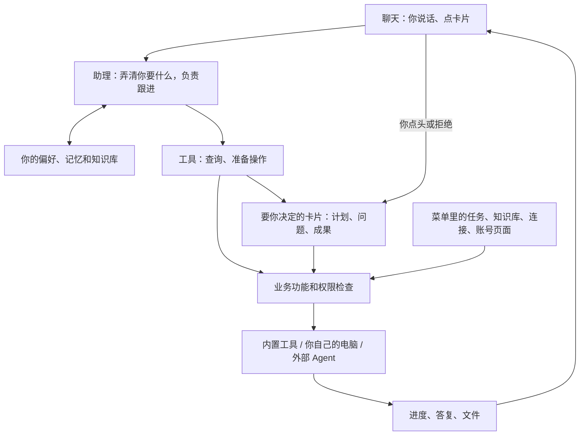

<p align="center">
  
</p>

# 栖序 · Qixu

栖序是一个自己部署的个人 AI 助理，命令行叫 `pa`。它记得你交代过的事，能查资料、设提醒、跑任务；遇到该你拿主意的事，会先问你。

你跟它说想做成什么，它会去翻你的记忆和知识库，选合适的工具去办，也可以叫你接入的其他 AI 一起干活。需要你决定的事，会在对话里变成一张卡片，等你点头。事情做到哪了、卡在哪、结果是什么，都回到同一个对话里。

主要给一个人用，也可以和几个信得过的人一起做项目。打开就是聊天，左上角的菜单里有任务、知识库、助手、项目、设备几个页面，用的是同一份数据。

项目名、`personal_agent` 包、`~/.personal-agent` 数据目录和 `PA_*` 环境变量沿用原来的名字，旧的部署不用改。

## 试试这样说

| 你说 | 它会怎么做 |
| --- | --- |
| “今天有什么要我确认的？” | 查看当前空间里的任务和待办，列出要你确认的计划、要你回答的问题和等你验收的成果。 |
| “每个工作日早上八点，整理一份我关注的行业简报。” | 建一个定时任务，到点自动执行，并按你设好的方式通知你。它会参考记住的你的偏好。 |
| “把这段资料整理进旅行计划。” | 先找到知识库里已有的笔记，准备好修改内容，再存进去。每一笔都有历史，随时能撤销。 |
| “记一下：预算每月五号提交。”“上次预算那件事是怎么定的？” | 值得留的，写成一两句，加进知识库里已有的笔记；你问起来，它先翻知识库再答，不凭印象。 |
| “那个调研做得怎么样了？” | 它知道交给各个助手的每个任务做到哪了、哪些在等你，直接告诉你。只在要你拿主意、结果交回来、没做成的时候主动说，等你的事最多提醒两次。 |
| “让 Grok 先调研，再让 Muse 整理成报告。” | 看有哪些 Agent 能用，拟好每一步的目标、材料和验收标准。你确认计划后，按先后顺序分头去做。 |
| “帮我接入另一台电脑。” | 给你一张接入卡片，在里面选是哪台电脑。 |
| “停掉这个任务，告诉我停下来没有。” | 先发出停止请求，再确认对方真的停了。“已请求停止”和“确实停了”分开显示。 |

## 打开就是聊天

| 页面 | 用来做什么 |
| --- | --- |
| **对话** | 首页，菜单第一项。像平时说话一样提需求；要你决定的事，在卡片里点头、回答或验收。 |
| **任务** | 看助手协作和电脑上的任务；每个任务一条线，等你的排在最前面，做完 24 小时后自动收起，也能先别提醒；审批计划、跟进进度、查看文件和成果。 |
| **知识库** | 搜索、新建、编辑笔记，查看历史版本。和 Obsidian 用同一个文件夹，见[知识库](docs/KNOWLEDGE_BASE.md)。 |
| **助手与连接** | 接入和管理 Grok、Muse、你自己的 Agent，设置它们怎么执行。 |
| **项目与成员** | 建项目、邀请成员、设置权限。 |
| **设备与账号** | 管理执行任务的电脑、已登录的设备、聊天账号和恢复方式。 |

电脑上的菜单可以收起，手机上从左边拉出来。换页面时，当前所在的空间不变。以前工作台里的功能都在这些页面里，旧的 `/workspace` 地址也还能用。

知识库、任务、连接这些事，都可以先在聊天里说。要你决定的（授权、对外发送的计划、成果验收），会变成卡片等你点。

## 想做得轻

你把想做成的事说一遍，栖序记下来，之后在聊天里一点点补全，到该做的时候去做，做完用一句话告诉你。

- **说一次就够。** 目标会写进记忆。后来聊到，更新的是同一条，不用从头解释。
- **该出现时才出现。** 要你决定的事才变成卡片。到点的提醒就是那件事本身，一两句话，带上当时用得上的细节。
- **做完只说一句。** 电脑上的任务结束了，会告诉你结果和去哪里看，不会贴一屏日志。
- **像人一样说话。** 一条消息一个要点，先给答案；能直接做的先做完再说；要问就只问一个。Telegram 和钉钉上，几句话的回复会分成几条，隔一会儿发出（`[chat] bubbles`）。
- **界面不抢戏。** 只有一个强调色，卡片靠底色深浅分开，不描边、不投影；字只有三种粗细；只有叶子会弹一下。

## 整体结构



**开始之前**：你需要自己部署，并配好要用的模型服务、聊天渠道和 Agent 账号。Grok 要自动被叫醒，得配一个 Routine；Muse 能不能自动触发，要看你的账号有什么功能。网页开着时内容实时更新；页面关着时想收到主动通知，要配 Telegram 或钉钉。要你操作的卡片，在网页的“对话”里处理。

## 用到了什么

它可以跑在你自己的主机上，也可以跑在你已有的 Railway 服务上；写代码这类任务，交给你自己的电脑去做。

- **模型**：默认用 OpenAI。也能接兼容的接口，可以自定义密钥的环境变量名，语音转文字可以单独配一个服务。联网搜索按各服务商的支持情况打开。
- **Agent 引擎**：[OpenAI Agents SDK](https://github.com/openai/openai-agents-python)，放在 `harness/` 这一层后面。
- **设计思路**：参考 Anthropic 最近关于常驻 Agent（always-on）、Agent 自动化（agent automations）、Agent 记忆（agent memory）、Managed Agents 和可信 Agent（trustworthy agents）的文章。落成五样基础件：事件收件箱、计时器、记忆、权限、发件箱。大脑（决策）、双手（动手执行）、会话（记录）三者分开。
- **可以扩展**：MCP 服务器、Agent Skills、渠道适配器、沙箱后端、模型接口。

## 文档

**日常使用**
- [使用指南](docs/PERSONAL_AGENT.md)：打开后怎么用，卡片怎么处理。
- [知识库：和 Obsidian 一起用](docs/KNOWLEDGE_BASE.md)：多个助手共用一个文件夹的笔记。
- [手机和浏览器连接](docs/MOBILE.md)：局域网、Tailscale、配对和排错。
- [钉钉](docs/DINGTALK.md) · [模型、语音和搜索服务](docs/PROVIDERS.md) · [把文件发给你](docs/ARTIFACTS.md)

**协作和执行**
- [个人与小团队协作](docs/COLLABORATION.md)
- [多 Agent 协作](docs/MULTI_AGENT.md) · [Grok / Muse 接入](docs/CLOUD_AGENTS.md) · [Grok Bot 配置指南](docs/GROK_BOT_SETUP.md) · [Muse 示例](examples/muse/README.md)
- [自己的电脑（节点和 Runner）](docs/NODES.md) · [在你自己的电脑上运行任务](docs/EXECUTION.md)

**部署和维护**
- [部署到 Railway](docs/RAILWAY.md)
- [可靠性与手机访问](docs/RELIABILITY.md) · [崩溃之后，什么还在](docs/RECOVERY.md) · [记忆和上下文的恢复](docs/memory-and-context-recovery.md)
- [开源组件、备份与升级](docs/OPEN_SOURCE_ADAPTERS.md)

**设计和调研**
- [架构设计](docs/ARCHITECTURE.md)：每项功能做到什么程度，也写在这里。
- [Anthropic 指南提炼](docs/research/anthropic-guidance.md) · [同类开源项目对比](docs/research/reference-analysis.md) · [参考项目复核](docs/REFERENCE_REVIEW.md)
- [V3 设计](docs/V3.md) · [0.2.0 设计](docs/V0_2.md)

**验收清单与开发流程**
- [V3 上线前验收清单](docs/V3_ACCEPTANCE.md) · [0.3.2 审查与修复](docs/REVIEW_0_3_2.md)
- [PR 处理手册](docs/PR_PLAYBOOK.md)：本机发现新 PR 之后怎么办

## 快速开始

```bash
uv sync
uv run pa init                # 创建 ~/.personal-agent：配置、数据库、记忆模板和一个空的 .env
# 用编辑器把 OPENAI_API_KEY=sk-... 填进 ~/.personal-agent/.env
uv run pa doctor              # 检查环境；加 --live 会真的调用两次模型（几美分）
uv run pa chat                # 开始聊天；/help 看命令，Ctrl-D 退出
uv run pa ask "你好"           # 只问一句
uv run pa prefs edit          # 写下你的长期规则；agent 每次运行都会读，但它自己改不了
uv run pa status              # 后台在不在跑、队列、定时任务、待批准、今天花了多少
```

想先试用、又不想动你的主目录：`PA_HOME=./.pa-home uv run pa init`（`.pa-home/` 已被 git 忽略）。

## 常用功能

### 让它在后台干活

```bash
uv run pa serve               # 前台常驻，Ctrl-C 正常退出。另开终端 pa chat，就是在跟这个常驻的它聊
uv run pa timers add brief "给我今天的简报" --cron "0 8 * * 1-5"
uv run pa approvals           # 看它想做、等你点头的事；用 pa approve / pa deny 回答（聊天里是 /approve /deny）
uv run pa audit               # 它实际做了什么：每次调用工具和对应的权限判定
uv run pa budget              # 今天花了多少、上限多少；pa budget extend 2 表示今天加额度，并放行被暂停的任务
```

默认是 `supervised` 模式：读取、记忆、通知直接放行；会改变外部世界的操作，先问你。想放开某一类，就在 `config.toml` 里写规则，比如 `[policy] allow = ["schedule"]`（让它不用问就能建定时任务）。

### 给它加能力（先看后用）

```bash
uv run pa skills                       # 已安装的技能；pa skills install <文件夹 | https 地址> 先审阅，再安装
uv run pa mcp add files -- npx -y @modelcontextprotocol/server-filesystem ~/Documents
uv run pa mcp tools files              # 连上去，看它有哪些工具、各自会怎么处理
uv run pa mcp trust files              # 读过工具说明并接受；以后新增或改动的工具会再问你
uv run pa plugins                      # Python 插件；装好后还要列在 config.toml 的 [plugins] enabled 里才生效
```

### 用 Telegram 在手机上聊（不需要公网地址）

```bash
# 1. 在 Telegram 里找 @BotFather 建一个机器人，把令牌填进 ~/.personal-agent/.env 的 TELEGRAM_BOT_TOKEN
# 2. 在 ~/.personal-agent/config.toml 里加一节 [telegram]，写上 enabled = true（连不上 Telegram 的地区，再加 proxy）
uv run pa channels test telegram       # 只让机器人报一下身份，确认令牌和网络都通
uv run pa serve                        # 常驻；给机器人发一句话，它会回你一个配对码
uv run pa channels approve telegram ABCD-EFGH   # 在你自己的电脑上批准这个配对码
```

配好之后，手机上直接聊就行：文字、语音、图片都可以。处理 Telegram 的 Ogg 语音需要 `brew install ffmpeg`。发 `/status`、`/approvals` 看状态；要你点头的操作会带 ✅/❌ 按钮；它主动找你的消息，会发到你最近用过的那个聊天 App。

### 用网页在手机或任意浏览器上聊

网页是一个不用构建的 PWA。

```bash
uv run pa web connect --via tailscale  # 配好私有 HTTPS，并打印一次性配对二维码
# 同一个可信 Wi-Fi 也行：uv run pa web connect --via lan --host 192.168.1.23
uv run pa serve                        # 第一次启动；已经在后台跑了就用 pa service restart
uv run pa web check                    # 检查本机监听和手机地址是不是这个 agent 的
uv run pa web pair --label phone       # 要新的配对链接时用（默认 10 分钟有效，只能用一次）
uv run pa web open                     # 直接在这台电脑上打开，并自动配对
uv run pa web sessions                 # 看已配对的浏览器；pa web revoke <id> 收回其中一个
```

`connect` 会保留你原来的配置和注释，也不会覆盖其他 Tailscale 服务。Tailscale 模式用的是 Serve，不开 Funnel；手机连上同一个 tailnet 后扫码即可。局域网模式只接受本机的私网地址。

局域网的 HTTP 可以聊天、发图片、上传录音文件；浏览器麦克风需要 HTTPS。手机页面“设置 → Recent tasks”里能看到排队、待审批、重试时间和最终停止的状态。

完整配置、撤销设备和排错见[手机连接说明](docs/MOBILE.md)。

> 网页现在是“你打开就能看到”（SSE 实时推送），**没有系统推送通知**。需要它主动叫你，就同时开着 Telegram 或钉钉。iOS 的“主屏幕 App”和 Safari 不共享 cookie，所以主屏幕 App 里要再配对一次。

### 让别的程序叫醒它（Webhook）

比如 GitHub、CI、定时脚本。

```toml
# config.toml
[webhooks]
enabled = true                       # 只监听 127.0.0.1:8766；要给外部服务用，用 tailscale funnel 或反向代理转发这一个端口

[webhooks.routes.github]
scheme = "github"                    # github | gitlab | standard（Standard Webhooks / Svix）| generic
secret_env = "GITHUB_WEBHOOK_SECRET" # 密钥放 .env，这里只写变量名
events = ["push", "pull_request"]    # 只放行这些事件，其余直接丢掉
prompt = "只告诉我失败的检查和需要我评审的 PR；没有就别打扰我。"
```

```bash
uv run pa webhooks secret github     # 生成一把新密钥，并告诉你该填进 .env 的哪一行（不会替你写文件）
uv run pa webhooks                   # 各路由的地址、密钥是否就绪、最近的投递和拒绝、监听端口能不能用
uv run pa webhooks send github --event push --body '{"ref":"refs/heads/main"}'   # 用真实密钥签名，发一次测试投递
```

webhook 唤醒的那一轮只能读内容、通知你，不会动手。`prompt` 里写你希望它怎么处理。

路由不存在、密钥没配好、签名错误、请求已过期，都回 404，具体原因看 `pa webhooks`。请求太大回 413，太快回 429。不在白名单里的事件和重复的投递回 202，意思是“收到了，不处理”。

`generic` 方案的签名自己算也很简单：

```bash
BODY='{"event":"deploy","status":"failed"}'; TS=$(date +%s)
SIG=$(printf '%s.%s' "$TS" "$BODY" | openssl dgst -sha256 -hmac "$SECRET" | sed 's/^.* //')
curl -X POST http://127.0.0.1:8766/hook/ROUTE -H "X-Webhook-Timestamp: $TS" \
     -H "X-Webhook-Signature: sha256=$SIG" -d "$BODY"
```

### 记忆和“做梦”

agent 大部分时间在睡觉。每次醒来都是一段**新的对话**，所以定时任务和 webhook 不会把一年的早晨堆进同一个上下文。它醒来时带着的东西，都来自文件：

- 你的偏好；
- 记忆索引；
- 进度文件：每个要跨好几次唤醒的任务有一份，上下文里只放“未完成任务”的一行索引；
- 最近已经发给你的消息，免得每天早上把同一件事再说一遍。

对话太长时，先压成摘要。更早说过的话用 `search_history` 查，原文永远留在日志里。

每天夜里（默认 03:30；电脑睡着了，醒来后补上）它会“做梦”一次：回看新的对话记录，整理记忆，改掉过时的笔记；知识库里还没整理的资料，也会写成笔记。做梦的规则：

- 至少有 20 条新记录才会跑；
- 花费最多 $0.30；
- 只动记忆和知识库：不给你发消息，不联网，也不动你写的偏好；在知识库里只新增笔记（一晚最多 6 篇，`[dreaming] max_new_notes`），你写的笔记不碰；
- 如果删得太多，或者这一晚没做完，整一次都会撤销，写进知识库的笔记也一并撤回。

```bash
uv run pa dream                        # 开没开、几点跑、攒了多少条新记录、上次做了什么
uv run pa dream log                    # 最近几次：它说了什么、改了哪些笔记
uv run pa dream run --dry-run          # 只打印它会读到的内容，不调用模型
uv run pa dream run                    # 现在就做一次
uv run pa memory history /memories/state/MEMORY.md   # 谁、什么时候改了这个文件
uv run pa memory restore 42            # 撤销某一次改动（版本号来自 history 或 dream log）
```

### 知识库（和 Obsidian 一起用）

知识库是一个文件夹的 Markdown 笔记。你、栖序、接进来的助手都往里写；Obsidian 直接打开这个文件夹，就能看、能改，属性、`[[链接]]`、反向链接和关系图都能用。文件就是真相：你在 Obsidian 里改了，栖序下次读到的就是新的。

```bash
uv run pa vault                        # 文件夹在哪、有多少篇、有什么要看一眼
uv run pa vault open                   # 交给 Obsidian 打开
uv run pa vault search 预算            # 按文字、标题、标签找
uv run pa vault lint                   # 断掉的链接、没人链接的笔记、还没整理的资料
uv run pa vault log                    # 最近的改动，带版本号；pa vault restore 42 放回一篇，pa vault undo 运行号 撤回一整轮
```

想放进你已有的仓库：在 `config.toml` 里写 `[vault]`，`path = "~/Documents/笔记/栖序"`。助手交回的结果、它问你的问题和你的回答，原样存在 `raw/agents/<助手名>/`；升级之后交出去的任务每个一篇，放在 `threads/`；栖序写的每一笔都能撤销，保留 180 天。详细说明见[知识库：和 Obsidian 一起用](docs/KNOWLEDGE_BASE.md)。

### 让它一直在后台跑（macOS）

想让它一直在，要做到三件事：关掉启动它的终端后还在，重新登录后还在，崩溃后会被重新拉起。macOS 上用 launchd：

```bash
uv run pa service install --dry-run    # 先看它会写什么：一个 LaunchAgent，不需要 root
uv run pa service install              # 登录后自动启动，异常退出后自动拉起；加 --keep-awake：接电源时不让 Mac 睡着
uv run pa service status               # 加载了没有、在不在跑、跑了几次、上次怎么退出的（直接写 pa service 效果一样）
uv run pa service logs                 # 它自己的日志；-f 持续跟随；--launchd 看日志打开之前的崩溃
uv run pa service restart              # 等进行中的任务做完再重启（launchd 限制 30 秒内不能重复重启，可能要等一会儿）
uv run pa service uninstall            # 停掉并删掉任务文件；你的数据和日志都还在
```

装之前先知道两件事：

1. macOS 不允许后台任务读「桌面 / 文稿 / 下载 / iCloud」文件夹。它不弹窗，只会报 “Operation not permitted”。解释器或代码放在这些文件夹里时，`install` 会醒目地警告：任务能装上，但起不来。解决办法：把项目放到别处（比如 `~/Developer`），或者在项目目录里 `uv tool install .` 装一份，再从那一份运行 `pa service install`。
2. 后台任务不继承终端的环境变量。需要代理就加 `--pass-env HTTPS_PROXY`。名字像密钥的变量不能这样传，放进 `.env`，守护进程自己会读。

`pa doctor` 会指出这几种问题：任务没加载、指向的程序已经不在了、被 macOS 挡在门外。

### 检查它的行为（评测）

`pa eval` 的做法来自 Anthropic 的 “Demystifying evals”：只评**结果**，不评措辞。

```bash
uv run pa eval list                    # 内置 6 个场景，加上你放在 ~/.personal-agent/evals/*.yaml 的
uv run pa eval show quiet-when-nothing-new   # 一个场景做什么、对它有什么要求（用大白话讲）
uv run pa eval run                     # 不联网、不花钱：先验证“判分本身”抓得出毛病，好脚本全部通过，每个坏脚本都让它该失败的检查失败
uv run pa eval run --live --trials 3 --max-cost 1.0 --model gpt-6.1-sol --effort medium
                                       # 用真实模型，每个场景跑 3 次；累计花到上限就停；报告里有通过率、花费、“该安静的步骤里它发了几条消息”
```

一个场景是一页 YAML，分三块：

- `seed`：它事先知道什么（偏好、记忆、任务进度、已经发过的消息、配置）；
- `steps`：来了什么（你的一条消息、一个定时任务、一次 webhook）；
- `checks`：之后必须成立的事（说没说、说了几条、用了哪些工具、记忆里写了什么、你写的偏好有没有被动过、花了多少）。

检查从不比对措辞，因为同一句话，模型有很多种说法。每个步骤还有一条隐含的检查：这一轮必须以允许的方式结束。崩溃的一轮什么也没说，不能被当成“选择安静”而通过。

内置场景覆盖这几件事：同一条新闻只说一次；没有新东西就不打扰；读不到信息源，不能当成“一切正常”；任务进度跨几次唤醒保留；遵守你的偏好；webhook 里夹带的指令只当数据。

报告（JSON 加 Markdown）写在 `~/.personal-agent/evals/reports/`。

### 控制数据库大小

数据库不会无限变大（`pa db`）。agent 常驻时每天整理一次，只删“已经结束、而且够旧”的记录：处理完的事件、送达的消息、触发过的定时任务、过期的配对码和网页会话、结束的 run、工具调用的审计、记忆文件的旧版本。

**从不删**你们的对话、记忆和偏好，也不动还在进行的东西（待发的消息、等你批准的操作、挂起的 run）。

多久算“够旧”，写在 `config.toml` 的 `[retention]` 里，单位是天，0 表示永远保留。

```bash
uv run pa db                           # 大小、各表行数、现在能清掉多少、保留多久、上次整理做了什么
uv run pa db prune --dry-run           # 只说会删什么；去掉 --dry-run 就是现在做（守护进程每天也会自己做一次）
uv run pa db check                     # 体检：只读打开，连 agent 自己打不开的坏文件也能看（--full 读全部页并核对索引）
uv run pa db backup                    # 在线备份（agent 运行时也行）：生成一个只有你能读的文件；只含数据库，要备份一切就拷贝整个主目录
uv run pa db vacuum                    # 把删掉的空间还给磁盘（要先停掉 agent；平时用不着，该做的时候 `pa doctor` 会提醒）
```

## 更多功能

### 和几个可信的人一起做项目（V3.0）

面向你自己和大约 2–5 名可信协作者：私人空间和项目空间、各自独立的成员和设备、手机工作台、持久的后台任务、步骤和补充回答、你自己电脑上的 Docker 执行节点、固定的渠道绑定，以及整个实例的备份和恢复。

部署方式：**一个已有的 Railway 服务，加持久卷，加你自己的电脑。** 不用新增付费的云沙箱。你的电脑离线时，云端的对话和审批照常，要执行的任务排队等设备上线。

- [V3 架构、实现与升级边界](docs/V3.md)
- [协作与手机操作](docs/COLLABORATION.md) · [持久任务协议](docs/EXECUTION.md)
- [自己的电脑（节点）](docs/NODES.md) · [部署到已有的 Railway 服务](docs/RAILWAY.md)

### 让多个 Agent 一起干活（0.4.0）

手机工作台里新增 **Agents / Agent 协作任务**：登记多个 Grok Bot、Muse 和你自己的执行端；你确认对外发送的计划后派活，各步骤按依赖先后接力，文件传回来，经你验收再进入下一步。Grok 用已有的 Routine webhook；Muse 通过 HTTP/MCP 或单文件 Python Bridge 主动来领任务。Muse 能不能自动唤醒，取决于你的账号有什么功能。

- [功能、架构、权限与升级](docs/MULTI_AGENT.md)
- [Grok / Muse 接入与 Routine 模板](docs/CLOUD_AGENTS.md)
- 自有 Agent Host 对接 Codex app-server、Cursor ACP 和独立的栖序 profile。服务端仍然用现有的 Railway、SQLite 和持久卷，不新增付费沙箱。
- 叫醒、领取、结果回传、验收分别记录。不确定有没有执行的任务，不会自动重跑。
- 每个任务是一条线（0.9.0）：有自己的状态；卡住了提醒一次，等你的事最多提醒两次；做完 24 小时后自动收起（`[threads]`）；对应的笔记在知识库的 `threads/` 里。
- 注册连接要在你自己的 Agent 环境里配置。

### 钉钉、流式回复、文件成果（0.2.0）

- **钉钉私聊**：Stream 长连接由电脑主动发起，不需要公网回调地址。在本机批准配对后才能和 agent 说话，支持主动通知，也能在聊天里审批。
- **手机流式回复**：网页在生成过程中就显示正文。断线重连后能恢复当前的预览，最终答复仍经持久的发件箱写进历史。如果端点不支持流式，可以关掉。
- **文件成果**：`publish_artifact` 给工作区里的文件做一份不可变的快照，网页鉴权后下载，Telegram 以文档上传。有配额和有效期，也不会因为不确定投递结果而重复发送。
- **服务分开配置**：模型和语音可以用不同的端点和密钥。`pa channels capabilities` 查看各渠道实际支持什么，`pa doctor` 检查配置。

钉钉、Telegram 和模型服务都要你自己配置。

[功能、架构与升级](docs/V0_2.md) · [钉钉](docs/DINGTALK.md) · [把文件发给你](docs/ARTIFACTS.md) · [模型、语音和搜索服务](docs/PROVIDERS.md)

## 版本记录

**0.9.0：像人一样说话，每件事一条线，加一个 Obsidian 知识库。** [详情](docs/RELEASE_0_9_0.md)

- 栖序说话更像人：一条消息一个要点，先给答案，能做的先做；Telegram 和钉钉上，几句话的回复分成几条，隔一会儿发出。
- 交给其他助手的每个任务是一条线：做着、等你、做完、已收起；卡住或等你时只提醒有限的几次，做完 24 小时后自动收起；任务页多了筛选和“先别提醒”。
- 菜单里的“资料”改叫“知识库”，是一个 Obsidian 能直接打开的文件夹：笔记、助手交回的结果、每个任务一篇，都在里面；每一笔能撤销；夜里的整理也会照看它，只新增，不碰你写的。新增 `pa vault`。
- 数据库从 v14 升到 v15（新增两张表），没有新增依赖。升级前先备份。

**0.8.1：界面再轻一层，通知改成中文。** [详情](docs/RELEASE_0_8_1.md)

- 示例、测试和演示里不再带预设的助手名字。助手叫什么，只由 `config.toml` 里的 `[agent] name` 决定，默认是“栖序”。
- 界面只留一个强调色，卡片不再描边和投影，字只用三种粗细，按钮和输入框统一成一套；各栏目自己的颜色和图标底座都去掉了。
- 电脑任务做完、出错或取消时，提醒是一句中文，说结果和去哪里看；系统主动发来的其他通知也改成了短的中文。
- 到点的提醒现在就是那件事本身；你反复提到的目标，会合并成同一条笔记，不用重复说明。
- 修了一个问题：待办里只要有一张带输入框的卡片（验收理由、助手的提问），整个待办列表就会显示“暂时无法更新”。
- 没有数据库迁移，没有新增依赖。

**0.8.0：改名栖序，换了图标和外观。** [详情](docs/RELEASE_0_8_0.md)

- 产品名是栖序（Qixu），图标是深林绿的底、奶油色的 Q 和一片叶子。网页、手机桌面图标、标签页和安装后的应用名都换了。
- 配色跟着图标走：浅色是米白的纸面，深色是深林，强调色是松针绿。
- 图标里的 Q 和叶子在界面里是活的：欢迎页上 Q 先画出来，叶子再长出来，之后轻轻摇；助手在忙时 Q 转起来，要你处理时叶子晃一下，断线时变灰。系统开了“减少动态效果”时，全部静止。
- 新建的助手默认叫“栖序”，已有的名字不变；菜单第一项“个人助理”改叫“对话”。
- `pa` 命令、`personal_agent` 包、`PA_HOME` 和环境变量都没变，没有数据库迁移，没有新增依赖。

**0.7.1：缺陷修复。** [详情](docs/RELEASE_0_7_1.md)

- 修了文件列表在目录被中途换成链接时的行为，以及无效预算金额让支出上限失效的问题。
- 修了手机上的几个问题：设置面板关不掉，旋转屏幕后菜单手势卡住，发图片后预览资源没释放，退出或切换空间后还留着旧的提示。
- 嵌套很深的请求会返回明确的“输入有误”。
- 发布检查现在会查重复写的配置值和新标签的作者邮箱，同时保留 GitHub 上已有的提交和标签。
- 界面和功能同 0.7.0，没有数据库迁移，没有新增依赖。

**0.7.0：更灵动，更像一个原生应用。** [设计说明](docs/RELEASE_0_7_0.md)

- 整个前端重做了视觉和动效：纸白和深林两套外观，玻璃质感的顶栏和输入区，统一的圆角、阴影和弹性过渡。系统开了“减少动态效果”时，动画全部关掉。
- 聊天更像在说话：回复边生成边排版，欢迎语随时段变化，助手在做什么，用日常的话告诉你。
- 手机上的手势跟手：向右拖拉出菜单，向左收回；设置和图片预览从底部升起，下拉放下。
- 每个栏目有自己的颜色和大标题，换页平滑过渡；提示滚动后依然看得见，过一会儿自己消失。
- 补上了只有看到真实渲染才会发现的问题：滑动关不了菜单、滚动后看不到提示、辅助文字对比度不够。
- 功能全部保留：Agent 工具、24 类管理操作、7 类助理卡片，以及记忆、提醒、渠道、执行、审批和成果。后端业务逻辑和接口没变，没有数据迁移，没有新增依赖。

**更早的版本**

- [0.6.1](docs/RELEASE_0_6_1.md)：把视觉、反馈和那些容易打断操作的细节，再打磨了一遍。
- [0.6.0](docs/RELEASE_0_6_0.md)：聊天成了首页，原来的工作台变成一个可以收起的菜单。
- [0.5.0](docs/RELEASE_0_5_0.md)：说出需求、看进度、回答问题、收下成果；主导航只有“个人助理”和“工作台”两个入口。
- [0.4.0](docs/RELEASE_0_4_0.md)：把任务派给 Grok Bot、Muse 和你自己电脑上的 Agent（见上面的“让多个 Agent 一起干活”）。

**0.3.2：真实调用和可靠性修复。** 修了这些问题：恢复配对、撤权时的流式响应和审批、退出和离开项目、发件箱中断后的恢复、长时间的工具会话、跨时区的提醒、Docker 客户端关闭，以及浏览器的响应校验和离线缓存。控制端、你自己的 Runner 和 SQLite 的结构不变，不增加云资源。

- [审查发现和修复](docs/REVIEW_0_3_2.md)
- 真实测试：先把 `OPENAI_API_KEY` 放进环境，再运行 `PA_LIVE=1 uv run pytest tests/live -q`。缺少密钥会明确报错；默认的离线测试不会调用模型。

**0.3.1：基础组件升级。** V3 的 API 改用 FastAPI/Pydantic 的严格契约；浏览器用上 TanStack Query、markdown-it，以及可复现的 TypeScript/Vite 构建；正文提取换成本地的 Trafilatura；自有 Runner 默认用 Docker 官方 SDK；整个实例的一致性快照可以交给 restic 做加密归档。原有的权限、收据和恢复撤权机制都保留。运行服务不需要 Node，也不新增云资源。

- [实现、配置、备份与回退](docs/OPEN_SOURCE_ADAPTERS.md) · [0.3.1 发布记录](docs/RELEASE_0_3_1.md)
- 更新：`uv sync --frozen`；启动：`uv run pa serve`；节点要回退到旧方式：`pa node run --backend cli`
- 维护前端：`npm ci && npm run check`。Python 安装包里已经带了浏览器的构建产物。

V3.0 和 0.2.0 的内容在上面的“更多功能”里。

## 开发历程

下面这些迭代都已完成。

| 迭代 | 做了什么 |
|------|------|
| 0 | 调研（Anthropic 指南和 9 个同类开源项目）、架构设计、搭脚手架、建 origin 仓库 |
| 1 | 内核：SQLite 收件箱、会话日志、发件箱、记忆；Harness；命令行聊天 |
| 2 | 常驻循环（worker / scheduler / dispatcher）、策略引擎、延迟审批、审计、预算、`pa serve` |
| 3a | 双手和联网：沙箱 shell（seatbelt）、命令黑名单、文件工具、`web_fetch` / `http_request`、托管的 `web_search`、密钥占位符、出站地址检查 |
| 3b | 可插拔：MCP（工具定义先看过再启用）、Agent Skills（按需加载）、Python 插件注册表 |
| 4a | 渠道基础和 Telegram：配对（在本机批准）、对话历史、聊天里的命令和审批按钮、语音转文字、图片、实时事件 |
| 4b | 网页（PWA，手机可用）、Webhook（校验签名）、插件提供的渠道、真实模型验证套件 |
| 5 | 对照 Anthropic 的 always-on 文章补记忆：每次醒来一段新对话（带着任务进度索引和“已经告诉过你什么”）、压缩、`search_history`、每夜“做梦”整理记忆（可撤销，有花费上限） |
| 6 | 评测（`pa eval`：场景文件，先验证判分本身，再用真实模型多次试验）、launchd 常驻服务（`pa service`）、加固和最终验证 |
| 7 | 系统性优化：整个包通过 mypy strict；属性测试和模糊测试；崩溃一致性（每次落盘后把进程杀掉，看会不会少答、多答、重复动手）和真实进程的端到端测试；命令行按主题拆开、延迟加载；数据生命周期（`pa db`、`[retention]`、每天一次整理） |
| 8 | 重新复盘一遍代码并修复（每条结论先核实，先写会失败的测试再修）：审批文字完整显示（不截断、不改写、带上载荷）；文件读取更稳；`deny` 能匹配链式命令里的每一条；run 进行中租约不会被收走；跨站重定向只带必要的请求头；Python 3.11 能跑 |
| 9 | 一个活了很久的进程会怎样：先量再改。空闲时每秒问的几个查询，在大库上从扫全表变成走索引（23 ms → 4 µs）；测试不再碰得到正在运行的 agent（顺着日志发现，测试曾真的往你的 webhook 端口 POST 过）；重定向的判断和任务进度索引各拆成可单独测试的小块（拆完做变异测试，抓到一个旧缺陷：调用方写的 `Accept` 和我们自己的 `accept` 两行一起发出）；删掉两个没人用的可选依赖 |
| 10 / 0.2.0 | 钉钉私聊、明确的渠道能力、独立的模型和语音服务、网页真流式预览、持久的文件成果交付；复核参考源码；配置、升级、故障文档 |

## 开发环境

```bash
uv sync                       # Python 3.13 加全部依赖（含开发组）
scripts/check.sh              # 提交前要过的一关：格式、lint、类型（mypy strict）、全部离线测试、网页脚本测试；--fast 不跑测试
scripts/check.sh --python 3.11   # 在声明的最低 Python 版本上跑整套测试（用私有环境，不动 .venv）
uv run pytest                 # 测试（不需要 API key，模型由脚本化的 ScriptedModel 代替；有没关掉的文件或连接，测试就算失败）
HYPOTHESIS_PROFILE=ci uv run pytest tests -n 4          # 属性测试用固定的随机用例，红了能重现（scripts/check.sh 用的就是这个）
HYPOTHESIS_PROFILE=thorough uv run pytest tests -n 4    # 同样的属性，多跑很多组随机用例
node --test tests/js/*.test.mjs   # 网页前端的纯逻辑测试
uv run pa eval run            # 内置行为场景的“判分自检”（不联网）；加 --live 才用真实模型
PA_LIVE=1 uv run pytest tests/live   # 用真实 OPENAI_API_KEY 做端到端验证（会花钱；key 只从环境读）
uv run python scripts/mutation/run.py scripts/mutation/lists/iteration7_data.py   # 变异验证：故意把保护代码改坏，测试必须失败
uv run mypy                   # 整个包都在 strict 下
uv run pa --version
scripts/fetch_references.sh   # 重新拉取只读的参考项目到 references/
.venv/bin/python scripts/pr_watch.py watch            # 在本机监测 GitHub 新 PR，来一个就打印一行事件；在 Cursor 里把它当后台任务盯着，处理办法见 docs/PR_PLAYBOOK.md
.venv/bin/python scripts/github_export.py --dry-run   # 推送到 GitHub 之前的检查（去掉 workflow 文件，查隐私和密钥）；去掉 --dry-run 才真的推送
```

## 数据放在哪

- 密钥放 `~/.personal-agent/.env`。
- 记忆、会话和数据库默认放在 `~/.personal-agent`，不在仓库里。
- 知识库默认在 `~/.personal-agent/vault`，`[vault] path` 可以指到你的 Obsidian 仓库里。
- 遥测和 OpenAI 托管的 tracing 默认关闭。
- 推到 GitHub 只经过 `scripts/github_export.py`。它读的私有配置（隐私名单、gitleaks 的放行名单）放在 `~/.config/pa-export/`，不在仓库里。
