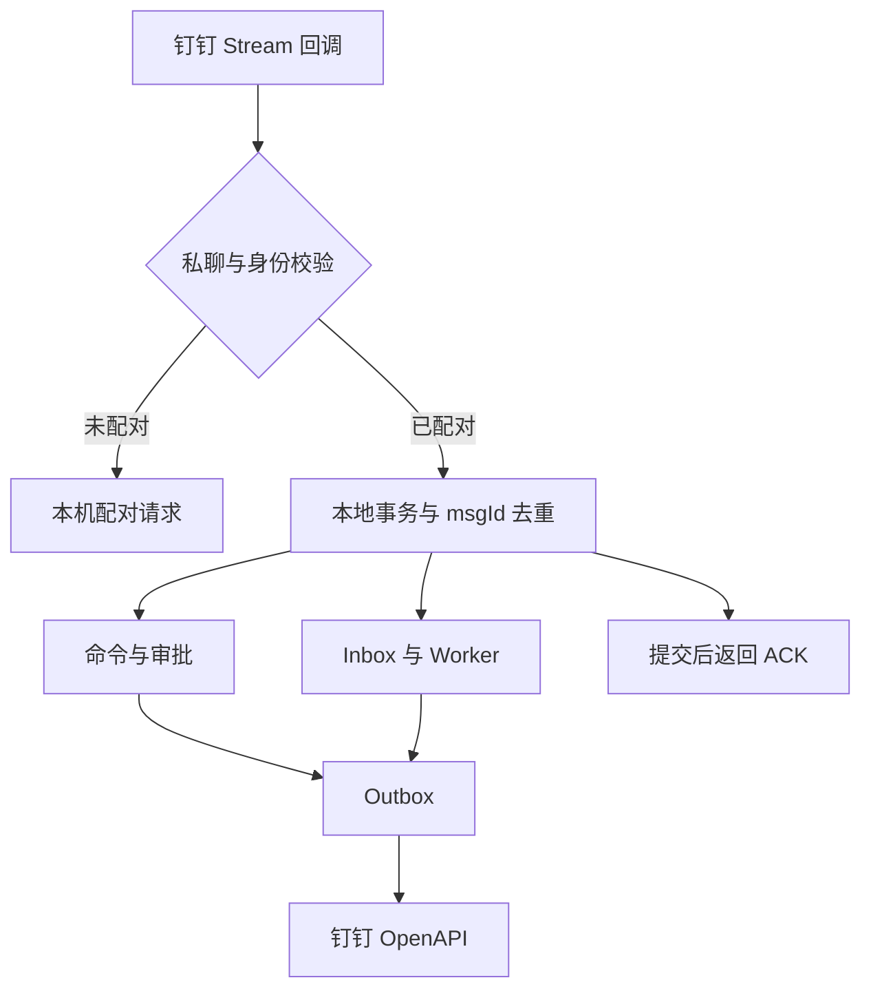

# 钉钉私聊机器人

钉钉渠道让手机通过企业内部应用机器人与 Personal Agent 私聊。电脑主动连接钉钉 Stream，接收消息后走现有的 Ingress、SQLite Inbox、Worker 和 Outbox；回复、审批提示和主动通知统一走钉钉 OpenAPI。

**不需要公网 IP、域名、入站端口或内网穿透。** 手机和电脑都需要访问钉钉云，电脑上的 `pa serve` 必须持续运行。想完全通过自己的局域网或 Tailscale 访问，请使用[网页手机连接](MOBILE.md)。钉钉文字经过钉钉云；模型请求由项目的模型配置决定。

## 支持范围

| 能力 | 当前实现 |
| --- | --- |
| 单聊文字 | 支持；仅本机批准的账号能进入 Agent |
| Markdown 回复 | 支持；长消息按 UTF-8 字节分段 |
| 主动通知 | 支持；无需等待用户新发消息，也不依赖会话 Webhook 的有效期 |
| 审批 | `/approvals`、`/approve ID`、`/deny ID`；提示包含可复制的命令 |
| 状态查询 | `/status`；命令在本机执行，不调用模型 |
| 自动重连 | 支持；每次获取新 ticket，带退避和抖动 |
| 消息去重 | 业务 `msgId` 经应用与组织作用域后写入本地持久状态 |
| 图片、语音、文档发送 | 尚未支持；收到非文字会回复提示 |
| 群聊、互动卡片、审批按钮、逐字流式回复 | 尚未支持 |

这是**企业内部应用机器人**接入，不是群自定义 Webhook 机器人。当前只实现单个应用、单个凭据配置；本机可以批准多个账号，获批账号均具有 owner 身份。

## 1. 创建并发布应用机器人

在[钉钉开放平台](https://open.dingtalk.com/)创建企业内部应用，启用应用机器人。按平台页面完成以下设置：

1. 将接收模式设置为 **Stream**，开启机器人单聊能力。
2. 保存应用的 **Client ID / AppKey**、**Client Secret / AppSecret** 和 **RobotCode**。有些应用的 RobotCode 与 Client ID 相同；不同则显式配置。
3. 为应用申请并授权机器人向企业成员发送单聊消息的权限，平台通常显示为“企业内机器人发送消息”。本实现使用 `robot/oToMessages/batchSend`，只开接收能力不够。
4. 将自己加入应用可见范围，发布应用或使用允许当前账号访问的测试版本。权限与可见范围由所在组织的管理员管理。

相关说明：[应用机器人概述](https://open-dingtalk.github.io/developerpedia/docs/learn/bot/appbot/overview/)、[机器人类型](https://open-dingtalk.github.io/developerpedia/docs/learn/bot/overview/)、[单聊发送 API](https://open.dingtalk.com/document/orgapp/chatbots-send-one-on-one-chat-messages-in-batches)。后台界面的具体名称可能调整，以当前页面为准。

## 2. 配置本机

初次使用先执行 `uv run pa init`。默认配置目录是 `~/.personal-agent`；使用了 `PA_HOME` 时，以下文件位于对应目录。

在这个目录的 `.env` 中填入自己的凭据：

```dotenv
DINGTALK_CLIENT_ID=你的应用ClientID
DINGTALK_CLIENT_SECRET=你的应用ClientSecret
```

在 `config.toml` 中添加：

```toml
[dingtalk]
enabled = true
# 以下均为可选项：
# client_id_env = "DINGTALK_CLIENT_ID"
# client_secret_env = "DINGTALK_CLIENT_SECRET"
# robot_code = "应用的RobotCode"  # 默认使用 Client ID；不同则必须填写
# corp_id = "ding组织ID"         # 建议填写，进一步固定允许的组织
```

`client_id_env`、`client_secret_env` 只能填大写环境变量名，最长 64 字符，不能填凭据本身。凭据放在本机 `.env` 或进程环境中，不要提交到仓库。更新配置后重启常驻进程。

```bash
uv run pa doctor
uv run pa channels
uv run pa channels capabilities
uv run pa channels test dingtalk
uv run pa serve
# 已安装后台服务时，修改配置后使用：
# uv run pa service restart
```

`pa channels` 和 `pa doctor` 展示启用、凭据存在、配对等本地检查结果；**配置完整不等于 Stream 已连接，也不等于发送权限已通过**。运行中的渠道在成功握手后记录 `DingTalk Stream connected`，断开后记录重连；`health()` 提供该实例实际观察到的状态和时间，不保存凭据或消息内容。

`pa channels capabilities` 不连接外部服务，展示各渠道实际声明的功能。`pa channels test dingtalk` 只请求一次 Stream ticket 来验证网关鉴权，不打印 ticket、不建立常驻连接、不发送聊天消息；成功后仍需完成配对和真实回复验证发送权限。

## 3. 从手机配对

在钉钉中打开这个应用机器人，发送任意一句话。机器人会回复短期配对码和本机批准命令：

```bash
uv run pa channels pending
uv run pa channels approve dingtalk ABCD-EFGH
uv run pa channels senders
```

只批准自己手机上看到的配对码。代码默认一小时过期；过期后重新给机器人发消息即可。批准之前的内容只用于请求配对，不会排入模型队列；批准后请再发一次实际任务。

身份以 `Client ID + Corp ID + Staff ID` 三项绑定。换应用需要重新配对；相同 Staff ID 在另一组织也不会继承权限。收消息时还要求私聊、发送者组织与机器人组织相同、RobotCode 匹配；配置了 `corp_id` 时必须一致。

撤销账号时，从 `pa channels senders` 复制完整 ID，并用单引号包住它：

```bash
uv run pa channels revoke dingtalk '["你的ClientID","你的CorpID","你的StaffID"]'
```

每次发送前和长消息分段之间都会重新检查批准状态。撤销后不会再向该账号交付已排队的普通回复。

## 4. 聊天、审批与主动通知

配对后可以直接发送任务。以下命令无需模型参与：

```text
/status
/approvals
/approve 12
/deny 12
```

审批通知会附上具体 ID 的命令；本版本没有钉钉卡片按钮。命令的审批结果、去重标记和回复在同一个本地事务中提交，重复回调不会重复执行命令。

当前对话的回复返回原账号；没有显式收件人的钉钉主动通知，发送给最近使用该渠道的已配对账号。提醒和定时任务沿用现有调度、Outbox、安静时段与通知限制，不需要额外 Webhook URL。可以在钉钉中要求创建一条短期提醒，确认任务后用实际收到的通知验证整条链路。

本渠道统一使用应用 access token 发消息，不读取、保存或调用回调中的 `sessionWebhook`。短期 ticket 和 access token 只驻留在内存中；关闭渠道会关闭自建 HTTP 客户端，断线时重新获取 ticket。接收 WebSocket 只接受网关签发的钉钉 TLS 地址，并拒绝连接重定向。

## 5. 可靠性与状态的含义

接收路径是：



业务消息使用回调正文的 `msgId` 去重；协议头的 `messageId` 用来回复当前推送的 ACK，二者不能混用。SQLite 提交成功后才返回成功 ACK，写入失败返回失败状态。

**这不意味着上游保证重放。** 钉钉官方协议说明，机器人消息当前采用 fire-and-forget；与事件订阅不同，机器人回调不会因为超时而重推。本地去重保护已经收到的重复消息，持久队列保护已经提交的工作；电脑离线或消息在提交前丢失时，应重新发送任务。不要为同一个应用启动多个互不共享状态的机器人实例：平台可能将消息分配给不同连接。

发送结果按以下规则交给项目 Dispatcher：

| 结果 | 处理 |
| --- | --- |
| `processQueryKey` 存在，目标用户不在失败列表 | 记为平台已接受；不代表用户已读，也不是最终送达回执 |
| 目标在 `invalidStaffIdList` / `filteredStaffIdList` | 明确拒绝；停止自动重试 |
| HTTP 429 或目标在 `flowControlledStaffIdList` | 明确未接受；按退避时间重试 |
| 发送时 token 被明确拒绝 | 清除旧缓存、取新 token，只重试一次 |
| 建连失败，消息尚未发出 | 明确未交付；允许重试 |
| 发送后超时、写入中断、HTTP 5xx/408、异常成功或重定向响应、无法解释的回执 | 结果未知；渠道本身不盲目重发 |
| 长消息已有部分被接受，后续片段失败 | 结果未知，不能当成整条都没发出 |

Dispatcher 对普通后台通知会将未知结果停在 `maybe_sent`；对交互回复、审批请求或紧急消息，沿用“宁可重复也要尽量送达”的现有策略，仍可能重试。因此长消息在故障时可能出现部分内容重复；本版本不承诺 exactly-once 交付。平台接受回执与通知限制、收件人的客户端状态是不同层次。

## 6. 排障

| 现象 | 检查 |
| --- | --- |
| 提示缺少凭据 | 检查当前 `PA_HOME` 的 `.env`、环境变量名和实际运行进程的环境；然后重启 |
| 可以看到机器人，消息无反应 | 检查 Stream 模式、应用发布/可见范围、RobotCode、组织限制；确认 `pa serve` 正在运行 |
| 本机已有待配对请求，手机没收到代码 | 接收已经到达；检查单聊发送权限、用户可见范围和 API 限流。修复后再发一句话重试 |
| 配对后仍请求新配对 | 检查是否换了 Client ID、组织或账号；从本机重新批准正确手机上的代码 |
| 一直重连或无法连接 | 允许电脑向 `api.dingtalk.com` 和网关返回的钉钉 WebSocket 域名发起 HTTPS/WSS；检查 DNS、代理及防火墙出站规则 |
| 文字正常，图片/语音没有被处理 | 当前渠道只接收文字；使用网页渠道上传图片和录音 |
| 回复被平台接受但手机没看到 | 检查应用可见范围、接收账号、钉钉通知设置；平台接受不等于已读 |
| 电脑重启后漏了离线期间的消息 | Stream 机器人回调没有离线补拉承诺；重新发送实际任务 |

不要通过记录整个回调来排障：回调可能包含临时 Webhook bearer URL。适配器日志只记录连接状态和经过约束的错误类别，不启用会打印 ticket URL、帧内容的 WebSocket 调试日志。

## 实现与验证

| 文件 | 责任 |
| --- | --- |
| `channels/dingtalk/config.py` | 独立配置模型及环境变量名校验 |
| `channels/dingtalk/api.py` | 固定 OpenAPI 地址、token 缓存、鉴权重试、单收件人的批量结果解析 |
| `channels/dingtalk/channel.py` | Stream 生命周期、系统 ping/disconnect、身份与配对、持久消息接收、Outbox 发送 |
| `channels/base.py` | 可选能力声明；DingTalk 声明 text、markdown、proactive |
| `channels/registry.py` | 开启配置后把渠道注册为收消息服务与发消息适配器 |

使用 `httpx` 和 `websockets` 的原生异步薄适配器，不依赖同步网络调用，也不引入第三方常驻进程。协议和字段来自钉钉官方文档与官方生成 SDK。

```bash
uv run pytest -q tests/test_dingtalk_api.py tests/test_dingtalk_channel.py tests/test_dingtalk_stream.py tests/test_dingtalk_cli.py
```

测试使用 HTTP MockTransport、真实本机 WebSocket 服务器和临时 SQLite：覆盖 token 轮换、部分失败、未知发送结果、跨应用/跨组织隔离、配对、重开数据库去重、审批事务回滚、提交后 ACK、重连和取消清理。测试不访问钉钉云，不发送真实消息；实际组织授权、应用发布和手机接收仍需按上述步骤验证。

官方资料：

- [Stream 模式介绍](https://open-dingtalk.github.io/developerpedia/docs/learn/stream/overview/)
- [Stream 协议、系统消息与 ACK 的边界](https://open-dingtalk.github.io/developerpedia/docs/learn/stream/protocol/)
- [应用机器人回复与主动发送](https://open-dingtalk.github.io/developerpedia/docs/learn/bot/appbot/reply/)
- [单聊批量发送 API](https://open.dingtalk.com/document/orgapp/chatbots-send-one-on-one-chat-messages-in-batches)
- [官方 Python Stream SDK](https://github.com/open-dingtalk/dingtalk-stream-sdk-python)
- [官方 Go SDK 的 BatchSendOTO 请求/响应字段](https://github.com/alibabacloud-go/dingtalk/blob/master/robot_1_0/client.go)
