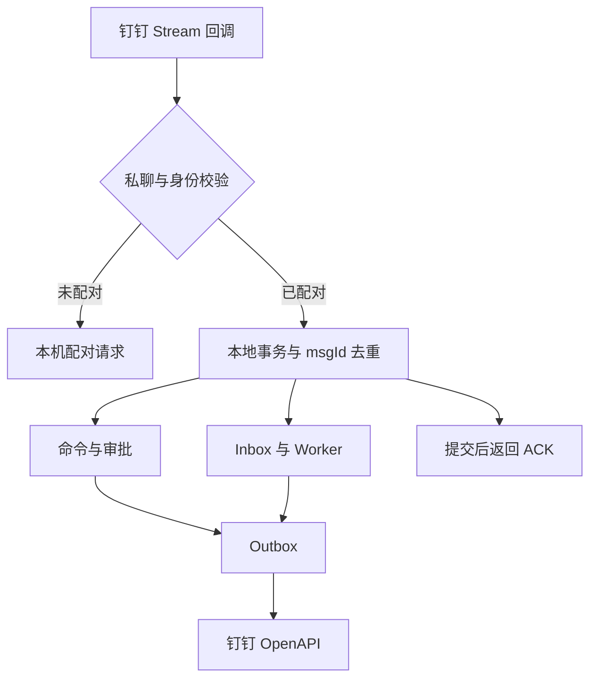

# 钉钉私聊机器人

用钉钉渠道，你可以在手机上通过企业内部应用机器人，和 Personal Agent 私聊。电脑主动连上钉钉的 Stream 服务；收到的消息走现有的流程（入口 → SQLite 收件箱 → worker → 发件箱）；回复、审批提示和主动通知，都通过钉钉 OpenAPI 发出去。

**不需要公网 IP、域名、入站端口，也不需要内网穿透。** 手机和电脑都要能访问钉钉云，电脑上的 `pa serve` 要一直开着。如果你想完全走自己的局域网或 Tailscale，请用[网页手机连接](MOBILE.md)。钉钉上的文字会经过钉钉云；模型请求发到哪里，由项目的模型配置决定。

## 支持什么

| 功能 | 现状 |
| --- | --- |
| 单聊文字 | 支持。只有在本机批准过的账号，才能和 Agent 说话 |
| Markdown 回复 | 支持。长消息按 UTF-8 字节分段 |
| 主动通知 | 支持。不用等你先发消息，也不依赖会话 Webhook 的有效期 |
| 审批 | `/approvals`、`/approve ID`、`/deny ID`；提示里带着可以直接复制的命令 |
| 查状态 | `/status`。命令在本机执行，不调用模型 |
| 自动重连 | 支持。每次重新取 ticket，带退避和随机抖动 |
| 消息去重 | 业务 `msgId` 加上应用和组织的范围后，写进本地持久状态 |
| 发图片、语音、文档 | 暂不支持。收到非文字消息，会回一条提示 |
| 群聊、互动卡片、审批按钮、逐字流式回复 | 暂不支持 |

这里接的是**企业内部应用机器人**，不是群里的自定义 Webhook 机器人。现在只支持一个应用、一套凭据；本机可以批准多个账号，批准后的账号都是 owner 身份。

## 1. 创建并发布应用机器人

在[钉钉开放平台](https://open.dingtalk.com/)创建企业内部应用，启用应用机器人。按平台页面的提示，完成这几项设置：

1. 把接收模式设成 **Stream**，打开机器人的单聊能力。
2. 记下应用的 **Client ID / AppKey**、**Client Secret / AppSecret** 和 **RobotCode**。有的应用 RobotCode 和 Client ID 一样；不一样的话，要单独配置。
3. 给应用申请并授权“机器人向企业成员发送单聊消息”的权限，平台上通常叫“企业内机器人发送消息”。这里用的是 `robot/oToMessages/batchSend`，只开接收能力是不够的。
4. 把你自己加进应用的可见范围，再发布应用，或者使用允许你当前账号访问的测试版本。权限和可见范围由你所在组织的管理员管理。

参考：[应用机器人概述](https://open-dingtalk.github.io/developerpedia/docs/learn/bot/appbot/overview/)、[机器人类型](https://open-dingtalk.github.io/developerpedia/docs/learn/bot/overview/)、[单聊发送 API](https://open.dingtalk.com/document/orgapp/chatbots-send-one-on-one-chat-messages-in-batches)。后台界面上的具体名称可能会变，以当前页面为准。

## 2. 配置本机

第一次用，先执行 `uv run pa init`。默认的配置目录是 `~/.personal-agent`；如果设了 `PA_HOME`，下面说的文件就在那个目录里。

在这个目录的 `.env` 里填你自己的凭据：

```dotenv
DINGTALK_CLIENT_ID=你的应用ClientID
DINGTALK_CLIENT_SECRET=你的应用ClientSecret
```

在 `config.toml` 里加上：

```toml
[dingtalk]
enabled = true
# 以下都是可选项：
# client_id_env = "DINGTALK_CLIENT_ID"
# client_secret_env = "DINGTALK_CLIENT_SECRET"
# robot_code = "应用的RobotCode"  # 默认用 Client ID；不一样就必须填
# corp_id = "ding组织ID"         # 建议填，进一步限定允许的组织
```

`client_id_env` 和 `client_secret_env` 只能填大写的环境变量名，最长 64 个字符，不能直接填凭据。凭据放在本机的 `.env` 或进程环境里，不要提交到仓库。改完配置，要重启常驻进程。

```bash
uv run pa doctor
uv run pa channels
uv run pa channels capabilities
uv run pa channels test dingtalk
uv run pa serve
# 已经装了后台服务的话，改完配置用：
# uv run pa service restart
```

`pa channels` 和 `pa doctor` 显示的是本地检查：有没有启用、凭据在不在、有没有配对。**配置完整，不等于 Stream 已经连上，也不等于发送权限已经通过。** 运行中的渠道握手成功后，会记一条 `DingTalk Stream connected`，断开后会记重连；`health()` 能给出这个实例实际观察到的状态和时间，不保存凭据或消息内容。

`pa channels capabilities` 不连外部服务，只显示各个渠道实际声明了哪些功能。`pa channels test dingtalk` 只请求一次 Stream ticket，用来验证网关鉴权：不打印 ticket，不建立常驻连接，不发聊天消息。它通过之后，还要完成配对、实际收到一次回复，才能确认发送权限没问题。

## 3. 从手机配对

在钉钉里打开这个应用机器人，随便发一句话。机器人会回一个短期有效的配对码，以及要在本机运行的批准命令：

```bash
uv run pa channels pending
uv run pa channels approve dingtalk ABCD-EFGH
uv run pa channels senders
```

只批准你自己手机上看到的配对码。配对码默认一小时过期；过期了，再给机器人发一条消息就行。批准之前发的内容，只用来申请配对，不会进模型队列；批准之后，请再发一次真正的任务。

身份由 `Client ID + Corp ID + Staff ID` 三项一起绑定。换了应用，要重新配对；同一个 Staff ID 出现在另一个组织，也不会继承权限。收消息时还要求：是私聊、发送者所在的组织和机器人所在的组织相同、RobotCode 匹配；配置了 `corp_id` 的话，必须一致。

撤销账号时，从 `pa channels senders` 复制完整的 ID，用单引号括起来：

```bash
uv run pa channels revoke dingtalk '["你的ClientID","你的CorpID","你的StaffID"]'
```

每次发送前、长消息每一段之间，都会重新检查这个账号还在不在批准名单里。撤销之后，已经排队的普通回复也不会再发给这个账号。

## 4. 聊天、审批和主动通知

配对之后可以直接发任务。下面这些命令不经过模型：

```text
/status
/approvals
/approve 12
/deny 12
```

审批通知里会附上带具体 ID 的命令；这个版本没有钉钉卡片按钮。命令的审批结果、去重标记和回复，在同一个本地事务里提交，所以重复的回调不会让命令执行两次。

当前对话的回复，发回原来的账号。没有指定收件人的钉钉主动通知，发给最近用过这个渠道的、已配对的账号。提醒和定时任务沿用现有的调度、发件箱、安静时段和通知限制，不需要额外的 Webhook URL。你可以在钉钉里让它建一条短期提醒，确认任务后，看实际收到的通知，就能验证整条链路。

这个渠道统一用应用的 access token 发消息，不读取、不保存、也不调用回调里的 `sessionWebhook`。短期 ticket 和 access token 只放在内存里；关闭渠道时会关掉自己建的 HTTP 客户端，断线后重新获取 ticket。接收用的 WebSocket 只接受网关发的钉钉 TLS 地址，并拒绝连接重定向。

## 5. 可靠性，以及各种状态是什么意思

消息的接收路径如下：



业务消息用回调正文里的 `msgId` 去重；协议头里的 `messageId` 用来回复当前这次推送的 ACK，两者不能混用。SQLite 提交成功之后，才返回成功的 ACK；写入失败，就返回失败状态。

**这不代表钉钉保证重放。** 钉钉官方协议说明，机器人消息目前是 fire-and-forget（发了就不管）：和事件订阅不同，机器人的回调不会因为超时而重推。本地去重，保护的是已经收到的重复消息；持久队列，保护的是已经提交的工作。电脑离线、或者消息在提交前丢了，就要重新发一遍任务。不要给同一个应用启动多个互不共享状态的机器人实例：平台可能把消息分给不同的连接。

发送结果按下面的规则交给项目的 Dispatcher：

| 结果 | 怎么处理 |
| --- | --- |
| 有 `processQueryKey`，目标用户不在失败列表里 | 记为平台已接受。这不代表用户已读，也不是最终的送达回执 |
| 目标在 `invalidStaffIdList` / `filteredStaffIdList` 里 | 明确被拒绝，不再自动重试 |
| HTTP 429，或目标在 `flowControlledStaffIdList` 里 | 明确没被接受，按退避时间重试 |
| 发送时 token 被明确拒绝 | 清掉旧缓存、取新 token，只重试一次 |
| 建连失败，消息还没发出去 | 明确没送到，允许重试 |
| 发送后超时、写入中断、HTTP 5xx/408、异常的成功响应或重定向响应、读不懂的回执 | 结果未知，渠道本身不会盲目重发 |
| 长消息已有部分被接受，后面的片段失败 | 结果未知，不能当成整条都没发出去 |

Dispatcher 对普通的后台通知，会把结果未知的停在 `maybe_sent` 状态；对交互回复、审批请求和紧急消息，沿用现有的“宁可重复，也要尽量送到”的策略，仍可能重试。所以长消息在出故障时，可能出现部分内容重复；这个版本不承诺 exactly-once（恰好一次）投递。平台接受回执、通知限制、收件人客户端上的状态，是不同层面的事情。

## 6. 排障

| 现象 | 检查什么 |
| --- | --- |
| 提示缺少凭据 | 检查当前 `PA_HOME` 的 `.env`、环境变量名，以及实际运行的进程里的环境；然后重启 |
| 能看到机器人，但发消息没反应 | 检查 Stream 模式、应用有没有发布、可见范围、RobotCode、组织限制；确认 `pa serve` 正在运行 |
| 本机有待配对的请求，手机却没收到配对码 | 说明消息已经收到了。检查单聊发送权限、用户的可见范围和 API 限流。修好后，再发一句话重试 |
| 配对后又要求重新配对 | 检查是不是换了 Client ID、组织或账号；在本机重新批准正确那部手机上的配对码 |
| 一直重连，或者连不上 | 允许电脑向 `api.dingtalk.com` 和网关返回的钉钉 WebSocket 域名发起 HTTPS/WSS；检查 DNS、代理和防火墙的出站规则 |
| 文字正常，图片、语音没有被处理 | 这个渠道目前只收文字；图片和录音请用网页渠道上传 |
| 平台已接受回复，手机上却没看到 | 检查应用的可见范围、接收账号、钉钉的通知设置。平台接受，不等于已读 |
| 电脑重启后，漏了离线期间的消息 | Stream 机器人回调没有离线补拉的保证；请重新发送真正的任务 |

不要靠记录整个回调来排障：回调里可能带着临时的 Webhook bearer URL。适配器日志只记连接状态和经过限制的错误类别，不会打开会打印 ticket URL、帧内容的 WebSocket 调试日志。

## 代码和测试

| 文件 | 负责什么 |
| --- | --- |
| `channels/dingtalk/config.py` | 独立的配置模型，以及环境变量名的校验 |
| `channels/dingtalk/api.py` | 固定的 OpenAPI 地址、token 缓存、鉴权重试、单个收件人的批量结果解析 |
| `channels/dingtalk/channel.py` | Stream 的生命周期、系统 ping/disconnect、身份与配对、持久的消息接收、从发件箱发送 |
| `channels/base.py` | 可选的能力声明；钉钉声明了 text、markdown、proactive |
| `channels/registry.py` | 配置开启后，把渠道注册为收消息服务和发消息适配器 |

它是用 `httpx` 和 `websockets` 写的原生异步薄适配器，不依赖同步的网络调用，也不引入第三方的常驻进程。协议和字段来自钉钉官方文档和官方生成的 SDK。

```bash
uv run pytest -q tests/test_dingtalk_api.py tests/test_dingtalk_channel.py tests/test_dingtalk_stream.py tests/test_dingtalk_cli.py
```

测试用的是 HTTP MockTransport、一个真实的本机 WebSocket 服务器和临时的 SQLite，覆盖：token 轮换、部分失败、发送结果未知、跨应用和跨组织的隔离、配对、重开数据库后的去重、审批事务回滚、提交后才 ACK、重连，以及取消后的清理。测试不访问钉钉云，也不发真实的消息；实际的组织授权、应用发布和手机接收，仍然要按上面的步骤自己验证。

官方资料：

- [Stream 模式介绍](https://open-dingtalk.github.io/developerpedia/docs/learn/stream/overview/)
- [Stream 协议、系统消息与 ACK 的边界](https://open-dingtalk.github.io/developerpedia/docs/learn/stream/protocol/)
- [应用机器人回复与主动发送](https://open-dingtalk.github.io/developerpedia/docs/learn/bot/appbot/reply/)
- [单聊批量发送 API](https://open.dingtalk.com/document/orgapp/chatbots-send-one-on-one-chat-messages-in-batches)
- [官方 Python Stream SDK](https://github.com/open-dingtalk/dingtalk-stream-sdk-python)
- [官方 Go SDK 的 BatchSendOTO 请求/响应字段](https://github.com/alibabacloud-go/dingtalk/blob/master/robot_1_0/client.go)
