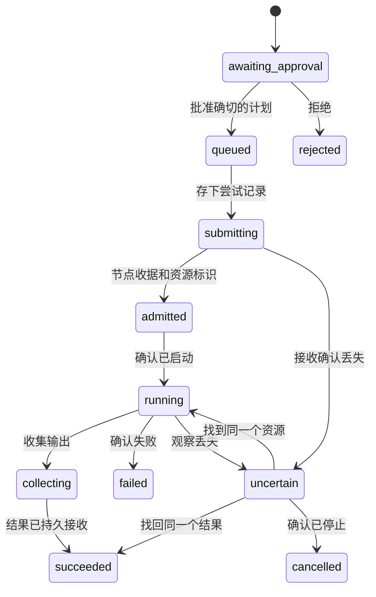

# 在你自己的电脑上运行任务

V3 沿用原来的流程：收件箱（Inbox）→ agent harness → 发件箱（Outbox）。耗时长的命令，跑在你自己的电脑上。服务端把活派出去之前，先把计划、你的批准、任务的修订版本和执行收据存下来。服务端仍然可以放在 Railway 上。这个功能不会替你开通付费的云沙箱，也用不着它。

执行任务的电脑，需要装好 Docker，并提前装好镜像。它主动连到服务端，不需要开放公网端口，也不需要 SSH 服务器让别人连进来。请用 HTTPS（Railway 的地址，或者 Tailscale 的 HTTPS 地址）。只有回环地址（loopback）才接受明文 HTTP。你的手机只是浏览器和遥控器，不运行任何东西。

## 谁能看到什么、能做什么

每个协作空间，都有自己的 App、SQLite 数据库、记忆目录树和工作区。身份和节点授权，存在根目录的数据库里。一个任务，属于登录的那个人，和他选的那个空间。请求里不能指定别人当操作者。

节点只会收到：批准过的命令、你选的输入文件的快照、输出路径的清单，以及执行限制。它永远拿不到模型的 API 密钥、渠道凭据、服务端的数据库，或者你的整个工作区。镜像由运维（operator）来选，agent 永远不能把镜像写进计划里。

第一版的执行配置，**没有网络**。依赖要提前装进节点的镜像里。命令运行的时候，不能 `pip install`、克隆仓库，或者调外部 API，除非准备好的输入或镜像已经覆盖了。如果 Docker 用不了，也不会退回到在主机 shell 里直接跑命令。

“被允许使用某台电脑”和“是项目成员”，是两回事。有写权限的成员，可以提议任务。批准使用这台电脑的人，是实例的主人，除非你另外指定了别人。光是成员身份，不能用别人的执行电脑。主人可以通过资源审核的接口（resource review endpoint），查看并批准成员私有的执行计划。这不等于主人能随便看成员私有的聊天或记忆。批准的人确实会看到计划本身：命令、选中的文件名，和哈希。

## 跑第一个任务

1. 在服务端的电脑上，用 `pa node invite --space personal-owner` 创建一个节点邀请。要给项目空间授权，就多加几个 `--space`。也可以在工作台里创建一次性的节点邀请。
2. 在执行电脑上，装好 Docker 和你要的镜像。用 `pa node pair --url https://your-control.example` 配对，并在提示符处输入那个短时有效的配对码。
3. 用 `pa node run --image python:3.12-slim` 启动。节点目录默认是 `~/.personal-agent-node`。`pa node status` 会列出它保存的收据，里面不含任何凭据。
4. 在工作台的“任务”视图里，填入一条命令、可选的工作区输入路径、可选的输出路径和超时时间。聊天里的 agent，也可以用 `submit_job` 提议一个任务。
5. 检查保存下来的命令、输入哈希、输出路径和超时。批准的是这份确切的计划哈希。有该空间授权、能力也满足的节点，随后就可以认领这个任务。
6. 看状态、有限长度的日志，和只读的结果文件。需要的话，可以在“任务”里取消。如果活已经在跑了，取消会一直是“待处理”，直到节点确认最终状态。

默认的 Python 镜像下，一条不用联网的示例命令：

```sh
python -c 'from pathlib import Path; Path("report.txt").write_text("hello from the node\n")'
```

批准之前，先把 `report.txt` 声明为输出。结果会作为附件发布，不会覆盖服务端工作区里正在用的文件。

## 存了什么

| 对象 | 存了什么 |
| --- | --- |
| 任务（Task） | 提交的人、选定的对话和接收人、修订版本、授权快照，以及整体状态 |
| 作业（Job） | 一个不会再变的步骤：命令、超时、输入的元数据、输出路径、计划哈希，和批准人 |
| 尝试（Attempt） | 固定的 ID、generation、分到的节点、资源授权的版本、资源 ID、最终收据和清理状态 |
| 输入问题（Input question） | 带版本、只能回答一次的问题：选项、答案、谁回答的，以及授权审计 |
| 输入快照（Input snapshot） | 有大小限制的文件内容，和不会变的计划元数据分开存 |
| 观察记录（Observation） | 去掉密钥之后的、累积的日志快照，和一个只增不减的游标 |

`client_request_id` 让创建任务可以放心重试（范围是同一个人、同一个空间）。同一个 key、同样的内容再发一次，返回已有的任务。内容变了，返回 HTTP 409。agent 的工具，用持久的 work ID 和工具的 `task_key`，拼出一个固定的 key。

计划是在请你批准**之前**就存好的。批准绑定的是 `plan_hash` 和当前的任务修订版本。输入文件在提交任务的时候就做了快照，所以之后再改工作区里的文件，也没法悄悄改变批准过的节点收到的东西。命令或者输入变了，就得新建步骤或计划，重新批准。

## 状态和恢复



进程很快就结束的时候，节点上的 Runner 可以直接从 `admitted` 或 `running`，报告最终结果。`collecting` 是它可以报告的一个状态，不是需要你多等一次的 HTTP 往返。没有可用的节点时，任务在队列里等着，不占对话的 worker。运行中的尝试如果没了动静，默认等 90 秒的观察窗口，之后变成 `uncertain`（不确定）。

服务端是**先**生成尝试的 ID，**再**返回认领结果的。如果响应丢了，再请求一次，拿到的还是同一个 ID、同一个 generation 和批准过的同一份计划。节点是先写好本地持久的收据，再按固定的名字创建 Docker 资源。重复的请求，会去对账那个资源，不会再创建第二个。第一版在结果不确定之后，从不自己提高 generation，也不会自己重试命令。

一个节点，在它被授权的所有空间里，同一时间只跑一个未完成的尝试。被新的授权作废（fenced）的尝试，或者状态不确定的尝试，都会一直占着这个名额。节点还会跨重启，保留还没被确认的最终结果，以及待做的清理。只有收到 HTTP 响应，明确确认结果已经被持久地接收之后，它才会删掉自己的执行文件和容器。清理失败的话，会留下一条可以重试的记录。清理完成后，会留一份精简的收据作为标记，用来识别重复的请求。

不要为了让警告消失，就把 `uncertain` 的收据删掉再重新提交。没有响应，或者检查（inspect）失败，都不能证明命令从来没跑过。先去检查、恢复你的节点和它原来的资源。我们保证的是：最多自动执行一次，并且有持久的对账。我们不保证，任意的外部副作用恰好发生一次。

### 取消、修改和撤销

`desired_state=cancel` 和观察到的最终状态，是两回事。排着队、还没开始的任务，可以立刻取消。已经提交、正在运行或者状态不确定的作业，在任务这一层，会一直是 `cancel_requested`，直到节点报告结果。如果节点拿到了认领，却从没接纳（admit）过资源，它可以确认一个“已取消”的结果，不带退出码、日志和产物。成功，永远需要有记录的资源接纳，和等于 0 的退出码。

本地和容器的期限，在网络或服务端消失之后，仍然有效。服务端的期限，只是请求取消，从不假定一个联系不上的进程已经停了。默认超时是 900 秒，可以设成 1–3600 秒。没开始的计划，七天后过期。

修改任务，用的是“比较再交换”（compare-and-swap）的修订版本检查，并取消还没做完的旧工作。旧版本迟到的结果，只作为历史留着，推进不了新版本，也不会为它发通知。修订后的任务里的新步骤，要重新批准。

批准和认领之前，以及投递之前，都会重新检查存下来的成员和主体（principal）的版本。成员被移除后再加入，他们旧的工作不会复活。节点的尝试，也会记录资源授权的版本，所以移除再恢复一项授权，不会把旧的授权带回来。被撤销的资源，只会拿到一个最简的取消状态，拿不到任务输入字节的新副本。节点当前的能力，仍然必须覆盖批准过的计划。

完成、一条收件箱收据，和发给固定接收人的发件箱通知，在同一个事务里提交。发布产物，也是这个事务的一部分。重复的最终确认，不会产生第二条通知或第二个产物。通知和产物，都带着原来的主体和成员版本，所以如果完成到投递之间，权限被撤销了，什么都不会投递。完成收据默认标成“已处理”，所以一条命令跑完，不会自己再花模型 token。明确设置 `wake_on_completion`，是一个内部的开关（opt-in）。

## 多步骤工作流

工作台的任务详情里，可以加步骤、请求回答、取消工作，和创建修订后的任务。API 支持同样的工作流，最多连续八个步骤。每个步骤单独保存，需要单独批准。第 2 步，要等第 1 步成功之后才能认领。如果某个依赖失败、被拒绝或者过期，排在它后面的队列步骤会被取消。

浏览器的每次写入，都使用正常登录的 `pa_session` cookie、正确的 `Origin` 和 `X-PA: 1`。选了项目的时候，在下面的路由后面加 `?space=SPACE_ID`。示例的请求体里是占位符，不是真的凭据。

用 `POST /api/v3/tasks` 创建任务：

```json
{
  "client_request_id": "report-2026-01",
  "title": "准备一份报告",
  "command": "python -c 'print(\"input validation complete\")'",
  "timeout_s": 60,
  "input_paths": [],
  "output_paths": []
}
```

用 `POST /api/v3/tasks/TASK_ID/steps` 保存第二步：

```json
{
  "expected_revision": 1,
  "step_id": "2",
  "command": "python -c 'from pathlib import Path; Path(\"report.txt\").write_text(\"ready\")'",
  "timeout_s": 60,
  "input_paths": [],
  "output_paths": ["report.txt"]
}
```

提交任务的人或项目管理员，可以加步骤。用同一个步骤号和同一份计划重复提交，返回已有的作业。同一个编号下，换成不同的计划，会冲突。用 `POST /api/v3/jobs/JOB_ID/approve` 批准每个作业，带上它返回的确切的 `plan_hash`：

```json
{"allowed": true, "plan_hash": "PLAN_HASH_FROM_THE_SAVED_JOB"}
```

实例的主人也可以改用 `POST /api/v3/review-jobs`，带上 `space_id`、`job_id`、`allowed` 和 `plan_hash`。这是审核成员私有任务的路径。

依赖只决定顺序。输出**不会**自动填进后面已批准的命令，也不会悄悄复制进它的输入快照。要用新的结果，就先看那个只读的产物，再有意识地把你选中的文件放进空间的工作区，然后提交下一步，并批准它确切的输入快照。这样，之后的文件改动，或者不可信的进程输出，就改变不了你已经批准的执行。

## 等人回答

用任务详情里的输入请求表单、agent 工具 `ask_task_input`，或者 `POST /api/v3/tasks/TASK_ID/questions`：

```json
{
  "expected_revision": 1,
  "request_id": "choose-report-format",
  "question": "下一步的报告用什么格式？",
  "choices": ["text", "csv"]
}
```

只有提交任务的人或管理员，才能让任务暂停，而且要在没有已提交、运行中或不确定的尝试时才行。任务会变成 `waiting_input`，它排队的作业不能被认领。同一时间只能有一个问题开着，最多十个选项，每个任务修订版本最多十六个问题。如果选项列表是空的，答案就是自由文本，最多 4000 个字符。

有写权限的成员，在任务详情里回答，或者用 `POST /api/v3/tasks/TASK_ID/questions/QUESTION_ID/answer`：

```json
{"expected_revision": 1, "answer": "csv"}
```

同一个人再发一次同样的答案，拿到的是已经保存的答案。冲突的答案、旧的任务修订版本、已取消的问题，或者变了的授权，都会被拒绝。只读成员不能回答。取消、修订版本变化或者过期，会关掉所有还开着的问题。审计会记录谁提的问题、谁回答、什么时候，以及回答者当时的授权版本。

有人回答之后，排队工作的暂停被解除，原来的计划和批准，保持原样。答案是不可信的输入，会出现在任务状态里。它永远不会被放进 shell 命令，也不会启动模型循环。如果答案会改变要运行的内容，就另建一个步骤或计划，再批准它。不要批准一条打算以后让答案来改写的命令。

## 限制和结果文件

| 限制 | 默认值 / 行为 |
| --- | --- |
| 一次传输的文件数 | 64 |
| 单个文件 | 2 MiB |
| 传输的输入/输出原始内容总量 | 每份清单 8 MiB |
| 输入快照的存储 | 每个空间 64 MiB；没开始就取消、被拒绝或过期，或者节点确认清理之后，释放 |
| 待处理的作业 | 每个空间 100 个 |
| 新任务 | 每个空间，滚动 24 小时内 100 个 |
| 命令长度 | 16,000 个字符 |
| 超时 | 900 秒；允许 1–3600 秒 |
| 实时日志的保留 | 最近 8 份累积快照，每份最多 64,000 个字符 |
| 最终输出 | 有上限的 stdout/stderr，各最多 64,000 个字符 |
| 节点的资源默认值 | 1 个 CPU、512 MiB 内存；节点的实际配置，由运维设定 |

执行配额用完之后，读取、取消和对账，仍然能用。这些限制，管的是执行的准入和存储，和模型的 token、费用预算是分开的。还是要保持 SQLite 需要的那种“单个服务进程 + 持久卷”的部署方式。

文件清单把相对路径、大小和 SHA-256 值绑在一起。传输会拒绝：路径穿越、绝对路径、重复条目、符号链接、硬链接，以及 `.env`、`.ssh`、`.git` 这类凭据或控制路径。做快照的时候，会检查文件在读取期间有没有变。节点产生的文件，必须列在批准过的输出路径里，并且走同样的清单检查。

收集到的文件，先暂存在生成的 `.pa-jobs/JOB_ID/` 目录下，再通过现有的、不可改的 `ArtifactStore` 发布，并对照声明的哈希和大小做检查。它们遵循现有的产物配额、下载认证和过期设置。它们不会替换工作区里的文件。确认清理之后，临时的暂存副本和记录过的输入快照会被删掉，发布出去的、不可改的产物留下。如果发布失败，节点的结果保持“未确认”，好让它可以恢复，而不是宣称成功、把唯一的一份副本扔掉。

日志是去掉密钥之后的累积快照，不是一块一块分别脱敏的片段，这样可以避免：一个已知的密钥，被拆在两次更新里，漏了出去。`GET /api/v3/attempts/ATTEMPT_ID/logs?after=N` 按游标返回快照。把最新的快照，当作当前的日志显示。不要把所有快照拼起来。旧的快照可能被清理，所以回来看的人，可以直接跳到保留下来的最新游标。进程输出和产物内容，一律当作不可信。

## 代码在哪里，怎么测的

- `execution/schema.py`：每个空间里持久的任务、作业、尝试、问题和输入。
- `execution/store.py`：批准、修订版本和授权的“围栏”（用版本号挡住过期的操作）、幂等、状态转换、有上限的观察记录、原子的完成和对账。
- `execution/workspaces.py`：基于文件描述符的安全文件快照，和结果的暂存。
- `tools/jobs.py`：提交、查看、取消任务，以及请求结构化输入的工具。
- `channels/web/collaboration.py`：需要认证的任务、工作流和节点路由。
- `nodes/`：主动外连的 Runner、持久的节点收据、Docker 后端和传输层。

`tests/test_execution_v3.py` 覆盖：重启和丢失的确认、迟到或过期的结果、撤销、配额、失败的依赖、产物的原子回滚，和暂停等待的输入。`tests/test_v3_execution_http.py` 覆盖：浏览器和节点的授权、空间之间的隔离、资源批准、授权的撤销和重新授予、一次性的答案，以及整条结果路径。节点后端和传输层的测试，覆盖执行协议的另一半。CI 用的是受控的后端替身（fake）。`tests/js/workbench.test.mjs` 用仓库里的 DOM 测试夹具，运行真实的任务渲染器和表单处理器。

真实的部署，仍然需要在你选定的执行主机上，跑一次 Docker 冒烟测试，并在手机和桌面宽度下，看一遍浏览器效果。这些测试，不证明真实的 Docker daemon 或者浏览器布局没问题。
