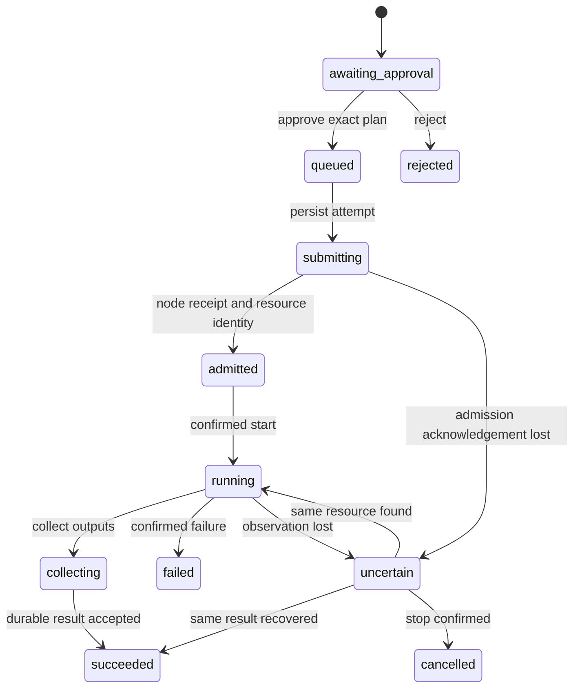

# Running tasks on your own computer

V3 keeps the existing flow: Inbox → agent harness → Outbox. Long commands run on a computer you own. Before it sends any work out, the server saves the plan, your approval, the task revision and the execution receipts. Railway can keep hosting the server. This feature doesn't set up or need a paid cloud sandbox.

The execution computer needs Docker and an image you installed in advance. It connects out to the server. It needs no public port and no inbound SSH server. Use HTTPS (a Railway address or a Tailscale HTTPS address). Plain HTTP is only accepted on loopback. Your phone is the browser and remote control. It doesn't run anything.

## Who can see and do what

Each collaboration space has its own App, SQLite database, memory tree and workspace. Identity and node grants live in the database in the root directory. A task belongs to the signed-in person and the selected space. A request can't name someone else as the actor.

The node only receives: the approved command, snapshots of the input files you picked, the list of output paths, and the execution limits. It never gets a model API key, a channel credential, the server's database, or your whole workspace. The operator picks the image. An agent can never put one in a plan.

The first execution profile has **no network access**. Install dependencies in the node image beforehand. A command can't run `pip install`, clone a repository or call an outside API while it runs, unless the prepared inputs or image already cover it. If Docker isn't available, there is no fallback that runs the command in the host shell.

Being allowed to use a computer is separate from being a project member. Members with write access can propose tasks. The person who approves use of the computer is the instance owner unless you set someone else. Membership alone doesn't let you use someone else's execution computer. The owner can look at and approve a member's private execution plan through the resource review endpoint. That doesn't give the owner general access to the member's private chats or memory. The approver does see the plan itself: the command, the chosen file names and the hashes.

## Your first task

1. On the server computer, create a node invitation with `pa node invite --space personal-owner`. Add more `--space` options to grant project spaces. You can also create a one-use node invitation in the Workbench.
2. On the execution computer, install Docker and the image you want. Pair it with `pa node pair --url https://your-control.example`, and type the short-lived code at the prompt.
3. Start it with `pa node run --image python:3.12-slim`. The default node directory is `~/.personal-agent-node`. `pa node status` lists the receipts it kept, without any credentials.
4. In the Workbench's Tasks view, enter a command, optional input paths in the workspace, optional output paths and a timeout. The chat agent can also propose a task with `submit_job`.
5. Check the saved command, input hashes, output paths and timeout. Approve that exact plan hash. A node that has the space grant and the needed capabilities can then claim the task.
6. Watch the status, the bounded logs and the read-only result files. Cancel from Tasks if you need to. If the work is already running, cancelling stays pending until the node confirms the final state.

An offline example command for the default Python image:

```sh
python -c 'from pathlib import Path; Path("report.txt").write_text("hello from the node\n")'
```

Declare `report.txt` as an output before you approve. The result is published as an attachment. It doesn't overwrite a file in the live workspace on the server.

## What gets saved

| Object | What it holds |
| --- | --- |
| Task | The person, the chosen conversation and recipient, the revision, a snapshot of authorization, and the overall state |
| Job | One step that never changes: command, timeout, input metadata, output paths, plan hash and the approver |
| Attempt | A stable ID, generation, assigned node, resource-grant version, resource ID, final receipt and cleanup state |
| Input question | A versioned question that can be answered once: the choices, the answer, who answered, and the authorization audit |
| Input snapshot | File content with a size limit, stored apart from the plan metadata, which never changes |
| Observation | A cumulative log snapshot with secrets removed, and a cursor that only goes up |

`client_request_id` makes creating a task safe to repeat, within one person and space. Sending the same key and content again returns the existing task. Changing the content returns HTTP 409. Agent tools build a stable key from the durable work ID and the tool's `task_key`.

The plan is saved **before** you're asked to approve it. Approval is tied to `plan_hash` and the current task revision. Input files are snapshotted when the task is submitted, so editing a workspace file later can't quietly change what an approved node receives. If the command or an input changes, you need a new step or plan, and a new approval.

## States and recovery



The runner may report a final result straight from `admitted` or `running` when it sees a fast process finish. `collecting` is a state it can report, not an extra HTTP round trip you have to wait for. If no node is available, the task waits in the queue and doesn't use up a conversation worker. If a running attempt goes quiet, it becomes uncertain after the default 90-second observation window.

The server creates the attempt ID **before** it returns a claim. If the response is lost, asking again returns the same ID, generation and approved plan. The node writes its durable local receipt before it creates the Docker resource with the fixed name. Repeated requests reconcile that resource. They don't create a second one. The first version never bumps the generation or retries a command by itself after an uncertain result.

A node runs one outstanding attempt at a time, across all the spaces it has been granted. An attempt that's fenced or uncertain keeps that slot. The node also keeps an unacknowledged final result and pending cleanup across restarts. It only removes its execution files and container after an HTTP response explicitly acknowledges that the result was durably accepted. If cleanup fails, a retryable record stays. After cleanup, a compact receipt stays as a marker so duplicates are recognized.

Don't delete an uncertain receipt and submit again just to make the warning go away. No response, or a failed inspect, doesn't prove the command never ran. First inspect and recover your node and its original resource. The guarantee is: at most one automatic execution attempt, with durable reconciliation. It doesn't promise that arbitrary outside side effects happen exactly once.

### Cancelling, editing and revoking

`desired_state=cancel` is different from an observed final state. A task that's queued and hasn't started can be cancelled right away. A job that's submitted, running or uncertain stays `cancel_requested` at the task level until the node reports its result. If a node got the claim but never admitted a resource, it can confirm a cancelled result with no exit code, logs or artifacts. Success always needs a recorded resource admission and a zero exit code.

Local and container deadlines still apply if the network or the server disappears. Server deadlines ask for cancellation. They never assume an unreachable process has stopped. The default timeout is 900 seconds, and you can set 1–3600 seconds. Plans that haven't started expire after seven days.

Editing a task uses a compare-and-swap revision check and cancels outstanding old work. A late result for an old revision stays as history. It can't move the newer revision forward or send a notification for it. New steps in the revised task need new approval.

The saved membership and principal versions are checked again before approval and claim, and again before delivery. If a member is removed and joins again, their old work doesn't come back to life. A node attempt also records the resource-grant version, so removing and restoring a grant doesn't bring back the old authorization. Revoked resources only get a minimal cancel status, not a fresh copy of the task's input bytes. The node's current capabilities must still cover the approved plan.

Completion, one Inbox receipt and the Outbox notice to the fixed recipient are committed in one transaction. Publishing artifacts is part of that transaction. A duplicate final acknowledgement doesn't create a second notification or artifact. The notice and the artifacts both carry the original principal and membership versions, so if access is revoked between completion and delivery, nothing is delivered. Completion receipts are marked as processed by default, so finishing a command doesn't spend more model tokens on its own. Setting `wake_on_completion` explicitly is an internal opt-in.

## Multi-step workflows

The task detail view in the Workbench can add steps, ask for answers, cancel work and create a revised task. The API supports the same workflow, up to eight steps in a row. Each step is saved on its own and needs its own approval. Step 2 can only be claimed after step 1 succeeds. If a dependency fails, is rejected or expires, the queued steps after it are cancelled.

Every browser write uses the normal signed-in `pa_session` cookie, the correct `Origin` and `X-PA: 1`. When you pick a project, add `?space=SPACE_ID` to the routes below. The example bodies have placeholders, not real credentials.

Create the task with `POST /api/v3/tasks`:

```json
{
  "client_request_id": "report-2026-01",
  "title": "Prepare a report",
  "command": "python -c 'print(\"input validation complete\")'",
  "timeout_s": 60,
  "input_paths": [],
  "output_paths": []
}
```

Save a second step with `POST /api/v3/tasks/TASK_ID/steps`:

```json
{
  "expected_revision": 1,
  "step_id": "2",
  "command": "python -c 'from pathlib import Path; Path(\"report.txt\").write_text(\"ready\")'",
  "timeout_s": 60,
  "input_paths": [],
  "output_paths": ["report.txt"]
}
```

The requester or a project manager can add a step. Repeating the same step number and plan returns the existing job. A different plan under that number conflicts. Approve each job with `POST /api/v3/jobs/JOB_ID/approve` and the exact `plan_hash` it returned:

```json
{"allowed": true, "plan_hash": "PLAN_HASH_FROM_THE_SAVED_JOB"}
```

The instance owner can use `POST /api/v3/review-jobs` instead, with `space_id`, `job_id`, `allowed` and `plan_hash`. That's the review path for a member's private task.

Dependencies only decide the order. Outputs are **not** automatically filled into a later approved command, and they're not quietly copied into its input snapshot. To use a new result, look at the read-only artifact, put the file you chose into the space workspace on purpose, then submit and approve the next step with its exact input snapshot. That way, a later file change or untrusted process output can't alter an execution you already approved.

## Waiting for a person's answer

Use the input request form in the task detail, the agent tool `ask_task_input`, or `POST /api/v3/tasks/TASK_ID/questions`:

```json
{
  "expected_revision": 1,
  "request_id": "choose-report-format",
  "question": "Which report format should the next step use?",
  "choices": ["text", "csv"]
}
```

Only the requester or a manager can pause a task, and only if no attempt is submitted, running or uncertain. The task becomes `waiting_input`, and its queued jobs can't be claimed. Only one question can be open at a time, with up to ten choices and up to sixteen questions per task revision. If the choices list is empty, the answer is free text of at most 4000 characters.

A member with write access answers in the task detail, or with `POST /api/v3/tasks/TASK_ID/questions/QUESTION_ID/answer`:

```json
{"expected_revision": 1, "answer": "csv"}
```

If the same person sends the same answer again, they get the saved answer back. A conflicting answer, an old task revision, a cancelled question or changed authorization is rejected. Viewers can't answer. Cancelling, a revision change or expiry closes any open questions. The audit records who asked, who answered, when, and the authorization versions of the answerer.

When someone answers, the pause on the queued work is released, and the original plan and approval stay exactly as they were. The answer is untrusted input that shows up in the task status. It's never put into a shell command, and it doesn't start a model loop. If the answer changes what should run, create a separate step or plan and approve that. Don't approve a command that you plan to have an answer rewrite later.

## Limits and result files

| Limit | Default / behavior |
| --- | --- |
| Files in one transfer | 64 |
| Individual file | 2 MiB |
| Total raw transferred input/output content | 8 MiB per manifest |
| Input snapshot storage | 64 MiB per space; released on unstarted cancellation/rejection/expiry or acknowledged node cleanup |
| Pending jobs | 100 per space |
| New tasks | 100 per rolling 24 hours per space |
| Command length | 16,000 characters |
| Timeout | 900 seconds; 1–3600 allowed |
| Live log retention | Last 8 cumulative snapshots, each at most 64,000 characters |
| Final output | Bounded stdout/stderr, each at most 64,000 characters |
| Node resource defaults | 1 CPU, 512 MiB RAM; operator config controls the node |

Reads, cancelling and reconciliation still work after an execution quota is used up. These limits are about admission and storage for executions. They're separate from the model token and cost budgets. Keep the single server process and persistent volume setup that SQLite needs.

File manifests bind relative paths, sizes and SHA-256 values. Transfers reject path traversal, absolute paths, duplicate entries, symlinks, hard links, and credential or control paths such as `.env`, `.ssh` and `.git`. Snapshots check that a file didn't change while it was read. Files the node produces must be listed in the approved output paths, and they go through the same manifest checks.

Collected files are staged under a generated `.pa-jobs/JOB_ID/` directory, then published through the existing immutable `ArtifactStore`, and checked against the declared hash and size. They follow the existing artifact quotas, download authentication and expiry settings. They don't replace working files. Once cleanup is confirmed, the temporary staging copies and input snapshots that were recorded are removed, and the published immutable artifact stays. If publishing fails, the node result stays unacknowledged so it can be recovered, rather than claiming success and throwing away the only copy.

Logs are cumulative snapshots with secrets removed. They aren't chunks redacted one by one, which avoids exposing a known secret that was split across two updates. `GET /api/v3/attempts/ATTEMPT_ID/logs?after=N` returns snapshots addressed by cursor. Show the newest snapshot as the current log. Don't join all the snapshots together. Old snapshots may be pruned, so a viewer that comes back can jump straight to the newest cursor that's kept. Treat all process output and artifact content as untrusted.

## Where it lives in the code, and how it's tested

- `execution/schema.py`: per-space persistent tasks, jobs, attempts, questions and inputs.
- `execution/store.py`: approval, revision and authorization fences, idempotency, state transitions, bounded observations, atomic completion and reconciliation.
- `execution/workspaces.py`: safe file snapshots based on file descriptors, and result staging.
- `tools/jobs.py`: the tools to submit, inspect and cancel a task, and to ask for structured input.
- `channels/web/collaboration.py`: the authenticated task, workflow and node routes.
- `nodes/`: the outbound runner, durable node receipts, the Docker backend and the transport.

`tests/test_execution_v3.py` covers restarts and lost acknowledgements, late or stale results, revocation, quotas, failed dependencies, atomic artifact rollback and paused inputs. `tests/test_v3_execution_http.py` covers browser and node authorization, isolation between spaces, resource approval, grant revocation and regranting, single-use answers and the whole result path. The node backend and transport tests cover the other half of the execution protocol. CI uses controlled backend fakes. `tests/js/workbench.test.mjs` runs the real task renderers and form handlers against the repository's DOM test fixture. A real deployment still needs a Docker smoke run on the execution host you chose, and a browser check at phone and desktop widths. These tests don't claim to validate a live Docker daemon or the browser layout.
