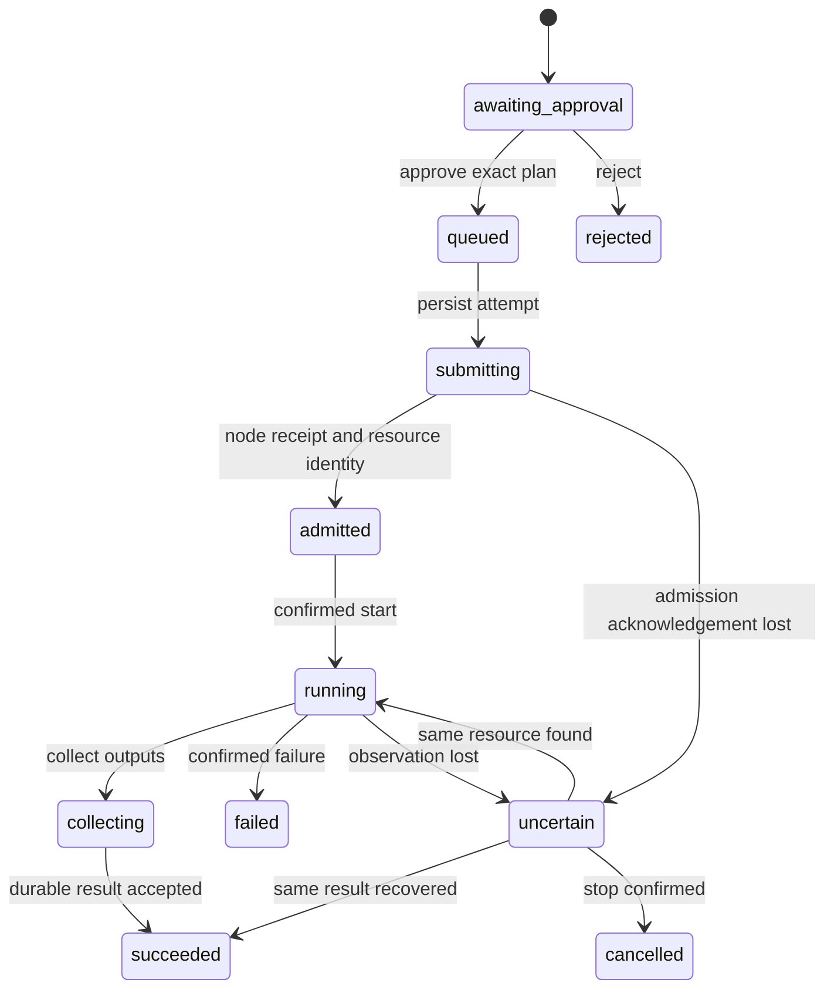

# Durable execution and task workflows

V3 keeps the existing Inbox → agent harness → Outbox architecture. Long commands run on an
owned execution computer. The control process stores the plan, approval, task revision and
execution receipts before sending work. Railway can continue hosting that control process;
this feature does not provision or require a paid cloud sandbox.

An execution computer needs Docker and a preinstalled image. It connects outbound to the
control service. Neither a public port on the computer nor an inbound SSH server is required.
HTTPS can be a Railway endpoint or a Tailscale HTTPS endpoint; plain HTTP is accepted only on
loopback. The phone is a browser/controller, not the execution host.

## Trust and data boundaries

Each collaboration space has a separate App, SQLite database, memory tree and workspace.
Identity and node grants live in the root directory database. A task belongs to the authenticated
principal and the selected space; callers cannot select another actor in a request body.

The node receives only the approved command, selected input snapshots, output path list and
execution limits. It receives no model API key, channel credential, control database or whole
workspace mount. Images are an operator choice, never an agent-supplied plan field.

The initial execution profile has **no network access**. Install dependencies in the node image
beforehand. A command cannot use `pip install`, clone a remote repository or call an external API
at runtime unless those operations are already satisfied by its prepared inputs/image. There
is no unrestricted host-shell fallback when Docker is unavailable.

Resource approval is separate from project membership. Writable members can propose tasks;
the designated resource approver defaults to the instance owner. Project membership alone
does not authorize consumption of someone else's execution computer. The owner can inspect
and approve a member's private execution plan through the resource review endpoint without
receiving general access to that person's private conversation or memory. The plan itself
necessarily discloses its command, selected filenames and hashes to the resource approver.

## First task

1. On the control computer, create a node invitation with `pa node invite --space personal-owner`.
   Additional `--space` arguments grant selected project spaces. The Workbench also creates
   a one-use node invitation.
2. On an owned execution computer, install Docker and the selected image. Pair with
   `pa node pair --url https://your-control.example`; enter the short-lived code at the prompt.
3. Start `pa node run --image python:3.12-slim`. The default node directory is
   `~/.personal-agent-node`. `pa node status` reports retained receipts without credentials.
4. In the Workbench's Tasks view, submit a command, optional workspace input paths, optional
   output paths and a timeout. The chat agent can also propose a task through `submit_job`.
5. Review the saved command, input hashes, output paths and timeout. Approve that exact plan
   hash. A node with the necessary space grant and capabilities can now claim it.
6. Inspect status, bounded logs and immutable result artifacts. Cancel from Tasks if needed.
   Cancellation of active work remains pending until the node confirms its final state.

Example offline command for the default Python image:

```sh
python -c 'from pathlib import Path; Path("report.txt").write_text("hello from the node\n")'
```

Declare `report.txt` as an output before approval. The result is published as an attachment;
it does not overwrite a file in the live control-plane workspace.

## Persisted objects

| Object | Responsibility |
| --- | --- |
| Task | Actor, selected conversation/recipient, revision, authorization snapshot and overall state |
| Job | One immutable step: command, timeout, input metadata, output paths, plan hash and designated approver |
| Attempt | Stable identity, generation, assigned node, resource-grant version, resource ID, final receipt and cleanup state |
| Input question | Versioned, single-use human question, choices, answer, answering principal and authorization audit |
| Input snapshot | Bounded file content saved separately from the immutable plan metadata |
| Observation | A redacted cumulative log snapshot with a monotonically increasing cursor |

`client_request_id` makes task creation idempotent within an actor and space. Repeating the
same key and content returns the existing task; changing the content produces HTTP 409.
Agent tools derive a stable key from the durable work ID and the tool's `task_key`.

Plans are saved **before** asking for approval. The approval binds to `plan_hash` and the
current task revision. Input files are snapshotted when the task is submitted, so editing a
workspace file afterwards cannot silently change what an approved node receives. A changed
command or input requires a new step/plan and a new approval.

## Lifecycle and recovery



The concrete runner may report a terminal result directly from `admitted` or `running` after
observing a fast process. `collecting` is a supported observation state, not a required extra
HTTP round trip. A task with no available node remains queued without consuming a conversation
worker. A stale live attempt becomes uncertain after the default 90-second observation window.

The control database creates an attempt ID **before** returning a claim. A lost response returns
the same ID, generation and approved plan. The node writes its durable local receipt before
creating the fixed-name Docker resource. Repeated requests reconcile that resource; they do
not create a second one. The first implementation does not automatically increment generations
or retry a command after an uncertain result.

A node runs one outstanding attempt across all its granted spaces. A fenced/uncertain attempt
continues to occupy that slot. The node also retains an unacknowledged final result and pending
cleanup across restarts. An HTTP response must explicitly acknowledge durable result acceptance
before the node removes its execution files/container. Cleanup failure retains a retryable
record; the compact receipt remains as a deduplication tombstone after cleanup.

Do not delete an uncertain receipt and resubmit to make the warning disappear. An absent
response or failed inspect does not prove that a command never ran. Inspect/recover the owned
node and its original resource first. This is at-most-one automatic execution attempt with
durable reconciliation, not a promise that arbitrary external effects are exactly once.

### Cancellation, edits and revocation

`desired_state=cancel` is distinct from an observed terminal state. A queued/unstarted job can
be cancelled immediately. A submitted/running/uncertain job remains `cancel_requested` at task
level until the node reports its result. A node that received the claim but never admitted a
resource can confirm a cancelled result with no exit code, logs or artifacts. Success always
requires a recorded resource admission and a zero exit code.

Local/container deadlines still apply if the network or controller disappears. Control-plane
deadlines request cancellation; they never infer that an unreachable process stopped. The
default timeout is 900 seconds, with an allowed range of 1–3600 seconds. Unstarted plans expire
after seven days.

Editing a task uses a compare-and-swap revision check and cancels outstanding old work. A late
result for an old revision remains historical evidence and cannot advance or notify the newer
revision. New steps in the revised task need new approval.

The saved membership and principal versions are rechecked before approval/claim and before
delivery. Revoking and subsequently rejoining a member does not revive their old work. A node
attempt also records the resource-grant version: removing and restoring a grant does not revive
the former authorization. Revoked resources receive a minimal cancellation status, not a fresh
copy of task input bytes. Current resource capabilities must still cover the approved plan.

Completion, one Inbox receipt and the fixed-recipient Outbox notice commit in one transaction.
Artifact publication participates in that transaction. Duplicate final acknowledgements do not
create a second notification or artifact. Both the notice and artifacts carry the original
principal/membership versions, so revocation between completion and dispatch also prevents
delivery. Completion receipts are marked processed by default: finishing a command does not
automatically consume more model tokens. Explicit `wake_on_completion` is an internal opt-in.

## Two-step workflows

The Workbench task detail can append steps, request answers, cancel work and create a revised
task. The corresponding API supports the same workflow, up to eight consecutive
steps. Each step is saved independently and needs its own approval. Step 2 is claimable only
after step 1 succeeded; failed/rejected/expired dependencies cancel queued successors.

All browser writes use the normal signed-in `pa_session` cookie, correct `Origin` and `X-PA: 1`.
Use `?space=SPACE_ID` on the following routes when selecting a project. Example bodies contain
placeholders rather than live credentials.

Create the task with `POST /api/v3/tasks`:

```json
{
  "client_request_id": "report-2026-01",
  "title": "Prepare a report",
  "command": "python -c 'print(\"input validation complete\")'",
  "timeout_s": 60,
  "input_paths": [],
  "output_paths": []
}
```

Save a second step with `POST /api/v3/tasks/TASK_ID/steps`:

```json
{
  "expected_revision": 1,
  "step_id": "2",
  "command": "python -c 'from pathlib import Path; Path(\"report.txt\").write_text(\"ready\")'",
  "timeout_s": 60,
  "input_paths": [],
  "output_paths": ["report.txt"]
}
```

The requester or a project manager can append a step. Repeating the same step number and plan
returns its existing job; a different plan under that number conflicts. Approve each job with
`POST /api/v3/jobs/JOB_ID/approve` and the exact returned `plan_hash`:

```json
{"allowed": true, "plan_hash": "PLAN_HASH_FROM_THE_SAVED_JOB"}
```

The instance owner may instead use `POST /api/v3/review-jobs` with `space_id`, `job_id`,
`allowed` and `plan_hash`. This is the review path for a member's private task.

Workflow dependencies determine order only. Outputs are **not** automatically substituted
into a later approved command or silently copied into its input snapshot. To use a new result,
inspect the immutable artifact, deliberately place the chosen file in the space workspace,
and submit/approve the next step's exact input snapshot. This prevents a later file change or
untrusted process output from changing an already approved execution.

## Waiting for a person's answer

Use the task detail's input request form, the agent tool `ask_task_input`, or
`POST /api/v3/tasks/TASK_ID/questions`:

```json
{
  "expected_revision": 1,
  "request_id": "choose-report-format",
  "question": "Which report format should the next step use?",
  "choices": ["text", "csv"]
}
```

Only the requester or a manager can pause a task, and no submitted/running/uncertain attempt
may exist. The task becomes `waiting_input`; queued jobs cannot be claimed. There is one open
question at a time, up to ten choices and up to sixteen questions per task revision. An empty
choices list allows a text answer of at most 4000 characters.

A writable member answers in task detail or with
`POST /api/v3/tasks/TASK_ID/questions/QUESTION_ID/answer`:

```json
{"expected_revision": 1, "answer": "csv"}
```

An identical repeat by the same answering principal returns the saved answer. A conflicting
answer, stale task revision, cancelled question or changed authorization is rejected. Viewer
members cannot answer. Cancellation, revision changes and expiry close outstanding questions.
The audit records who asked, who answered, when, and the answering authorization versions.

Answering releases the pause on existing queued work, preserving the exact original plan and
approval. The answer is untrusted evidence visible through task status; it never gets interpolated
into a shell command and does not trigger a model loop. If the answer changes what should run,
create a separate step/plan and approve it. Do not approve a command that you intend an answer
to rewrite later.

## Limits and artifact behavior

| Limit | Default / behavior |
| --- | --- |
| Files in one transfer | 64 |
| Individual file | 2 MiB |
| Total raw transferred input/output content | 8 MiB per manifest |
| Input snapshot storage | 64 MiB per space; released on unstarted cancellation/rejection/expiry or acknowledged node cleanup |
| Pending jobs | 100 per space |
| New tasks | 100 per rolling 24 hours per space |
| Command length | 16,000 characters |
| Timeout | 900 seconds; 1–3600 allowed |
| Live log retention | Last 8 cumulative snapshots, each at most 64,000 characters |
| Final output | Bounded stdout/stderr, each at most 64,000 characters |
| Node resource defaults | 1 CPU, 512 MiB RAM; operator config controls the node |

Reads, cancellation and reconciliation remain available after an execution quota is reached.
These are execution admission/storage limits; they are separate from model-token/cost budgets.
Keep the single control process and persistent volume deployment model for SQLite.

File manifests bind relative paths, size and SHA-256. Transfers reject traversal, absolute
paths, duplicate entries, symlinks, hard links and credential/control paths such as `.env`,
`.ssh` and `.git`. Snapshots verify a file did not change while being read. Node-produced files
must be explicitly listed in the approved output paths and pass the same manifest validation.

Collected files are staged under a generated `.pa-jobs/JOB_ID/` directory, published through
the existing immutable `ArtifactStore`, and checked against the declared hash/size. They use
the existing artifact quotas, download authentication and expiry settings. They do not replace
working files. Confirmed cleanup removes the recorded temporary staging copies and input
snapshots, preserving the immutable published artifact. A failed publication leaves the node result unacknowledged for recovery instead
of claiming success and discarding the only copy.

Logs are redacted cumulative snapshots rather than independently redacted chunks: this avoids
revealing a known secret split across two updates. `GET /api/v3/attempts/ATTEMPT_ID/logs?after=N`
returns cursor-addressed snapshots. Render the newest snapshot as the current log; do not
concatenate every snapshot. Old snapshots may be pruned, so a resumed viewer can skip directly
to the newest retained cursor. Treat all process output and artifact content as untrusted.

## Implementation and verification

- `execution/schema.py`: per-space persistent tasks, jobs, attempts, questions and inputs.
- `execution/store.py`: approval/revision/auth fences, idempotency, state transitions,
  bounded observations, atomic completion and reconciliation.
- `execution/workspaces.py`: descriptor-based safe file snapshots and result staging.
- `tools/jobs.py`: submit, inspect, cancel and structured input tools.
- `channels/web/collaboration.py`: authenticated task/workflow/node routes.
- `nodes/`: outbound runner, durable node receipts, Docker backend and transport.

`tests/test_execution_v3.py` covers restart and lost acknowledgements, late/stale results,
revocation, quotas, dependency failures, atomic artifact rollback and input pauses.
`tests/test_v3_execution_http.py` covers browser/node authorization, cross-space isolation,
resource approval, grant revocation/regrant, single-use answers and the complete result path.
Node backend/transport tests cover the other half of the execution protocol. CI uses controlled
backend fakes; `tests/js/workbench.test.mjs` exercises the actual task renderers/form handlers
with the repository's DOM test fixture. A deployment still needs a real Docker smoke run on
the chosen execution host and a browser check at phone/desktop widths. These tests do not
claim to validate a live Docker daemon or browser layout.
