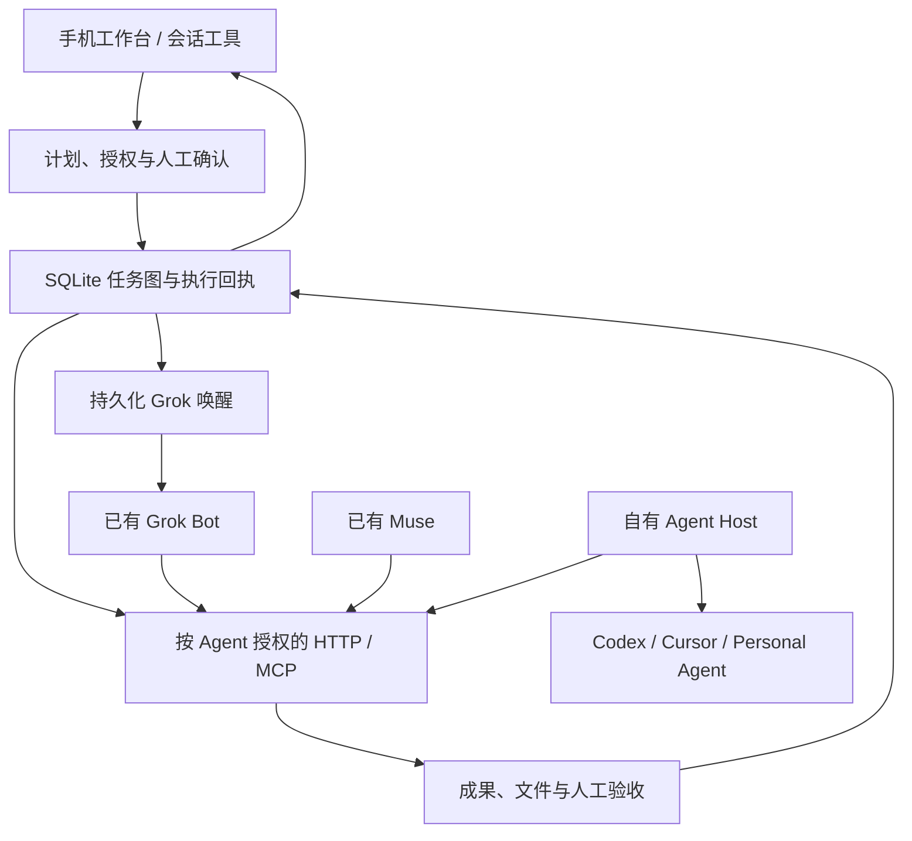

# 0.4.0 多 Agent 协作

## 目标与边界

把已有的 Grok Bot、Muse、自有电脑上的 Codex / Cursor 和本项目 Agent 接入一个可从手机操作的任务台。控制端保留原有 Inbox、Timers、Memory、Permissions、Outbox；新增独立协作账本，不替换原有离线 Docker 命令执行器，不增加 Redis、队列集群或付费云沙箱。

适用个人与少量可信协作者。原生 SaaS 账号、订阅、已有登录、模型用量和 CLI 授权仍属于各执行端。任务平台能够约束自己交给执行端的数据和工具，不能收回原生产品本来就拥有的权限，也不能保证供应商只扣一次费用。

## 能力对应

| 执行端 | 派发与运行 | 结果与取消 | 必须先配置 |
| --- | --- | --- | --- |
| Grok Bot | 已批准任务落盘后调用官方 Routine webhook；Bot 从 HTTP/MCP/Bridge 领取 | 主动心跳、问答、文件和结果回传；取消是协作协议，须原生执行端停止 | 每个 Bot 的 worker token；Routine URL/key 的环境变量引用；原生 Routine 指令 |
| Muse | HTTP/MCP/Bridge 主动领取；手动启动或账号原生 schedule | 同一任务协议；不假设公开的 session/cancel/wake API | 账号能调用外部工具；配置连接或运行 Bridge；原生 schedule 单独验证 |
| Codex | 自有 Host 启动 `codex app-server`，标准输入输出协议 | 原生事件、审批、取消与本地回执 | 该机器的 CLI、明确选定的工作目录、原生登录 |
| Cursor | 自有 Host 启动 `agent acp`，复用官方 ACP Python SDK | session 更新、权限、问题、计划和取消 | 该机器的 CLI、原生登录、所需 ACP 能力 |
| Personal Agent | 自有 Host 的独立 profile，复用既有 Harness / ToolGuard | 原有副作用审批映射到手机问题；独立会话和结果 | 专用 profile 配置与模型凭据，不能自动沿用个人记忆目录 |

HTTP/MCP 证明的是我们的任务协议可用；Grok/Muse 的账号权限、连接器安装、原生自动触发仍需真实账号验收。缺少账户配置时，注册记录显示等待连接或领取，不生成虚假的执行成功。

## 架构



控制端只向 Grok 发送固定协议标识与不透明的 wake/agent/task ID。完整任务正文通过已鉴权的领取接口提供。Muse 和自有 Host 使用出站 HTTPS，无需对外开放本机 CLI 服务端口。局域网或 Tailscale 可用于执行端访问控制端；是否能从云产品访问该路径，要按其实际网络能力配置。[Grok/Muse 具体步骤](CLOUD_AGENTS.md)与[现有手机连接说明](MOBILE.md)分别说明账号接入和网络接入。

### 代码职责

| 路径 | 职责 |
| --- | --- |
| `orchestration/store.py` | Agent 授权、不可变计划、DAG 依赖、原子领取、租约、状态转换、验收和恢复 |
| `orchestration/service.py` | 常驻服务中的轻量调度；先保存 wake，再进行一次受控 HTTPS 请求 |
| `orchestration/artifacts.py` | 有大小和配额限制的不可变结果文件；与结果回执一起提交 |
| `channels/web/agents.py` | 浏览器账号与 worker token 两类接口；认证先于读取正文，修改前事务内再次认证 |
| `channels/web/agent_mcp.py` | 官方 MCP SDK 的无状态 HTTP 传输，复用同一 worker 权限和账本 |
| `channels/web/agent_openapi.py` | 由严格 Pydantic 契约生成每个 Agent 的 API 定义 |
| `agent_adapters/cloud.py` | Grok Routine Bearer/200 合同、SSRF 控制、响应分类，不读取原生响应正文 |
| `agent_adapters/bridge.py` | 可直接下载的标准库脚本；私有凭据、稳定领取 ID、本地回执和同正文重试 |
| `agent_adapters/host.py` | 自有机器上的单实例运行、目录占用、心跳、原生审批与结果回传 |
| `agent_adapters/codex.py` / `cursor.py` / `native_pa.py` | 原生运行时适配；不拥有任务授权决定权 |
| `tools/agents.py` | 对话中列连接、拟定计划、查任务、请求取消；模型没有批准计划或签发 worker token 的工具 |
| `static/orchestration.js` | 手机连接、任务草稿、外发计划确认、问答、成果验收和停止核对 |

## 使用流程

1. 在目标空间的 **Agents** 中建立连接；每个原生 Bot/执行端分别注册。仅首次展示 token，轮换后原 token 失效。
2. 从接入指引复制 MCP 地址、下载 OpenAPI 定义，或下载单文件 Bridge。Bearer 凭据放在执行端的连接设置或私密环境中，不写进任务提示和 Git。
3. 在 **Tasks → Agent 协作** 填目标、验收标准和各步骤要求。可选择并行、顺序或「并行后汇总」；API 支持一般无环依赖图。
4. 核对完整外发正文和可见范围，然后确认计划。计划保存和执行授权是两个独立操作。
5. Grok 自动发送一次已配置的 Routine 唤醒；Muse 等待其手动/原生定时领取；自有 Host 在线时领取。
6. 执行端持续续租，可请求补充信息。手机上回答问题不等于授权所有后续动作；原生工具审批仍按对应执行器规则处理。
7. 候选成果进入验收。人工确认当前 attempt、revision 和 plan hash 后，后继步骤才获得该成果。

对话中也可说“让 Grok 调研，再让 Muse 整理”。`delegate_agents` 只保存计划；工作台中的确认决定是否派发。任务有稳定 ID，对话无需等待远端完成，也不应反复轮询模型。

## 状态与恢复

| 记录 | 含义与处理 |
| --- | --- |
| `planned` | 计划待确认，尚未执行 |
| `queued` | 已批准，等待合格的执行端领取 |
| wake `sent` | 唤醒请求得到指定接收回执，尚不证明领取或完成 |
| wake `uncertain` | 请求可能已经送达；禁止自动再次发送 |
| `claimed` / `running` | 已取得一次执行权 / 有运行进度或心跳 |
| `waiting_input` | 执行端在等回答；回答后仍需执行端恢复 |
| `result_reported` | 记录了结果，尚未人工验收 |
| `accepted` | 当前步骤通过验收，依赖可继续 |
| `cancelling` | 已请求停止，尚无足够的终止证据 |
| `uncertain` | 租约过期、进程状态或结果未知；保留占用，禁止自动新开执行 |
| `stopped` | 资源所有者核对原生执行已停止，并留下说明；需要新计划才能重新尝试 |

### 保证与实际限制

- **领取幂等：** 每次原生调用生成一个稳定 `worker_id`。丢失领取响应时复用它，取回原 attempt；新 nonce 不会绕过仍运行或未知的占用。
- **外发先落盘：** webhook 请求之前保存 wake ID。进程崩溃、5xx、超时或不明确的接收状态不会触发盲目重发。
- **结果重试：** Bridge 私有 outbox 保存原正文与事件序号。只重试同一回执，不因结果传输失败再次执行任务。
- **停止未知执行：** 先在原生产品/拥有的机器上核对和停止，再由资源所有者在工作台确认；按钮本身不是远程 kill 命令。
- **未领取的唤醒：** 即使原计划已取消或过期，未知唤醒仍可能占用自动唤醒额度。所有者确认原生唤醒已结束或未发生后才解除；原计划不会被重发。
- **身份变更：** 连接配置、令牌轮换、撤权会使旧授权失效。旧凭据不能继续读取或提交；保留执行端本地回执用于人工核对。换成同一 Agent 的有效凭据后，Host 只能跨代读取最小停止确认（状态、代际和确认人/时间），不能读取旧正文、结果或 lease；仅凭据轮换不会解除执行占用。
- **服务重启：** 任务、回执、问题和验收在 SQLite 中；页面关闭不影响后台。Host 重启只恢复已保存的传输回执，无法证明旧原生执行结束时不启动第二个写者。
- **失败传播：** 必需步骤失败、拒绝或取消时，父任务不会被标记成功；依赖步骤会停止。失败结果不能以“验收”变成成功。

## 授权、可见范围和秘密

控制台只向请求者展示私人任务；项目管理员不会自动获得他人的私人任务正文。执行端会收到明确派给它的步骤内容，能管理该原生账号或机器的人可能访问这些内容，因此这里的可见范围不等于对执行资源所有者的加密隔离。明确选择空间共享后，当前空间成员可查看，viewer 不能修改。创建任务还需要资源所有者授予该成员使用对应 Agent 的权限，项目所有者身份本身不包含这个授权。

Grok 连接强制标识为共享原生环境。同一原生账号下多个 Bot 的 worker token 互相独立，但它们可能共享原生文件、历史、浏览器和已有授权。跨所有者的私人任务不能进入标记为共享的执行环境；应明确选择空间共享或使用独立账号/隔离执行端。本版按 Agent 串行，未把多个 SaaS 账号的完整供应商配额抽象为统一资源池。

控制数据库只存 worker token 的哈希；独立的 claim lease 标识只对该 Agent 返回，浏览器任务记录不含它。Grok webhook URL/key 存在部署环境，数据库仅记录变量名称。只有实例管理员能配置这些引用。正文、进度和文件回传过滤已知凭据；文件名与文件内容中的已知连接秘密会被拒绝。

worker token 不能访问网页会话、成员管理、其他 Agent 队列或未获准的依赖文件。浏览器接口保留 Cookie、Origin 和 CSRF 检查；仅无 Cookie、明确 Bearer 的 worker 路由支持标准机器/MCP 客户端，Host 和已提供的 Origin/Fetch Metadata 仍受校验。

## 配额与费用

- 工作台/API 每个计划最多 16 步；任务等待和执行的总期限为 60 秒至 7 天。
- 每个 Agent 同时最多一个尚未明确停止的 attempt；同一代连接最多一个未被领取消费的唤醒。
- HTTP/Bridge 单文件最多 2 MiB、一次结果文件合计 8 MiB、每空间文件总量 128 MiB；结果 JSON 请求最多 16 MiB。OpenAPI 连接器可取 base64 JSON 文件，Bridge 使用二进制下载。
- 文件 SHA-256 和字节数由服务端核验；同 attempt 同名文件不能换内容。下载始终经过任务/依赖授权。
- 控制循环仅检查数据库和轻量 HTTP，不在空队列上调用模型。Muse 的原生定时器是否产生模型用量由平台决定。
- 控制端已有模型预算继续有效；独立 Personal Agent runtime 执行单次费用限制，跨 attempt 的 profile 日费用尚未聚合。外部 Grok/Muse/Codex/Cursor 的费用来源也未统一，不能把未知费用显示为零，也不能把期限当成供应商硬性费用上限。

## 升级与回退

先备份整个实例及各空间数据库、持久卷和私有配置。停止旧进程，更新依赖后再启动：

```bash
uv sync --frozen
uv run pa serve
```

新增协作账本和文件表，数据库由 schema 12 升到 14。旧任务、离线 Docker Runner 和原有 Web/V3 API 保持独立。回退到 0.3.2 时必须同时恢复升级前的数据库快照；旧版本会拒绝较新的 schema，不能只回退代码。

生产上保持单个控制进程与持久卷。机器和浏览器接入使用现有 HTTPS、局域网或 Tailscale 方案。不要把 Codex app-server/ACP stdio 直接暴露为公网服务。

## 验证口径

测试区分三层：状态机与权限；真实应用 HTTP/MCP、持久 Bridge 和受控原生协议进程；实际供应商账户。前两层通过不能替代第三层。发布记录应注明测试数量、命令、CLI/SDK 版本和未完成的账号验收；提供连接地址与模板，不把未配置账号报告为已远程调度成功。

首次生产接入用无副作用任务验证：领取同一个 task ID、回传一段文字与小文件、手机验收、随后测试取消和断线恢复。Grok 的 webhook 唤醒单独验收；Muse 手动领取与自动触发单独验收。
