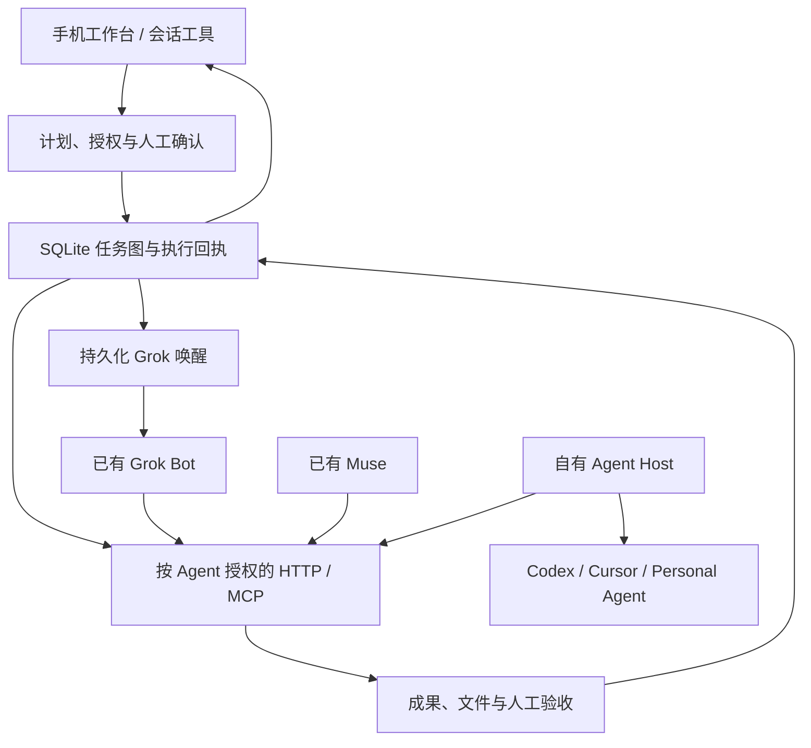

# 0.4.0 多 Agent 协作

## 目标和边界

把你已有的 Grok Bot、Muse、你自己电脑上的 Codex / Cursor，以及本项目自己的 Agent，接到同一个能在手机上操作的任务台里。服务端保留原有的 Inbox、Timers、Memory、Permissions、Outbox；另外新增一本独立的协作账本。它不替换原来的离线 Docker 命令执行器，也不增加 Redis、队列集群或付费云沙箱。

适合个人和少数可信的协作者。原生 SaaS 账号、订阅、已有的登录、模型用量和 CLI 授权，仍然归各个执行端自己管。任务平台能管住的，是它自己交给执行端的数据和工具；它收不回原生产品本来就有的权限，也不能保证供应商只扣一次费。

## 各执行端能做什么

| 执行端 | 怎么派发、怎么运行 | 结果和取消 | 必须先配置 |
| --- | --- | --- | --- |
| Grok Bot | 已批准的任务落盘后，调用官方的 Routine webhook；Bot 通过 HTTP / MCP / Bridge 来领取 | 主动发心跳、提问、回传文件和结果；取消是协作式的协议，要由原生执行端去停 | 每个 Bot 的 worker token；Routine URL / key 的环境变量引用；原生 Routine 指令 |
| Muse | 通过 HTTP / MCP / Bridge 主动领取；手动启动，或用账号原生的 schedule | 同一套任务协议；不假设有公开的 session / cancel / wake API | 账号能调用外部工具；配好连接或运行 Bridge；原生 schedule 单独验证 |
| Codex | 自有 Host 启动 `codex app-server`，走标准输入输出协议 | 原生事件、审批、取消和本地回执 | 这台机器上的 CLI、明确选定的工作目录、原生登录 |
| Cursor | 自有 Host 启动 `agent acp`，复用官方的 ACP Python SDK | session 更新、权限、问题、计划和取消 | 这台机器上的 CLI、原生登录、需要的 ACP 能力 |
| Personal Agent | 自有 Host 里的独立 profile，复用现有的 Harness / ToolGuard | 原有的副作用审批，映射成手机上的问题；独立的会话和结果 | 专用的 profile 配置和模型凭据，不能自动沿用个人的记忆目录 |

HTTP / MCP 能证明的，是我们的任务协议能用；Grok / Muse 的账号权限、连接器安装、原生的自动触发，仍然要用真实账号验收。缺少账户配置时，注册记录显示“等待连接”或“等待领取”，不会生成虚假的“执行成功”。

## 架构



服务端只向 Grok 发送固定的协议标识，和不透明的 wake / agent / task ID。完整的任务正文，通过已鉴权的领取接口提供。Muse 和自有的 Host 都用出站 HTTPS，不需要对外开放你本机的 CLI 服务端口。执行端访问服务端，可以走局域网或 Tailscale；云产品能不能访问这条路径，要按它实际的网络能力去配。[Grok / Muse 的具体步骤](CLOUD_AGENTS.md)和[现有的手机连接说明](MOBILE.md)，分别讲账号接入和网络接入。

### 代码职责

| 路径 | 负责什么 |
| --- | --- |
| `orchestration/store.py` | Agent 授权、不可变的计划、DAG 依赖、原子领取、租约、状态转换、验收和恢复 |
| `orchestration/service.py` | 常驻服务里的轻量调度；先保存 wake，再发一次受控的 HTTPS 请求 |
| `orchestration/artifacts.py` | 有大小和配额限制的、不可变的结果文件；和结果回执一起提交 |
| `channels/web/agents.py` | 浏览器账号和 worker token 两类接口；先认证、再读正文，修改之前在事务里再认证一次 |
| `channels/web/agent_mcp.py` | 官方 MCP SDK 的无状态 HTTP 传输，复用同一套 worker 权限和账本 |
| `channels/web/agent_openapi.py` | 由严格的 Pydantic 契约，生成每个 Agent 的 API 定义 |
| `agent_adapters/cloud.py` | Grok Routine 的 Bearer / 200 约定、SSRF 控制、响应分类；不读取原生响应的正文 |
| `agent_adapters/bridge.py` | 可以直接下载的标准库脚本；私有凭据、稳定的领取 ID、本地回执，以及用同样的正文重试 |
| `agent_adapters/host.py` | 自有机器上的单实例运行、目录占用、心跳、原生审批和结果回传 |
| `agent_adapters/codex.py` / `cursor.py` / `native_pa.py` | 各原生运行时的适配；它们没有任务授权的决定权 |
| `tools/agents.py` | 在对话里列出连接、拟计划、查任务、请求取消；模型没有批准计划或签发 worker token 的工具 |
| `static/orchestration.js` | 手机上的连接、任务草稿、外发计划确认、问答、成果验收和停止核对 |

## 使用流程

1. 在目标空间的 **Agents** 里建连接；每个原生的 Bot 或执行端，分别注册。token 只在第一次显示，轮换之后，原来的 token 就失效了。
2. 从接入指引里复制 MCP 地址、下载 OpenAPI 定义，或者下载单文件 Bridge。Bearer 凭据放在执行端的连接设置或私密环境里，不写进任务提示，也不写进 Git。
3. 在 **Tasks → Agent 协作** 里填目标、验收标准和各个步骤的要求。可以选并行、顺序，或者“并行后汇总”；API 支持一般的无环依赖图。
4. 核对完整的外发正文和可见范围，然后确认计划。“保存计划”和“授权执行”是两个独立的操作。
5. Grok 会自动发出一次已配置的 Routine 唤醒；Muse 等着它手动、或原生定时来领取；自有的 Host 在线时去领取。
6. 执行端持续续租，也可以请求补充信息。你在手机上回答了问题，不等于授权了所有后续的动作；原生的工具审批，仍按对应执行器自己的规则处理。
7. 候选成果进入验收。你确认当前的 attempt、revision 和 plan hash 之后，后面的步骤才能拿到这份成果。

在对话里也可以说“让 Grok 调研，再让 Muse 整理”。`delegate_agents` 只保存计划；工作台里的确认，才决定会不会派发。任务有稳定的 ID，对话不用等远端做完，也不该反复轮询模型。

## 状态与恢复

| 记录 | 含义，以及怎么处理 |
| --- | --- |
| `planned` | 计划等你确认，还没开始执行 |
| `queued` | 已批准，等合格的执行端来领 |
| wake `sent` | 唤醒请求得到了约定的接收回执；这还不能证明已领取或已完成 |
| wake `uncertain` | 请求可能已经送到了；禁止自动再发一次 |
| `claimed` / `running` | 已经拿到一次执行权 / 有运行进度或心跳 |
| `waiting_input` | 执行端在等回答；回答之后，仍然要执行端自己恢复 |
| `result_reported` | 记录了结果，还没人工验收 |
| `accepted` | 当前步骤通过验收，依赖它的步骤可以继续 |
| `cancelling` | 已经请求停止，但还没有足够的终止证据 |
| `uncertain` | 租约过期、进程状态未知或结果未知；保留占用，禁止自动开新的执行 |
| `stopped` | 资源所有者核对过原生执行已经停了，并留下说明；要重新尝试，需要新的计划 |

### 保证，和实际的限制

- **领取是幂等的：** 每次原生调用生成一个稳定的 `worker_id`。领取的响应丢了，就复用它，取回原来的 attempt；换一个新的 nonce，绕不开仍在运行或状态未知的占用。
- **先落盘，再外发：** 发 webhook 之前，先保存 wake ID。进程崩溃、5xx、超时或接收状态不明确，都不会触发盲目的重发。
- **结果重试：** Bridge 的私有 outbox 保存原来的正文和事件序号。只重试同一份回执，不会因为结果传输失败，就再执行一次任务。
- **停止状态未知的执行：** 先在原生产品或你拥有的机器上核对并停掉，再由资源所有者在工作台里确认；这个按钮本身不是远程 kill 命令。
- **没被领取的唤醒：** 就算原来的计划已经取消或过期，结果未知的唤醒，仍可能占用自动唤醒的额度。所有者确认原生的唤醒已经结束、或根本没发生之后，才会解除；原来的计划不会被重发。
- **身份变更：** 连接配置、令牌轮换、撤销授权，都会让旧的授权失效。旧凭据不能再读取或提交；执行端本地的回执保留下来，用于人工核对。换成同一个 Agent 的有效凭据之后，Host 只能跨代读取最少的停止确认（状态、代际，以及确认的人和时间），读不到旧的正文、结果或 lease；光是轮换凭据，不会解除执行占用。
- **服务重启：** 任务、回执、问题和验收都在 SQLite 里；关掉页面不影响后台。Host 重启时，只恢复已保存的传输回执；如果没法证明旧的原生执行已经结束，就不会再启动第二个“写者”。
- **失败的传播：** 必需的步骤失败、被拒绝或被取消时，父任务不会被标成成功；依赖它的步骤会停下来。失败的结果，不能靠“验收”变成成功。

## 授权、可见范围和秘密

控制台只向请求者本人展示他的私人任务；项目管理员不会自动拿到别人的私人任务正文。执行端会收到明确派给它的步骤内容，而能管理那个原生账号或机器的人，可能看到这些内容；所以这里说的可见范围，并不等于对资源所有者的加密隔离。明确选择“空间共享”之后，当前空间的成员可以查看，viewer 不能修改。创建任务，还需要资源所有者授权这位成员使用对应的 Agent；项目所有者的身份，本身并不包含这项授权。

Grok 连接被强制标记为共享的原生环境。同一个原生账号下的多个 Bot，各自的 worker token 互相独立，但它们可能共享原生的文件、历史、浏览器和已有的授权。不同所有者的私人任务，不能进入标记为共享的执行环境；请明确选择“空间共享”，或者用独立的账号 / 隔离的执行端。这个版本按 Agent 串行执行，没有把多个 SaaS 账号完整的供应商配额，抽象成一个统一的资源池。

控制数据库只存 worker token 的哈希；独立的 claim lease 标识，只对这个 Agent 返回，浏览器里的任务记录不含它。Grok webhook 的 URL / key 放在部署环境里，数据库只记变量名。只有实例管理员能配置这些引用。正文、进度和文件回传，会过滤已知的凭据；文件名和文件内容里，出现已知的连接秘密，会被拒绝。

worker token 不能访问网页会话、成员管理、其他 Agent 的队列，或没获准的依赖文件。浏览器接口仍保留 Cookie、Origin 和 CSRF 检查；只有不带 Cookie、明确使用 Bearer 的 worker 路由，才支持标准的机器 / MCP 客户端，而 Host 和已提供的 Origin / Fetch Metadata，仍然会被校验。

## 配额与费用

- 工作台 / API 里，每个计划最多 16 步；任务等待加执行的总期限，从 60 秒到 7 天。
- 每个 Agent 同时最多一个还没明确停止的 attempt；同一代连接，最多一个还没被领取消费的唤醒。
- HTTP / Bridge 单个文件最多 2 MiB，一次结果的文件合计最多 8 MiB，每个空间的文件总量最多 128 MiB；结果的 JSON 请求最多 16 MiB。OpenAPI 连接器可以用 base64 的 JSON 文件，Bridge 用二进制下载。
- 文件的 SHA-256 和字节数，由服务端核验；同一个 attempt 里，同名的文件不能换内容。下载始终要经过任务和依赖的授权。
- 控制循环只检查数据库和轻量的 HTTP，不会在空队列上调用模型。Muse 的原生定时器会不会产生模型用量，由平台决定。
- 服务端已有的模型预算继续有效；独立的 Personal Agent runtime 会限制单次的费用，跨 attempt 的 profile 日费用还没有汇总。外部的 Grok / Muse / Codex / Cursor，费用来源也没有统一，所以不能把未知的费用显示成零，也不能把期限当成供应商的硬性费用上限。

## 升级与回退

先备份整个实例，以及各空间的数据库、持久卷和私有配置。停掉旧进程，更新依赖，再启动：

```bash
uv sync --frozen
uv run pa serve
```

新增了协作账本和文件表，数据库的 schema 从 12 升到 14。旧任务、离线的 Docker Runner 和原有的 Web / V3 API，各自独立，不受影响。要回退到 0.3.2，必须同时恢复升级前的数据库快照；旧版本会拒绝较新的 schema，不能只回退代码。

生产环境保持单个服务进程，配一个持久卷。机器和浏览器的接入，用现有的 HTTPS、局域网或 Tailscale 方案。不要把 Codex app-server / ACP 的 stdio，直接暴露成公网服务。

## 验证口径

测试分三层：状态机和权限；真实的应用 HTTP / MCP、持久的 Bridge 和受控的原生协议进程；实际的供应商账户。前两层通过了，也替代不了第三层。发布记录里要写明：测试数量、命令、CLI / SDK 版本，以及还没完成的账号验收；提供连接地址和模板，不要把没配置的账号，报告成“已经远程调度成功”。

第一次生产接入，用没有副作用的任务来验证：领取同一个 task ID，回传一段文字和一个小文件，在手机上验收，然后测试取消和断线恢复。Grok 的 webhook 唤醒，单独验收；Muse 的手动领取和自动触发，也各自单独验收。
