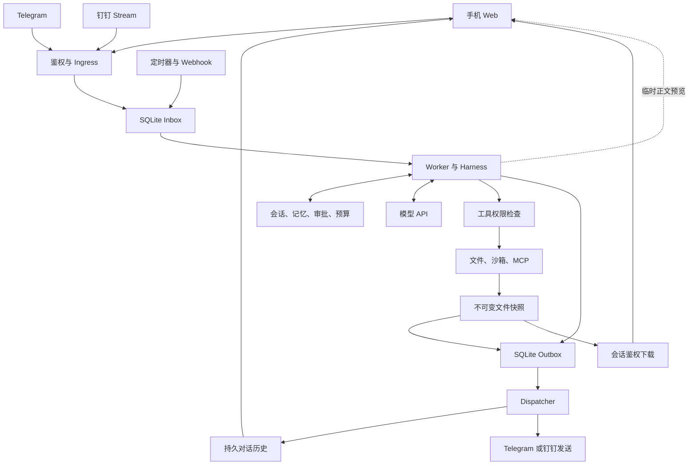

# 0.2.0：渠道、流式回复与文件成果

本版基于 `215358b6ce2b6e66315552ecbd156f263234aa8b`，补齐从手机提出任务、等待执行、处理审批到拿到文件的使用链路。保留现有 SQLite 内核、OpenAI Agents SDK、权限规则和审批恢复机制。

## 1. 能用来做什么

| 使用场景 | 本版实现 | 入口与边界 |
| --- | --- | --- |
| 手机日常聊天 | Web 正文流式预览；已有图片、录音、审批、任务状态继续可用 | 局域网或 Tailscale；网页关闭后无系统 Web Push |
| 国内聊天入口 | 钉钉企业应用机器人私聊，Stream 接收、OpenAPI 发送 | 需要应用凭据、机器人能力和平台权限；不支持群聊、钉钉语音或原生审批卡片 |
| 长任务交付文件 | `publish_artifact` 固化工作区文件，持久排队交付 | Web 鉴权下载；Telegram `sendDocument`；其他渠道指向 Web |
| 采用不同模型服务 | 自定义模型密钥变量、兼容端点、托管搜索能力声明 | 仍须兼容 Agents SDK 使用的 API 和工具调用协议 |
| 语音独立服务 | 语音单独配置端点、密钥和模型 | 仍为 OpenAI 兼容的转写 HTTP API；可通过 Python 注入替换 `Transcriber` |
| 检查渠道是否可用 | `pa channels`、`pa channels capabilities`、`pa doctor` | 配置已启用与后台已连通分别描述；探针不发送真实聊天 |

模型生成的中间文字可以变化；真正完成的回答和交付记录仍以持久历史为准。

## 2. 实现架构



### 入站与配对

Web 使用已有配对 cookie；Telegram 与钉钉使用 `PairingStore`，陌生发送者只能申请配对，本机 CLI 批准后才能进入模型。钉钉身份同时绑定应用、企业和员工标识，切换机器人或企业不会沿用另一套身份的批准。

钉钉消息通过向平台发起的 HTTPS/WSS 连接接收。回调在本地事务提交后才 ACK；`msgId` 按应用和企业命名去重。上游机器人回调不承诺断线期间重放，因此“本地持久接收”不等于离线期间永不漏消息。发送使用应用凭据对应的 OpenAPI，不持久化带访问权的 `sessionWebhook` URL。

实现：[DingTalk channel](../src/personal_agent/channels/dingtalk/channel.py)、[API](../src/personal_agent/channels/dingtalk/api.py)、[Ingress](../src/personal_agent/channels/ingress.py)。协议、权限和手动验收见 [DINGTALK.md](DINGTALK.md)。

### 模型流式与持久历史

只有启用 Web 流式的可信前台 Web 请求使用 `Runner.run_streamed`。消费器仅处理公开正文事件，推理文本、工具参数及后台任务正文不进入预览。流结束后走同一条预算、审批暂停、结果入 Outbox 的路径。

`LiveBus` 为每个 run 保留有限的临时正文快照，先清除危险控制字符、修复孤立 Unicode surrogate，再脱敏。已知密钥的半截前缀在后续字符到达前暂不展示，避免逐块脱敏泄露密钥。此保护针对注册凭据及现有检测规则，不承诺识别模型输出中的一切敏感信息。

SSE 的 `drafts` 是可替换快照，不带持久事件 ID；只有已提交的 `turn` 推进历史游标。重连时 `hello` 带当前预览，之后补放历史。最终答复具有 `final_response` 标记，旧审批或中间文件通知不会误删正在恢复的预览。旧连接的异步回调不能覆盖新连接。

浏览器断开不取消任务。worker 被取消、超时、失败或等待审批时会清理预览并结束 SDK 消费；不会把失败流式请求静默重发为非流式。既有任务重试仍受 Inbox、审批和工具幂等规则约束。

实现：[streaming.py](../src/personal_agent/harness/streaming.py)、[live.py](../src/personal_agent/core/live.py)、[Web API](../src/personal_agent/channels/web/api.py)、[客户端状态](../src/personal_agent/channels/web/static/store.js)。

### 文件交付

`publish_artifact` 在现有文件工具和权限检查后执行，从工作区安全打开一个已完成的普通文件，将字节固化到独立存储；在同一数据库事务中登记元数据并创建 Outbox 通知。源文件随后改变或删除不会改变已发布成果。

快照含大小、SHA-256、到期时间、会话/run/work 关联；默认单文件 10 MiB、总活跃字节 200 MiB、活跃文件 1,000 个、保留 30 天。重试同一任务的同一路径会返回原始发布结果，需要同任务的新版本时应使用新路径。

Web 下载验证配对会话，并强制附件下载、禁止缓存、阻止 HTML/SVG 在应用源下执行。Telegram 发送实际文件字节。钉钉本版只通知到 Web 查看，不声称已实现其文件上传 API。

文件交付请求来自前台时不受静默时段延后；上传结果不明时，即使来自前台，也停在 `maybe_sent`，重启后不盲目重发。普通交互文字和紧急通知保留原有可重试策略，仍可能重复；各消息类型的保证不能混为一谈。

实现：[ArtifactStore](../src/personal_agent/core/artifacts.py)、[发布工具](../src/personal_agent/tools/artifacts.py)、[下载路由](../src/personal_agent/channels/web/artifacts.py)、[Outbox](../src/personal_agent/core/outbox.py)。更多细节见 [ARTIFACTS.md](ARTIFACTS.md)。

## 3. 哪些依赖云，哪些可以替换

| 能力 | 实际执行位置与出站数据 | 可替换程度 |
| --- | --- | --- |
| 模型推理、工具选择 | 配置的模型 API；请求可能包含会话、记忆、图像、工具描述及工具结果 | 可换兼容端点/密钥/模型；不是任意 LLM 或 harness 的通用插件 |
| 语音转写 | 配置的转写 API；发送录音数据，结果再进入模型上下文 | 端点和密钥独立；`Transcriber` 接口可由代码注入本地实现 |
| 托管搜索 | 支持 Responses 搜索工具的模型服务 | 原生 OpenAI HTTPS 端点自动判断；其他兼容服务需显式声明；Chat Completions 不启用 |
| Telegram / 钉钉 | 平台云处理对应聊天和文件；凭据保存在 agent 主机 | 渠道工厂可扩展；平台协议、权限和投递语义仍各不相同 |
| Web 页面、配对、文件下载 | agent 主机；手机通过局域网或 Tailscale 访问 | 已有 Web 渠道；前端本地托管，无单独云账号 |
| Tailscale | 提供私网连通和 HTTPS 接入；本项目调用现有 CLI | 可选，局域网方案不依赖它；不提供模型推理或文件托管 |
| 调度、Inbox/Outbox、审批、审计 | 主机 SQLite 与常驻进程 | 核心实现，不是本版新增的可替换持久化后端 |
| 记忆、偏好、文件成果 | 主机磁盘；被模型或工具读取的部分可能出站 | 存储实现内置；“落盘在本地”不等于“内容从不离开主机” |
| Shell 与沙箱 | 主机 seatbelt 或 Docker 等已有后端 | 沙箱后端可扩展；是否允许联网取决于明确配置与策略 |
| MCP、Skills、Python 插件 | 本地或远端，取决于安装与配置 | 已有扩展点；不意味着所有 MCP 扩展协议或跨框架状态迁移都已实现 |

`store=false` 和关闭 tracing 不能保证第三方服务不处理请求。真实数据边界由启用的 Provider、工具和渠道决定，详见 [PROVIDERS.md](PROVIDERS.md)。本版没有新增远程遥测。

`ChannelCapabilities` 只声明功能，不授予权限，也不把平台“已接受请求”解释成收件人已读。旧插件不声明 metadata 仍可按原有 `Channel` 协议运行。

## 4. 配置与升级

### 升级已有安装

1. 停止常驻服务并备份 `PA_HOME`。`pa db backup` 只备份数据库；完整备份还应包含记忆、配置、工作区及新 `artifacts/` 目录。
2. 更新代码后执行 `uv sync --frozen`，确认 `uv run pa --version` 为 `0.2.0`。
3. 保留已有配置和 `.env`，只添加需要的字段；启动自动执行追加的数据库迁移，原有迁移未重写。
4. 执行 `uv run pa doctor` 与 `uv run pa channels capabilities`。
5. 用原来的方式重启：终端 `uv run pa serve`，或 macOS `uv run pa service restart`。

原有配置仍可加载。钉钉默认关闭；语音端点/密钥留空时保留旧的继承规则；文件成果默认启用，但仍受文件工具开关、画像和现有权限规则约束。

### 钉钉

只在 `.env` 写入自己的 `DINGTALK_CLIENT_ID` 和 `DINGTALK_CLIENT_SECRET`；不要把值粘贴进聊天、文档或提交。`config.toml`：

```toml
[dingtalk]
enabled = true
# corp_id = "你的企业标识"  # 可选：限定企业
```

```bash
uv run pa channels test dingtalk
uv run pa serve
# 手机向已配置的企业机器人私聊，取得配对码后在电脑执行：
uv run pa channels approve dingtalk ABCD-EFGH
```

平台配置、所需权限与故障分类见 [DINGTALK.md](DINGTALK.md)。`test` 只检验网关鉴权；接收消息、发送权限和真实账号配对要分别验收。

### 独立语音配置

```toml
[model]
api_key_env = "MODEL_SERVICE_KEY"

[media]
transcribe_base_url = "https://api.openai.com/v1"
transcribe_api_key_env = "OPENAI_API_KEY"

[web]
stream_responses = true
```

这只是密钥路由示例；为 `MODEL_SERVICE_KEY` 设置模型服务对应的端点与模型名，并在 `.env` 配置所引用的变量。显式指定却缺失的变量会报错，不会悄悄借用另一服务的密钥。兼容端点与托管搜索完整示例见 [PROVIDERS.md](PROVIDERS.md)。

### 停用与回退

可以分别关闭 `[dingtalk] enabled`、`[web] stream_responses`、`[artifacts] enabled`。停用文件发布不会撤销已发出的 Telegram 文件，也不会删除已经保存到手机的副本。撤销 Web 会话使用已有 `pa web revoke`。

旧程序可能无法识别新增数据库 schema。代码回退前停止新服务，并使用升级前完整备份恢复到另一目录验证；不要在唯一一份生产数据库上尝试手工删表或修改 schema 版本。新版创建后的任务和文件不会存在于升级前备份中。

## 5. 验证与验收

提交前入口是 `scripts/check.sh`：Ruff 格式与 lint、mypy strict、全部离线 Python 回归和 Node 前端测试；`scripts/check.sh --python 3.11` 验证声明的最低 Python 版本。测试环境阻止访问真实外部 API 及正在运行的 agent 默认端口。

2026-11-17，在整合主分支 `64f627cbe2cfc9559d764e40698b1745e8d1d7fe` 后的代码树上完成最终验证（Linux）：Python 3.13.5 与 3.11.18 各 **5,183 passed / 56 skipped**；Node **103 passed**；Ruff、mypy strict（144 个源文件）通过。每个 Python 环境的跳过项为 27 项真实 API 测试、23 项 macOS 专属测试，以及 6 项因本机未安装 gitleaks 而跳过的上游 GitHub export 测试。主分支新增的 PR watcher/export 工具、测试和文档均已保留，属于上游更新，不计为本版四项新增功能。

此前更新的 11 个 Provider/service/eval/doctor 定向变异已验证，全部 killed；本次主分支整合后未重跑这 11 项，亦未重跑全部历史变异实验。上面的 5,183 项结果来自整合后的实际回归，不沿用旧基线的 5,011 项结果。

本版新增验证重点：

- 钉钉真实本机 WebSocket 的断线重连、新 ticket、取消关闭；HTTP MockTransport 校验鉴权、发送载荷、token 更新、限流及不明投递。
- 真实 SDK 流式消费、手机 SSE 断开/重连、审批持久化后跨重启继续、半截密钥与异常 Unicode、旧浏览器连接回调隔离。
- 文件路径替换、符号/硬链接、写入竞态、限额、到期、事务回滚、重启幂等、下载鉴权和 Telegram multipart 编码。
- 模型与语音密钥路由、托管搜索能力判断、自定义密钥脱敏与禁止写入 LaunchAgent。

自动化测试不代表你的钉钉企业权限、生产 Provider、Tailscale ACL 或真机浏览器已验收。部署后应分别验证一次私聊配对、一次审批、一份文件下载和一次手机断线重连；按需进行真实模型测试。

## 6. 参考取舍与后续边界

[REFERENCE_REVIEW.md](REFERENCE_REVIEW.md) 记录了实际克隆审阅的 OpenClaw、DeepSeek Harness 与 Grok Bot 重建项目，包括固定 commit、发布时间、原始设计和重建作者扩展的区别。未核验到确实基于更新 Grok 客户端的完整重建源码；版本号更大的仓库标题不等于新的逆向来源。

本版借鉴独立 Provider、显式渠道能力、结构化文件成果、临时流与持久历史分离的设计，所有实现独立编写。Grok 重建仓库未提供可直接复用的上游授权，本仓库不导入其实现代码或私有凭据协议。

尚未实现：原生 iOS/Android 应用、TTS/实时语音、设备摄像头和位置节点、钉钉群聊/多媒体、跨模型服务自动 failover、通用 harness 注册、可持久化子 agent 调度、结构化问答卡片，以及任意外部副作用的 exactly-once 保证。它们需要分别设计协议、权限和恢复边界，不能用一个“支持插件”的开关代替。
