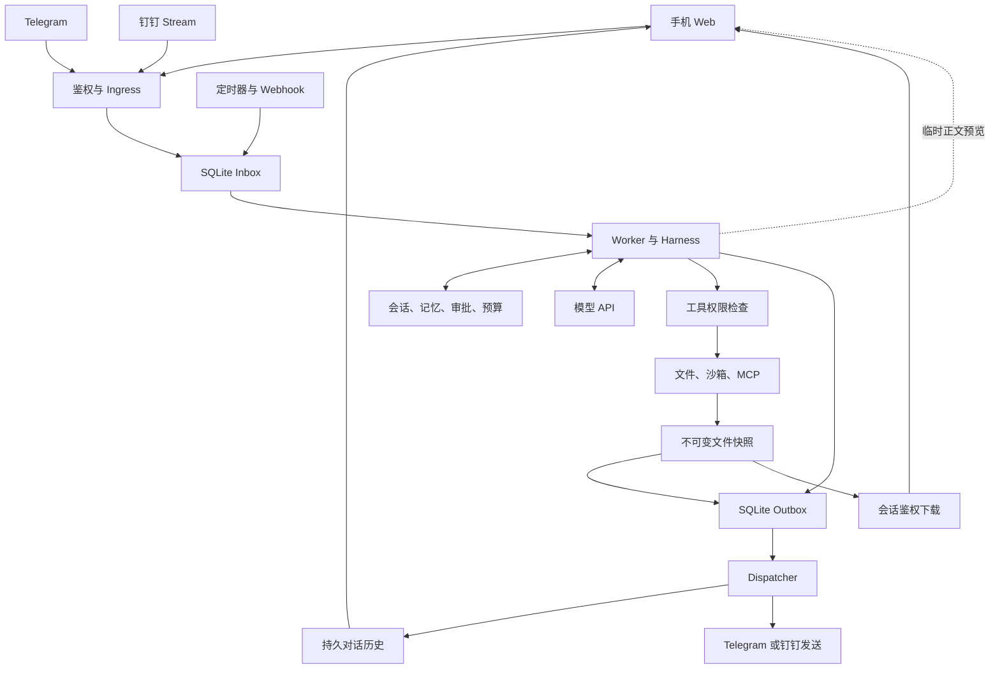

# 0.2.0：渠道、流式回复与文件成果

这一版基于 `215358b6ce2b6e66315552ecbd156f263234aa8b`，把这条路补完整了：在手机上提任务、等它执行、处理审批、最后拿到文件。现有的 SQLite 内核、OpenAI Agents SDK、权限规则和审批恢复机制都保留。

## 1. 能拿来做什么

| 场景 | 这一版怎么做 | 入口和限制 |
| --- | --- | --- |
| 手机日常聊天 | Web 上正文边生成边显示；已有的图片、录音、审批、任务状态照常可用 | 局域网或 Tailscale；网页关闭之后，没有系统级的 Web Push |
| 国内的聊天入口 | 钉钉企业应用机器人的私聊，用 Stream 接收、OpenAPI 发送 | 需要应用凭据、机器人能力和平台权限；不支持群聊、钉钉语音和原生审批卡片 |
| 长任务交付文件 | `publish_artifact` 把工作区里的文件固化下来，持久排队交付 | Web 登录后下载；Telegram 用 `sendDocument`；其他渠道指向 Web |
| 换用不同的模型服务 | 可以自定义模型密钥的变量、兼容端点，以及托管搜索的能力声明 | 仍然要兼容 Agents SDK 用的 API 和工具调用协议 |
| 语音用独立服务 | 语音单独配置端点、密钥和模型 | 仍然是 OpenAI 兼容的转写 HTTP API；也可以用 Python 注入的方式，替换 `Transcriber` |
| 检查渠道能不能用 | `pa channels`、`pa channels capabilities`、`pa doctor` | “配置已启用”和“后台已连通”分开说明；探针不会发真实的聊天消息 |

模型生成到一半的文字可能会变；真正完成的回答和交付记录，以持久历史为准。

## 2. 怎么实现的



### 消息怎么进来、怎么配对

Web 用已有的配对 cookie；Telegram 和钉钉用 `PairingStore`，陌生的发送者只能申请配对，要在本机用 CLI 批准之后，才能进到模型。钉钉的身份，同时绑定了应用、企业和员工标识，所以换机器人或换企业，不会沿用另一套身份的批准。

钉钉消息，通过向平台主动发起的 HTTPS/WSS 连接接收。回调在本地事务提交之后，才会 ACK；`msgId` 按应用和企业命名去重。上游的机器人回调，不承诺在断线期间重放，所以“本地持久接收”，不等于离线期间一定不会漏消息。发送用的是应用凭据对应的 OpenAPI，不会持久化带访问权限的 `sessionWebhook` URL。

实现：[DingTalk channel](../src/personal_agent/channels/dingtalk/channel.py)、[API](../src/personal_agent/channels/dingtalk/api.py)、[Ingress](../src/personal_agent/channels/ingress.py)。协议、权限和手动验收见 [DINGTALK.md](DINGTALK.md)。

### 模型流式输出和持久历史

只有启用了 Web 流式的、可信的前台 Web 请求，才用 `Runner.run_streamed`。消费器只处理公开的正文事件，推理文本、工具参数和后台任务的正文，都不会进入预览。流结束之后，走的还是同一条路径：预算、审批暂停、结果入 Outbox。

`LiveBus` 给每个 run 保留有限的临时正文快照；先清除危险的控制字符、修复孤立的 Unicode surrogate，再脱敏。已知密钥的半截前缀，在后面的字符到达之前，暂时不显示，免得一块一块地脱敏，反而泄露密钥。这个保护针对的是已注册的凭据和现有的检测规则，不保证能识别模型输出里的所有敏感信息。

SSE 的 `drafts` 是可以被替换的快照，不带持久的事件 ID；只有已经提交的 `turn`，才会推进历史游标。重连时，`hello` 带着当前的预览，之后再补放历史。最终的答复有 `final_response` 标记，旧的审批或中间的文件通知，不会误删正在恢复的预览。旧连接的异步回调，不能覆盖新连接。

浏览器断开，不会取消任务。worker 被取消、超时、失败或者在等审批时，会清理预览并结束 SDK 的消费；失败的流式请求，不会被悄悄地改成非流式重发。已有的任务重试，仍然受 Inbox、审批和工具幂等规则的约束。

实现：[streaming.py](../src/personal_agent/harness/streaming.py)、[live.py](../src/personal_agent/core/live.py)、[Web API](../src/personal_agent/channels/web/api.py)、[客户端状态](../src/personal_agent/channels/web/static/store.js)。

### 文件交付

`publish_artifact` 在现有的文件工具和权限检查之后执行：从工作区里，安全地打开一个已经写完的普通文件，把字节固化到独立的存储里；在同一个数据库事务里，登记元数据，并创建 Outbox 通知。之后源文件被改动或删除，不会影响已经发布的成果。

快照里有大小、SHA-256、到期时间，以及会话 / run / work 的关联；默认单个文件 10 MiB、活跃的总字节 200 MiB、活跃文件 1,000 个、保留 30 天。重试同一个任务的同一个路径，会返回原来的发布结果；同一个任务里要发新版本，应该用新路径。

Web 下载会验证配对会话，并强制作为附件下载、禁止缓存、阻止 HTML/SVG 在应用的源下执行。Telegram 发送的是真正的文件字节。钉钉这一版只通知你到 Web 上查看，不声称已经实现它的文件上传 API。

从前台发起的文件交付请求，不会被静默时段推迟；上传结果不明确时，即使是前台发起的，也会停在 `maybe_sent`，重启之后不会盲目重发。普通的交互文字和紧急通知，保留原来的可重试策略，仍然可能重复；各类消息的保证，不能混为一谈。

实现：[ArtifactStore](../src/personal_agent/core/artifacts.py)、[发布工具](../src/personal_agent/tools/artifacts.py)、[下载路由](../src/personal_agent/channels/web/artifacts.py)、[Outbox](../src/personal_agent/core/outbox.py)。更多细节见 [ARTIFACTS.md](ARTIFACTS.md)。

## 3. 哪些依赖云，哪些可以替换

| 能力 | 实际在哪里执行、哪些数据会发出去 | 能替换到什么程度 |
| --- | --- | --- |
| 模型推理、工具选择 | 配置的模型 API；请求里可能带会话、记忆、图像、工具描述和工具结果 | 可以换兼容的端点 / 密钥 / 模型；不是任意 LLM 或 harness 的通用插件 |
| 语音转写 | 配置的转写 API；发送的是录音数据，结果再进入模型上下文 | 端点和密钥是独立的；`Transcriber` 接口，可以用代码注入本地的实现 |
| 托管搜索 | 支持 Responses 搜索工具的模型服务 | 原生 OpenAI 的 HTTPS 端点自动判断；其他兼容的服务，需要显式声明；Chat Completions 不启用 |
| Telegram / 钉钉 | 平台云处理对应的聊天和文件；凭据保存在 agent 所在的主机上 | 渠道工厂可以扩展；平台的协议、权限和投递语义，仍然各不相同 |
| Web 页面、配对、文件下载 | agent 所在的主机；手机通过局域网或 Tailscale 访问 | 已有的 Web 渠道；前端在本地托管，不需要单独的云账号 |
| Tailscale | 提供私网连通和 HTTPS 接入；本项目调用现有的 CLI | 可选，局域网方案不依赖它；它不提供模型推理或文件托管 |
| 调度、Inbox/Outbox、审批、审计 | 主机上的 SQLite 和常驻进程 | 核心实现，不是这一版新增的、可替换的持久化后端 |
| 记忆、偏好、文件成果 | 主机的磁盘；被模型或工具读取的部分，可能会发出去 | 存储实现是内置的；“落盘在本地”，不等于“内容从不离开主机” |
| Shell 与沙箱 | 主机的 seatbelt 或 Docker 等已有的后端 | 沙箱后端可以扩展；是否允许联网，取决于明确的配置和策略 |
| MCP、Skills、Python 插件 | 本地或远端，取决于怎么安装和配置 | 已有的扩展点；不意味着所有 MCP 扩展协议，或跨框架的状态迁移，都已经实现 |

`store=false` 和关闭 tracing，不能保证第三方服务不处理请求。真实的数据边界，由启用的 Provider、工具和渠道决定，详见 [PROVIDERS.md](PROVIDERS.md)。这一版没有新增远程遥测。

`ChannelCapabilities` 只声明功能，不授予权限，也不会把平台的“已接受请求”，理解成收件人已读。旧插件不声明 metadata，仍然可以按原来的 `Channel` 协议运行。

## 4. 配置与升级

### 升级已有的安装

1. 停掉常驻服务，备份 `PA_HOME`。`pa db backup` 只备份数据库；完整备份还应包括记忆、配置、工作区和新增的 `artifacts/` 目录。
2. 更新代码，执行 `uv sync --frozen`，确认 `uv run pa --version` 是 `0.2.0`。
3. 保留已有的配置和 `.env`，只加需要的字段；启动时会自动执行追加的数据库迁移，原来的迁移没有被重写。
4. 执行 `uv run pa doctor` 和 `uv run pa channels capabilities`。
5. 用原来的方式重启：终端里 `uv run pa serve`，或者 macOS 上 `uv run pa service restart`。

原来的配置仍然能加载。钉钉默认关闭；语音端点和密钥留空时，保留旧的继承规则；文件成果默认启用，但仍然受文件工具开关、画像和现有权限规则的约束。

### 钉钉

只在 `.env` 里写自己的 `DINGTALK_CLIENT_ID` 和 `DINGTALK_CLIENT_SECRET`；不要把值粘贴到聊天、文档或提交里。`config.toml`：

```toml
[dingtalk]
enabled = true
# corp_id = "你的企业标识"  # 可选：限定企业
```

```bash
uv run pa channels test dingtalk
uv run pa serve
# 手机向已配置的企业机器人私聊，取得配对码后在电脑执行：
uv run pa channels approve dingtalk ABCD-EFGH
```

平台配置、所需权限和故障分类，见 [DINGTALK.md](DINGTALK.md)。`test` 只检验网关鉴权；接收消息、发送权限和真实账号的配对，要分别验收。

### 语音单独配置

```toml
[model]
api_key_env = "MODEL_SERVICE_KEY"

[media]
transcribe_base_url = "https://api.openai.com/v1"
transcribe_api_key_env = "OPENAI_API_KEY"

[web]
stream_responses = true
```

这只是密钥路由的示例；要给 `MODEL_SERVICE_KEY` 设置模型服务对应的端点和模型名，并在 `.env` 里配置所引用的变量。显式指定、却缺失的变量，会报错，不会悄悄借用另一个服务的密钥。兼容端点和托管搜索的完整示例，见 [PROVIDERS.md](PROVIDERS.md)。

### 停用与回退

可以分别关掉 `[dingtalk] enabled`、`[web] stream_responses`、`[artifacts] enabled`。停用文件发布，不会撤回已经发出的 Telegram 文件，也不会删除已经存到手机上的副本。撤销 Web 会话，用已有的 `pa web revoke`。

旧程序可能认不出新增的数据库 schema。回退代码之前，先停掉新服务，并用升级前的完整备份，恢复到另一个目录来验证；不要在唯一的一份生产数据库上，手工删表或改 schema 版本。新版创建之后的任务和文件，不会出现在升级前的备份里。

## 5. 验证与验收

提交前的入口是 `scripts/check.sh`：Ruff 格式和 lint、mypy strict、全部离线的 Python 回归和 Node 前端测试；`scripts/check.sh --python 3.11` 验证声明的最低 Python 版本。测试环境会阻止访问真实的外部 API，和正在运行的 agent 默认端口。

2026-11-17，在整合了主分支 `64f627cbe2cfc9559d764e40698b1745e8d1d7fe` 之后的代码树上，完成最终验证（Linux）：Python 3.13.5 和 3.11.18 各 **5,183 passed / 56 skipped**；Node **103 passed**；Ruff、mypy strict（144 个源文件）通过。每个 Python 环境的跳过项是：27 项真实 API 测试、23 项 macOS 专属测试，以及 6 项因为本机没装 gitleaks 而跳过的上游 GitHub export 测试。主分支新增的 PR watcher/export 工具、测试和文档，都保留了，它们属于上游的更新，不算这一版的四项新增功能。

之前更新的 11 个 Provider/service/eval/doctor 的定向变异，已经验证过，全部 killed；这次主分支整合之后，没有重跑这 11 项，也没有重跑全部历史的变异实验。上面的 5,183 项结果，来自整合之后的实际回归，没有沿用旧基线的 5,011 项结果。

这一版新增的验证重点：

- 钉钉真实的本机 WebSocket：断线重连、新 ticket、取消关闭；HTTP MockTransport 校验鉴权、发送载荷、token 更新、限流和不明投递。
- 真实 SDK 的流式消费、手机 SSE 断开 / 重连、审批持久化之后跨重启继续、半截密钥和异常的 Unicode、旧浏览器连接回调的隔离。
- 文件路径替换、符号链接 / 硬链接、写入竞态、限额、到期、事务回滚、重启幂等、下载鉴权和 Telegram multipart 编码。
- 模型和语音的密钥路由、托管搜索的能力判断、自定义密钥的脱敏，以及禁止写入 LaunchAgent。

**回收时补充的变异验证（2026-11-17，本机 PR 回收流程）。** 这一版新增的保护代码，之前没有变异清单。新写了 `scripts/mutation/lists/v02_channels_files.py`（114 条），故意把下面这些地方改坏，要求对应的测试变红：产物存储的无链接打开、限额、目录 / 文件权限和清理；下载响应头；`publish_artifact` 的审批类别和档案范围；钉钉 Stream 的地址校验和“不明投递”；流式预览里的半截密钥和数量上限；Provider 地址和密钥路由；LaunchAgent 不复制 Provider 凭据。

第一轮，88 条被抓住，**26 条存活**。每一条存活的，都是当时没有测试把守的保护，比如：说明文字超过 500 字符、任务标识为空、读取期间同样长度的改写、`Retry-After` 夹取、被截断的预览里的半截密钥、`api.openai.com/v1/proxy` 被当成原生地址。为它们补了 21 个测试函数，和 Provider 地址表里的 5 行（`test_artifacts.py`、`test_dingtalk_api.py`、`test_stream_privacy.py`、`test_provider_config.py`），再整份重跑，114 条全部被抓住。另有 2 条“地址里不得带密码”，在逻辑上等价于相邻的“不得带用户名”检查（`urlsplit` 有密码就一定有用户名），任何测试都区分不了，所以没有收录，原因写在清单文件的开头。

运行：`uv run python scripts/mutation/run.py scripts/mutation/lists/v02_channels_files.py`；可以按模块名前缀（`"ar "`、`"dt "` 等）分几路并行，整份大约 8 分钟。`tests/test_mutation_lists.py` 会在每次普通测试里，检查这些锚点仍然恰好出现一次。

自动化测试，不代表你的钉钉企业权限、生产 Provider、Tailscale ACL 或真机浏览器已经验收。部署之后，应该分别验证：一次私聊配对、一次审批、一份文件下载、一次手机断线重连；需要的话，再做真实模型测试。

## 6. 参考取舍与后续边界

[REFERENCE_REVIEW.md](REFERENCE_REVIEW.md) 记录了实际克隆下来审阅的 OpenClaw、DeepSeek Harness 和 Grok Bot 重建项目，包括固定的 commit、发布时间，以及原始设计和重建作者自己扩展的内容的区别。没有核实到确实基于更新的 Grok 客户端的完整重建源码；版本号更大的仓库标题，不等于有新的逆向来源。

这一版借鉴了：独立的 Provider、显式的渠道能力、结构化的文件成果、临时流和持久历史分开，这几种设计，所有实现都是独立写的。Grok 重建仓库没有提供可以直接复用的上游授权，本仓库不导入它的实现代码或私有凭据协议。

还没有实现的：原生 iOS/Android 应用、TTS/实时语音、设备摄像头和位置节点、钉钉群聊和多媒体、跨模型服务的自动 failover、通用的 harness 注册、可持久化的子 agent 调度、结构化的问答卡片，以及对任意外部副作用的 exactly-once 保证。它们每一项，都要分别设计协议、权限和恢复边界，不能用一个“支持插件”的开关来代替。
