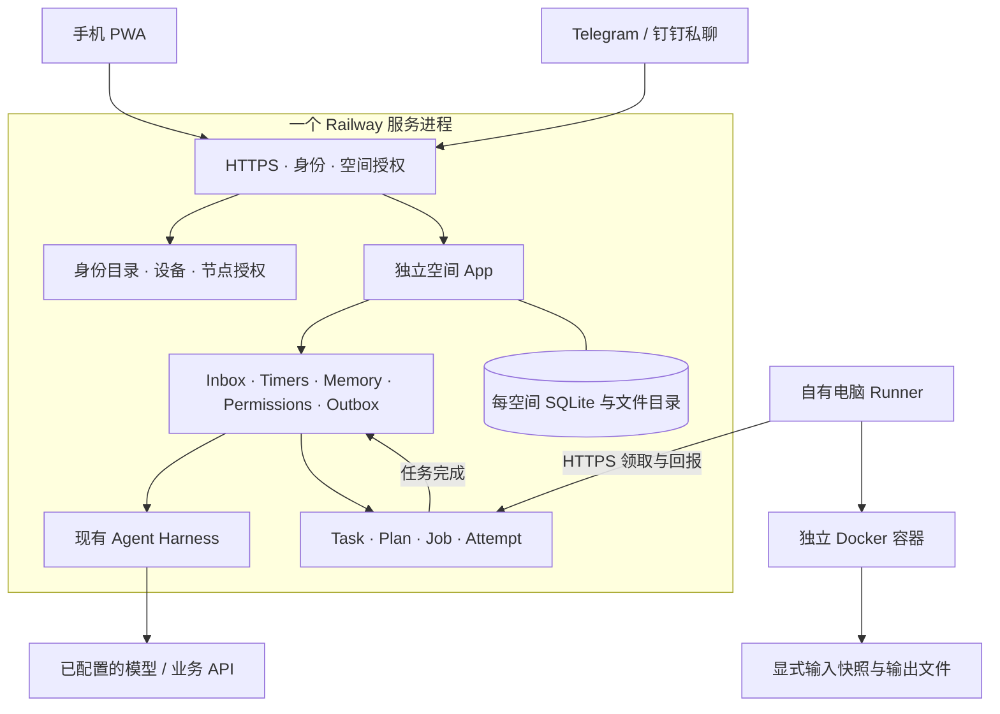

# V3：个人优先的协作，和你自己的执行电脑

这次产品迭代叫 **V3.0**，Python 包版本是 **0.3.0**。它面向的是：一位部署管理员，加上大约 2–5 位可信的协作者。继续用现有的 Railway 服务和持久卷，执行电脑由你自己提供。

## 完整的使用路径

1. 管理员用已有的 `pa web pair` 登录，进入对话页的 **工作台**。
2. 创建共享项目，邀请成员。成员有自己独立的身份、私人空间，以及被邀请项目的成员资格；设备配对只会给本人增加一台设备。
3. 在手机上，选一个空间发起任务，或者让 Agent 用 `submit_job` 保存计划。聊天 Worker 随后就释放了，不用等执行电脑。
4. 资源所有者检查命令、输入清单、输出路径、超时和计划哈希，然后批准。没有设备在线的话，任务就一直排队。
5. 你自己电脑上的 Runner 主动连到服务端，先把执行收据持久化，再操作固定的 Docker 容器；重新连上之后，核对的还是同一个 attempt，不会因为响应丢了，就重复启动。
6. 成果写进当前空间里不可变的 Artifact，任务完成这件事回到 Inbox，通知进入 Outbox。你在手机上看状态、日志和文件。回执收齐之后，清理容器和暂存的输入。

执行计划的确认，和聊天里的工具审批是分开的。节点用的是资源所有者的电脑，所以协作者不能批准自己的命令去用别人的节点。

## 架构



### 关键决定：每个空间一套独立的数据

评估过几种方案之后，选了**一个服务进程，每个空间一个数据库和文件根目录**。没有引入分布式数据库，也没有加别的服务。

原来 owner 的 `PA_HOME/state.db`、记忆、会话和文件，都还在原来的位置。根数据库里加了身份目录和节点注册表；新空间的数据，放在 `PA_HOME/spaces/<generated-id>/` 下面。`SpaceManager` 统一管理这些 App；HTTP 请求和运行上下文，都明确绑定到具体的某个 App，没有全局的“当前空间”。

这样，现有的搜索、FTS、摘要、Dream、Artifact、文件工具和恢复代码，天然就只会碰到本空间的数据。不用在大量旧查询里，靠每次手写 `space_id` 条件来保证隔离。代价是：备份必须覆盖整个目录树；这是单实例架构，不能靠多加 Railway 副本来横向扩容。

新空间只继承运维限制和明确共享的模型服务，不继承管理员的偏好、私有工作区、业务凭据、Python 插件、MCP 信任或私网访问白名单；本地 shell 默认关闭。

## 各能力由什么实现，怎么替换

| 能力 | 在哪里实现 | 云端请求与替换方式 |
| --- | --- | --- |
| 模型推理、流式响应、总结 | `harness/models.py`、现有 `ModelFactory` | 继续用已配置的 API / 兼容端点；共享模型服务的费用，按整个实例汇总检查 |
| Agent 运行时 | `harness/runner.py`、`harness/runctx.py` | 保留现有的 Agents SDK Harness；增加了身份和授权版本的传递，没有引入第二套运行内核 |
| 身份与空间 | `collaboration/store.py`、`scopes.py`、`runtime.py` | 本地 SQLite 和目录，不委托第三方身份 SaaS |
| 长任务与审批 | `execution/store.py`、`tools/jobs.py` | 持久化的任务、冻结的计划、每步单独批准、提问和回答、取消，以及重启后的对账 |
| 执行后端 | `nodes/backend.py` 的 `Backend` 协议 | 目前远程的实现是自有 Docker；不依赖 Railway Sandbox、E2B、Daytona |
| 输入与成果 | `execution/workspaces.py`、`nodes/transfers.py`、`core/artifacts.py` | 显式的文件清单、内容哈希、有限的上传和私有的成果下载；不以对象存储为前提 |
| 渠道 | 现有 adapters + `for_space(app)` | Web 不需要额外服务；Telegram / 钉钉仍然调用各自的官方服务 |
| 凭据 | 现有 `SecretBroker` 和空间配置边界 | 业务凭据留在服务端；跨成员共享业务凭据，目前还没开放 |
| 手机界面 | `channels/web/static/` | DOM / ES Modules + API 类型声明；静态资源由 Python 提供，不增加常驻的 Node 服务 |
| 部署与恢复 | `deploy.py`、`collaboration/backup.py` | 一个现有的 Railway 服务加持久卷；也可以完全自托管 |

新增执行后端，必须实现状态检查、取消确认、日志、清理和同样的恢复逻辑，不能只实现一个 `run(command)`。目前还没有：Seatbelt 的远端持久运行、Claude / Codex CLI runtime 的切换、云供应商的接入。

## 账号、权限和恢复

- 成员、设备、空间和节点，是分别建模的。邀请是短时、一次性的，数据库里只存令牌的哈希；恢复码重新签发之后，旧的就失效了；用恢复码登录，会撤销这个身份所有旧的会话，并作废它名下还没用的邀请和配对码（已经完成的绑定不受影响，需要你自己检查）。
- 私人空间只有本人能用；项目里有 owner / member / viewer。普通工具由空间 owner 审批，机器执行由指定的资源所有者审批。
- Telegram / 钉钉用 `/bind <一次性代码>`，显式绑定身份和空间；provider 的 bot / app / 组织，构成账号的边界。旧安装迁移时，只保留当时已经批准的 owner sender，后来新增的 sender 不会自动升级成 owner。
- 容器身份在创建之前就落盘了。`submitting`、`running`、`uncertain`、`cancel_requested`，以及成功和失败，各自单独记录。失联，不会被说成“已经失败”；发出取消请求，也不等于进程已经停了。
- 默认的完成通知不会额外调用模型。

## 产品入口

### 对话与工作台

`/` 是已有的聊天页，`/workspace` 是工作台；两者通过 `?space=<id>` 保持空间一致。新界面提供：任务列表、审批、日志、步骤、等待补充信息、资料编辑和版本历史、成员管理、本人设备的配对和恢复、节点和渠道的绑定。

任务的各个步骤是顺序依赖的，每一步都需要自己的计划确认。需要改命令的话，创建一个新计划，再审批。

每个执行任务用的是固定下来的输入快照；输出作为独立的成果发布，不会自动覆盖服务端原来的工作区。这个版本没有自动应用代码 diff，你看过成果之后自己合进去。任务中心显示执行状态，以及空间 / 实例的模型预算；还没有按任务分摊费用。

### 手机连接

已有的 Railway 部署，直接用 HTTPS；完全自托管的话，仍然可以用 `pa web connect --via tailscale`，或者可信的局域网配置。节点是主动向外连接的，不用在电脑上开放入站端口。手机 PWA 不是后台执行节点；电脑离线时，API 聊天、提醒、审批和成果查询都可以继续用，依赖电脑的任务，等它上线再做。

PWA 仍然没有操作系统级的推送通知。需要主动提醒手机的话，用已经绑定的 Telegram / 钉钉。局域网 HTTP 不适合跨公网使用；浏览器录音需要 HTTPS。

## 配额与运维

单个节点同一时间只接收一个还没结束的 attempt，跨空间也不会重复占用。输入和输出每次最多 64 个文件，单个文件 2 MiB，总共 8 MiB；节点完成端点的 JSON 请求上限是 16 MiB。输出只允许计划里列出的路径。任务日志有截断和总量的限制。

应用同时保留：任务和输入的存储配额、现有 Artifact 的保留期和容量限制、模型每次运行和每天的费用上限，并且把所有空间已经记账的费用汇总起来。

Docker 限制了 CPU、内存、PID、网络和根文件系统，默认没有网络。任务工作区没有硬磁盘配额，请放在空间足够的独立目录或分区里，并自己留意用量。

## 升级与回退

数据库用的是追加式迁移，旧 owner 的路径不搬动，已有的 Web 设备迁移后成为 owner。升级之前，先停掉引擎和 Runner，等已经执行的动作结算完，再备份完整的旧 `PA_HOME`；不能靠复制在线的 `state.db`，来代替备份。

V3 提供整个实例的快照：

```bash
# 所有控制进程必须停止，备份目录在 PA_HOME 之外
pa db backup-all /trusted-backups/pa-v3-snapshot
# 校验文件哈希与全部 SQLite 完整性，只恢复到新目录
pa db restore-all /trusted-backups/pa-v3-snapshot --to /trusted-restores/pa-home
```

快照包含 PA_HOME 里各个空间的数据库、记忆、成果、工作区、配置和凭据，目录权限只有本人能访问；放在 Railway Variables 或进程环境里的密钥，不会被复制，需要你单独保留。运行锁、日志和旧备份不会复制。它不会覆盖现有的 home，也不会跟随链接。恢复到新目录时，会撤销旧的 Web 会话、还没用的邀请、节点凭据和渠道绑定，提高身份授权版本，并暂停定时器和旧的待处理消息，免得旧快照把曾经撤销的权限恢复回来，或者重复执行外部动作。内容和执行收据会保留；请用本地管理员命令 `pa web pair` 重新配对 owner，用 `pa web pair --principal <身份 ID>` 为原来的成员重新配对，然后重新绑定渠道，审阅之后，重新建立任务和定时器。恢复之后，只启动一个服务端实例。要把服务端回滚到旧快照之前，先停掉 Runner，并核对仍然活着的容器。

旧版本的代码，会拒绝更高的 schema，所以回退时，要同时恢复升级前的数据备份。不要删除迁移的版本标记，不要同时运行新旧两个服务端，也不要手工清掉 `uncertain` 的 attempt，再重新执行。

## 和最初的迭代方案对照

| 工作包 | 这次做了什么 | 以后可以扩展 |
| --- | --- | --- |
| S0 部署与恢复 | 单服务镜像、环境变量覆盖、健康检查、整个实例的快照和恢复 | 在已有的生产卷和域名上做实际部署验收 |
| S1 身份与作用域 | 身份目录 + 物理空间隔离 + 全链路的授权版本 | Passkey、公共多租户、跨用户共享凭据 |
| S2 持久任务 | Task/Job/Attempt、审批、幂等、取消、修订、提问、步骤 | 复杂的可视化工作流、自动重新规划 |
| S3 自有节点 | 出站 HTTP(S)、收据、Docker、回报和清理 | 远端 Seatbelt、其他 runtime / backend、硬磁盘配额 |
| S4 手机协作 | 工作台、设备 / 恢复、资料历史、渠道绑定、诊断 | 原生手机 App、群聊线程、系统推送 |
| S5 发布与运维 | 配额、恢复测试、完整备份、操作文档 | 真实设备、网络和付费模型的验收 |

## 上线前

部署之前，按 [NODES.md](NODES.md)、[RAILWAY.md](RAILWAY.md)，检查你自己的设备和已有的服务。

## 文档导航

- [COLLABORATION.md](COLLABORATION.md)：身份、成员、设备和渠道的操作。
- [EXECUTION.md](EXECUTION.md)：任务、节点协议、故障时的行为、步骤和补充回答。
- [NODES.md](NODES.md)：自有节点的安装、连接和故障处理。
- [RAILWAY.md](RAILWAY.md)：在已有服务上部署、变量、卷和回退。
- [V3_ACCEPTANCE.md](V3_ACCEPTANCE.md)：上线前要在真实环境里走一遍的验收清单。
- [ARCHITECTURE.md](ARCHITECTURE.md)：已有的五个基础部件（Inbox、Timers、Memory、Permissions、Outbox）和 Harness。
